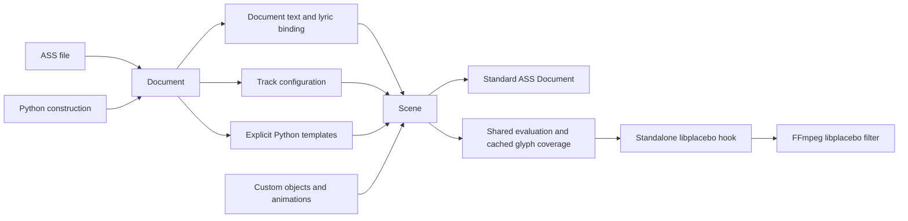

# Architecture

## Shared model

ass.py preserves ordered records and serializes standard ASS. Document text and
lyric modules project decoded text, styles, singing spans, ruby, and cue markers
with source mappings. LyricSource wraps parsed or structured DocumentLyrics. Track authoring, lyric
anchors and Scene object clocks use seconds; raw ASS records retain milliseconds.

scene.py defines text, path, group, and native-event objects. scene_animation.py
provides typed animation declarations and seekable evaluation.
SceneEvaluator composes hierarchy and reference dependencies in world coordinates.
Geometry, masks, paint fields, particles, and cues are independent typed extensions.

## Frontends

orchestration.prepare_tracks selects independent Track streams, measures lyric
objects, resolves timing rules from Track.effects, constructs its callable visuals once, collects
authored visual intervals, calls Layout.allocate once per stream, and binds
common animations to the prepared LyricLine targets. Custom callables can return
`line.schedule(...)`: animation factories resolve once per interval when declared, while reservation
and final alias binding use the same preparation helpers as Track rules.
Visibility changes retain
explicit local clock origins rather than rebuilding factory callbacks. LyricScene adds inspectable
plans to Scene without overriding compilation. Arbitrary row counts use the same
allocator; custom policies override its batch function. Source ownership and
same-source visual views remain separate.

The CLI default recipe uses this frontend, including its source-position
allocator and before/after paint rules. Effect scripts return a Scene or declare
Tracks. No new lyrics are pre-encoded into NativeEvents before compilation.

ObjectGroup.coverage declares explicit component and material bindings. Coverage, ordinary per-layer drawing, and completed-group
RGBA rasterization have different composition semantics and explicit budgets.
They are not interchangeable names for one rendering operation.

The KaraokeRows preset fits cells to shaped ink and side bearings. Glyph-local paint
and clipping use the pen origin, which may differ from the left edge of the cell.
Registered vector guides split the font shaping run at the source character.
Their em-scaled path and advance replace the cell before clearance and ruby placement.
The glyph remains a lyric target through animation binding. The shared Scene leaf
collector then lowers it and its paint layers to path drawings for ASS and GPU.
Lyric binding applies Track outline clearance to shaped cluster ink bounds before
ruby, cues and row allocation. Each cluster retains the cumulative extra distance
so automatic sweeps and compact ASS timing share the Studio primary-stroke interval or the native font advances.

Karaoke sweep timing belongs to the lyric engine. Singing progress is measured
over shaped text geometry. Studio measures the glyph and primary hard stroke,
then shortens the endpoint where adjacent layout cells overlap. Clearance,
secondary strokes and glow never expand the distance traversed during singing. The built-in singing
highlighter reserves decorative edge transitions and lowers eligible linear
clips internally. Templates declare appearance rather than compensating for
blur in clip coordinates or source clocks.

engine.py preserves the Python ASS-template frontend and its context helpers.
Template execution prepares NativeEvents for Scene compilation. Its historical
preprocessing semantics are intentionally separate from new visual object
lifetimes. No template code runs from ordinary parsing.

`karaoke_effects.py` exposes the built-in animation catalog as a Track callable.
It composes existing highlights, semantic rules and ordinary particle/path nodes.
`_karaoke_motion.py` and `_karaoke_sprites.py` contain private motion/shape recipes;
neither evaluates a second timeline or encodes ASS. Front/flash aliases share the
source glyph clock, while emitted ornaments keep independent lifetimes.

## Compiler and native measurement

scene_output.py performs whole-scene preflight, strategy selection, deterministic
sampling, event merging, ownership handling, reporting, and final resource checks.
NativeEvent preserves already-lowered ASS while sharing output/provenance rules.
Rendered output is a new Document; caller-owned scene/source objects remain intact.

native/metrics.cpp and the bundled libass patches supply text measurement,
shaping, outlines, and raster coverage. The native build is keyed by source and
patch bytes, platform, and Python ABI. Python author callbacks are evaluated
before serialization; the player receives ordinary ASS rather than Python.

Public exports are defined once in kara_templater.__all__. Add a public interface
only when authors need it; internal preparation/compiler values stay internal.
The generated [API reference](../reference/README.md) documents the retained set.

## Optional GPU output

Scene.export_hook partitions each leaf at lifetime, clip and animation boundaries.
Known motion spans store endpoint transforms and easing; rectangle keyframes
interpolate independently. Opaque spans sample the shared evaluator locally.
A sparse timeline indexes tiled draws in painter order. Curve knots, scalar
tracks, tile lists, materials and raster masks share storage across instances. The fragment shader composites those
draws in painter order onto the input video. FFmpeg/libplacebo owns the frame
clock and GPU resources. Ordinary ASS can be saved independently.
See [GPU output](../guides/gpu-rendering.md) for the clock and format limits.
