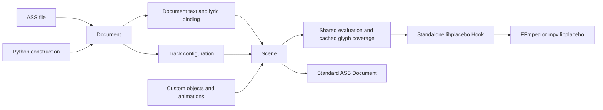

# Architecture

Understand how timed lyrics, scene objects, native text measurement, and the Hook and ASS exporters fit together. Read this guide before modifying library modules or public interfaces.

## Pipeline overview

All authoring APIs share one unit system and leave caller-owned inputs unchanged:

| Domain | Unit / convention |
| --- | --- |
| Raw ASS `Line` timestamps | Integer milliseconds |
| `DocumentLyrics`, `Track`, `Scene`, animations, cues | Floating-point seconds |
| Layout, paths, clips, outlines, blurs | Script pixels (`PlayResX` × `PlayResY`) |
| Opacity (`Paint`, `VisualState`, groups) | `0.0` to `1.0` |

## Shared document and scene model

- **`ass.py`** preserves ordered ASS records and serializes standard ASS (`Document`, `Line`, `Record`, `Style`). Raw `Line` records retain millisecond timestamps.
- **`document_text.py` and `document_lyrics.py`** decode text, timing spans (`TimedTextSpan`), ruby readings (`RubyText`), and cue markers (`CueMarker`) with source mappings. Imported lyrics adopt the template's styles while keeping original labels for selection. `LyricSource` wraps parsed ASS or structured `DocumentLyrics`.
- **`scene.py`** defines `Scene`, `TextObject`, `PathObject`, `ObjectGroup`, `AssDialogue`, `PreparedHook`, and the `Scene.export()`, `Scene.export_resources()`, and `Scene.ass` entry points.
- **`scene_animation.py` and `scene_evaluation.py`** provide typed animation declarations (`StateAnimation`, `AnimationSequence`, `ShaderMotion`, and friends) and seekable evaluation. `SceneEvaluator` composes group hierarchy and reference dependencies (`object_references.py`) in world coordinates.
- **Independent typed extensions** sit alongside the core scene: `geometry.py`, `group_geometry.py`, `path_geometry.py`, `path_boolean.py`, `path_layout.py`, `path_animation.py`, `path_motion.py`, `text_geometry.py`, `paint_fields.py`, `particles.py`, `cues.py`, and `karaoke_cues.py`.

## Lyric frontends and built-in effects

`lyrics/tracks.py` implements `build_lyric_scene`, which orchestrates multi-track karaoke authoring:

1. Select independent `Track` streams from `LyricSource` inputs.
2. Measure lyric objects and resolve timing rules from `Track.effects`.
3. Construct callable visuals once and collect authored visual intervals.
4. Call `Layout.allocate` (`lyrics/placement.py`) once per stream to place lines.
5. Bind animations to the prepared `LyricLine` (`lyric_line.py`) targets.

Custom callables can return `line.schedule(...)`: animation factories resolve once per interval when declared, while reservation and final alias binding reuse the same preparation helpers as `Track` rules. Visibility changes keep explicit local clock origins rather than rebuilding factory callbacks. `LyricScene` attaches inspectable `LyricLinePlan` records to `Scene` without overriding export. Arbitrary row counts share the same allocator; custom placement policies override `Layout.allocate`. Source ownership and same-source visual views remain separate.

The CLI default recipe (`__main__.py` and `_cli_preset.py`) builds on this frontend with preset placement and before/after paint rules. `--effect` scripts export `tracks` or `build(document) -> Scene`; lyrics remain editable `Scene` objects until export.

### Shaping, clearance, and sweeps

- `ObjectGroup` carries transform hierarchy, inherited opacity, and clipping.
- `KaraokeRows` fits cells to shaped ink and side bearings. Glyph-local paint and clipping use the pen origin, which can differ from the cell's left edge.
- `VectorGuide` entries (`Track.guide_symbols`, `lyrics/layout.py`) split the font shaping run at the source character. Their em-scaled path and advance replace the cell before clearance and ruby placement while remaining a lyric target through animation binding. The shared leaf collector (`_scene_tree.py`) lowers them and their paint layers to path drawings for both Hook and ASS output.
- Lyric binding applies `Track` outline clearance to shaped cluster ink bounds before ruby, cues, and row allocation. Each cluster keeps cumulative extra distance so automatic sweeps follow `StudioSpacing` primary-stroke intervals or native font advances.
- `lyrics/highlights.py` measures wipe progress over shaped text geometry. In Studio mode, it measures the glyph plus primary hard stroke and shortens the endpoint where adjacent layout cells overlap. Clearance, secondary strokes, and glow never expand wipe travel distance. `LyricHighlights` reserves decorative edge transitions and lowers eligible linear clips internally so templates declare appearance rather than compensating for blur in coordinates or clocks.

### Built-in effect catalog

`karaoke_effects.py` exposes `KaraokeEffects` as a `Track` callable. It composes `LyricHighlights`, `LyricRule` bindings, and ordinary particle/path nodes. `_karaoke_motion.py` and `_karaoke_sprites.py` hold private motion and shape recipes; neither introduces a second timeline or encodes ASS. Front and flash aliases share the source glyph clock, while emitted ornaments keep independent lifetimes.

## Hook output

`output/hook/` (`export.py`, `draws.py`, `motion.py`, `materials.py`, `wipes.py`, `bands.py`) implements `Scene.export()` and `Scene.export_resources()` via `PreparedHook` and `HookDrawResolver`:

- **Span partitioning and motion**: each leaf splits at lifetime, clip, and animation boundaries. Known motion spans store endpoint transforms and easing; `RectangleKeyframes` interpolate independently; `ShaderMotion` programs receive per-instance data and the clip clock. Inherited screen-rectangle tracks are shared across descendants and evaluated on the owning group's clock, while leaf clips keep their own coordinate space and lyric-wipe role.
- **WGSL materials**: ordered `MaterialClip` entries on text and path objects compile once per distinct WGSL function through the bundled Naga translator (`_kara_wgsl`, built from `native/wgsl/`) and run after coverage calculation. Named `PaintInput` values become uniforms; `PreparedHook.material_inputs()` and `textures.json` expose their names and defaults to preview hosts.
- **Coverage and strokes**: filled paths rasterize with `aggdraw` and static round strokes with FreeType (`_text_native.round_stroke`). Pillow filters blurred coverage (`_path_raster.py`). Dynamic strokes evaluate in the fragment shader from positioned contours (`_contour_stroke.py`).
- **Sparse tiled timeline**: coverage masks shelf-pack into `KARAMASK` (2048 px wide, up to 8192 px high) and deduplicated frame, tile, curve, material, and draw records pack into `KARADATA`. A sparse timeline indexes 64×64 tiled draws in painter order. Each draw shares its transform, clip, and opacity across coverage planes; tiles retain plane bounds and select alternate mask sets before compositing in order.
- **Work checks and deduplication**: geometry-changing shader motions sample poses on the output frame grid in 8-frame windows; built-in particles can use analytic travel and scale bounds. Both paths index reachable mask coverage and pass through the same per-frame and per-tile work limits. Curve knots, shader parameters, tile lists, materials, and masks share storage across instances. FFmpeg or mpv `libplacebo` owns the frame clock and GPU resources. See [Play and render a Hook](../output/hook.md) for playback and format limits.

## Native text measurement and ASS export

`text/measurement.py` (`text_extents`), `text/layout.py` (`layout_document_text`), and `_metrics.py` wrap the C++17 extension `_text_native` (`native/metrics.cpp`). The extension selects faces with Fontconfig and FreeType, resolves bidirectional runs with FriBidi, and shapes runs with HarfBuzz. `text_extents` pads each ink-bearing line's typographic box by `style.outline`; pen placement uses unpadded advances; shape queries (`text_geometry.py`) decompose FreeType outlines in script coordinates.

`output/ass_export.py` implements `Scene.ass`, the secondary standard-ASS compatibility export. It runs whole-scene preflight, strategy selection, deterministic native ASS lowering, source ownership handling, reporting (`AssResult`, `AssObjectReport`), and `AssBudget` checks. `AssDialogue` preserves already-lowered ASS under the same provenance rules. Python author callbacks evaluate before serialization so players receive ordinary ASS in a new `Document`, leaving caller-owned scenes and sources intact. `_ass_preview.py` and `_raster.py` rasterize compiled ASS drawings on the CPU with `aggdraw` and Pillow.

## Public API boundary

All public exports are listed once in `kara_templater.__all__` (`kara_templater/__init__.py`). Export a symbol only when template authors need it; keep preparation, lowering, and compiler internals private. Regenerate the [API reference](../reference/README.md) with `uv run python -m tools.generate_reference` whenever a public signature or docstring changes.

## Next steps

- [Checks and documentation](checks.md)
- [Set up a development environment](setup.md)
- [API reference](../reference/README.md)
