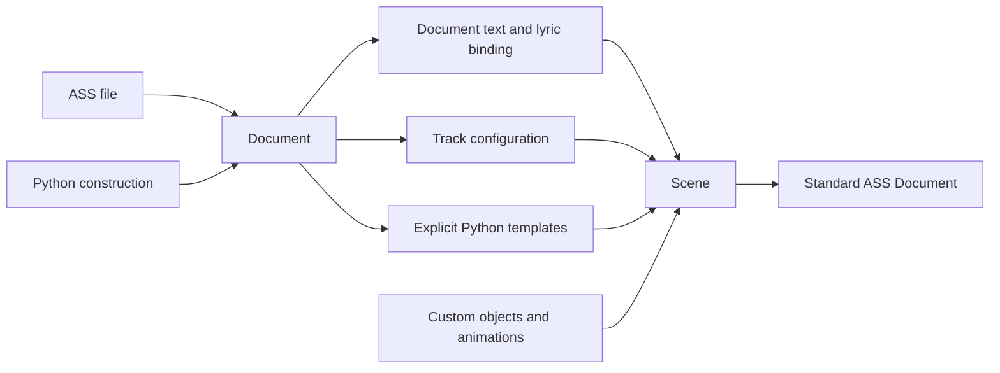

# Architecture

## Shared model

ass.py preserves ordered records and serializes standard ASS. Document text and
lyric modules project decoded text, styles, singing spans, ruby, and cue markers
with source mappings. LyricSource wraps parsed or structured DocumentLyrics. Track authoring, lyric
anchors and Scene object clocks use seconds; raw ASS records retain milliseconds.

scene.py defines text, path, group, and native-event objects. scene_animation.py
provides typed animation declarations and seekable evaluation.
SceneEvaluator composes hierarchy and reference dependencies in world coordinates.
Geometry, masks, paint fields, particles, and cues are independent typed extensions.

## Frontends

orchestration.prepare_tracks selects independent Track streams, measures lyric
objects, resolves animation durations, constructs factory visuals once, collects
authored visual intervals, calls Layout.allocate once per stream, and binds
common animations to the prepared LyricLine targets. Visibility changes retain
explicit local clock origins rather than rebuilding factory callbacks. LyricScene adds inspectable
plans to Scene without overriding compilation. Arbitrary row counts use the same
allocator; custom policies override its batch function. Source ownership and
same-source visual views remain separate.

The CLI default recipe uses this frontend, including its source-position
allocator and before/after paint rules. Effect scripts return a Scene or declare
Tracks. No new lyrics are pre-encoded into NativeEvents before compilation.

ObjectGroup.coverage declares explicit component and material bindings. Coverage, ordinary per-layer drawing, and completed-group
RGBA rasterization have different composition semantics and explicit budgets.
They are not interchangeable names for one rendering operation.

engine.py preserves the Python ASS-template frontend and its context helpers.
Template execution prepares NativeEvents for Scene compilation. Its historical
preprocessing semantics are intentionally separate from new visual object
lifetimes. No template code runs from ordinary parsing.

## Compiler and native measurement

scene_output.py performs whole-scene preflight, strategy selection, deterministic
sampling, event merging, ownership handling, reporting, and final resource checks.
NativeEvent preserves already-lowered ASS while sharing output/provenance rules.
Rendered output is a new Document; caller-owned scene/source objects remain intact.

native/metrics.cpp and the bundled libass patches supply text measurement,
shaping, outlines, and raster coverage. The native build is keyed by source and
patch bytes, platform, and Python ABI. Python author callbacks are evaluated
before serialization; the player receives ordinary ASS rather than Python.

Public exports are defined once in kara_templater.__all__. Add a public interface
only when authors need it; internal preparation/compiler values stay internal.
The generated [API reference](../reference/README.md) documents the retained set.
