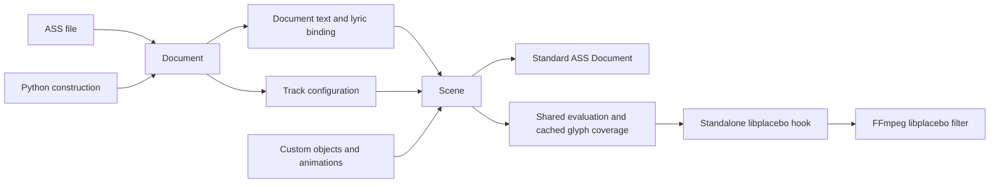

# Architecture

## Shared model

ass.py preserves ordered records and serializes standard ASS. Document text and
lyric modules project decoded text, timing spans, ruby, and cue markers with
source mappings. Imported lyrics use the template's styles and keep the original
labels for selection. LyricSource wraps parsed or structured DocumentLyrics. Track authoring, lyric
anchors and Scene object clocks use seconds; raw ASS records retain milliseconds.

scene.py defines text, path, group, and ASS dialogue objects. scene_animation.py
provides typed animation declarations and seekable evaluation.
SceneEvaluator composes hierarchy and reference dependencies in world coordinates.
Geometry, masks, paint fields, particles, and cues are independent typed extensions.

## Frontends

`lyrics/tracks.py` implements `build_lyric_scene`, which selects independent Track streams, measures lyric
objects, resolves timing rules from Track.effects, constructs its callable visuals once, collects
authored visual intervals, calls Layout.allocate once per stream, and binds
common animations to the prepared LyricLine targets. Custom callables can return
`line.schedule(...)`: animation factories resolve once per interval when declared, while reservation
and final alias binding use the same preparation helpers as Track rules.
Visibility changes retain
explicit local clock origins rather than rebuilding factory callbacks. LyricScene adds inspectable
plans to Scene without overriding compilation. Arbitrary row counts use the same
allocator; custom policies override its batch function. Source ownership and
same-source visual views remain separate.

The CLI default recipe uses this frontend with preset placement and before/after
paint rules. Effect scripts return a Scene or declare
Tracks. Lyrics remain editable scene objects until export.

Object groups carry hierarchy, inherited opacity and clipping.

The KaraokeRows preset fits cells to shaped ink and side bearings. Glyph-local paint
and clipping use the pen origin, which may differ from the left edge of the cell.
Registered vector guides split the font shaping run at the source character.
Their em-scaled path and advance replace the cell before clearance and ruby placement.
The glyph remains a lyric target through animation binding. The shared Scene leaf
collector then lowers it and its paint layers to path drawings for ASS and GPU.
Lyric binding applies Track outline clearance to shaped cluster ink bounds before
ruby, cues and row allocation. Each cluster retains the cumulative extra distance
so automatic sweeps follow the Studio primary-stroke interval or the native font advances.

The lyric engine measures wipe progress
over shaped text geometry. Studio measures the glyph and primary hard stroke,
then shortens the endpoint where adjacent layout cells overlap. Clearance,
secondary strokes and glow never expand the distance traversed during the wipe. The built-in
highlighter reserves decorative edge transitions and lowers eligible linear
clips internally. Templates declare appearance rather than compensating for
blur in clip coordinates or source clocks.

`karaoke_effects.py` exposes the built-in animation catalog as a Track callable.
It composes existing highlights, semantic rules and ordinary particle/path nodes.
`_karaoke_motion.py` and `_karaoke_sprites.py` contain private motion/shape recipes;
neither evaluates a second timeline or encodes ASS. Front/flash aliases share the
source glyph clock, while emitted ornaments keep independent lifetimes.

## Compiler and native measurement

`output/ass_export.py` performs whole-scene preflight, strategy selection, deterministic
native ASS lowering, ownership handling, reporting, and final resource checks.
AssDialogue preserves already-lowered ASS while sharing output/provenance rules.
Rendered output is a new Document; caller-owned scene/source objects remain intact.

`text/measurement.py` exposes extent queries. The native text backend provides font registration and positioned glyph outlines. The C++ extension selects faces with Fontconfig and FreeType, resolves bidirectional runs with FriBidi and shapes them with HarfBuzz. Public extent queries pad each ink-bearing line’s typographic box by the style outline radius. Pen placement uses the unpadded advances; shape queries decompose FreeType outlines in script coordinates. The CPU preview rasterizes compiler drawings with aggdraw and Pillow.
Python author callbacks are evaluated
before serialization; the player receives ordinary ASS rather than Python.

Public exports are defined once in kara_templater.__all__. Add a public interface
only when authors need it; internal preparation/compiler values stay internal.
The generated [API reference](../reference/README.md) documents the retained set.

## Default GPU output

`output/hook/` implements `Scene.export()`. It partitions each leaf at lifetime, clip and animation boundaries.
Known motion spans store endpoint transforms and easing; rectangle keyframes
interpolate independently. Custom motion programs receive per-instance data and the clip clock.
WGSL materials are carried by the Scene's text and path objects as ordered clips.
The Hook exporter compiles each distinct function through the bundled Naga adapter
and applies the active functions after calculating coverage. Named material inputs
are uniforms. The resource manifest gives preview hosts their names and defaults.
The hook shares inherited screen-rectangle tracks across descendants and
evaluates them using the owning group's clock. Leaf clips retain their own
coordinate space and their role in lyric wipes.
Hook export rasterizes filled paths with aggdraw and static round strokes with FreeType. Pillow filters the resulting coverage.
The fragment shader evaluates dynamic strokes from positioned contours.
A sparse timeline indexes tiled draws in painter order. Each draw shares its
transform, clip and opacity across its coverage planes. Tiles retain individual
plane bounds, and the shader selects any alternate mask set before compositing
its planes in order. Geometry-changing shader
motions use poses on the output frame grid in short windows. Built-in particles
can use analytic travel and scale bounds. Both paths index the reachable mask
coverage and pass through the same per-frame and per-tile work checks. Curve
knots, shader parameters, tile lists,
materials and raster masks share storage across instances. The fragment shader composites those
draws in painter order onto the input video. FFmpeg/libplacebo owns the frame
clock and GPU resources. Ordinary ASS can be saved independently.
See [GPU output](../guides/gpu-rendering.md) for the clock and format limits.
