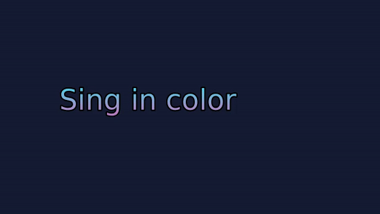

# Example scripts

Browse runnable karaoke examples by visual goal, inspect their previews, and run them directly from a source checkout. Use this page when you want working code to adapt for your own song.

The [component coverage index](component-coverage.md) maps every component library card to an editable control or to the source inputs needed to reproduce the effect.

Run all commands below from the repository root. Create `build/` first (`mkdir -p build`) so generated files stay inside the ignored build directory. Install the fonts referenced by an example to match its preview layout — see [Choose and register fonts](../guides/fonts.md).

## Find an example by its visual goal

Pick the row that matches what you want to build. For the complete catalog of built-in entrances, highlights, exits, and ornaments, see [Built-in karaoke effects](../guides/karaoke-effects.md).

| Visual goal | What the example shows | Where to start |
| --- | --- | --- |
| Keep lyrics legible over changing footage | A dark keyline, a colored outer rim, and a soft halo around the same lettering | [Built-in karaoke effects](../guides/karaoke-effects.md) · [Choose and register fonts](../guides/fonts.md) |
| Compare whole-song motion styles | Mix entrances, note highlights, exits, and ornaments on the same timed lyrics | [Whole-song templates](#whole-song-templates) · [Motion studies](../tutorials/lyric-studies.md) |
| Place alternating rows or multiple vocals | Independent lead and harmony `Track` streams with row rotation, palettes, and cues | [lyric_orchestration.py](../../examples/lyric_orchestration.py) · [karaoke_designs.py](../../examples/karaoke_designs.py) |
| Mark note attacks without a color wipe | At each attack, a diamond lands above the syllable, the whole syllable turns amber, and the text begins a brief pulse | [Karaoke without a color wipe](#karaoke-without-a-color-wipe) |
| Give the entrance a crisp masked reveal | Characters slide out of invisible vertical cuts while keeping readings attached | [Fixed-cut lyric reveal](#fixed-cut-lyric-reveal) |
| Focus, type in, or break apart letters | Separate entrance and exit recipes that keep active lyrics clean and readable | [Effect recipes](../tutorials/effect-recipes.md) |
| Add a count-in that fits the song | Flashing inline volume bars, independent star lamps, and a custom paw-print cue | [Count-ins and cues](#count-ins-and-cues) |
| Paint with gradients, sparkles, echoes, or WGSL | Continuous shader gradients, sweep-front particles, onset echoes, and custom WGSL materials | [Drawings, gradients, and custom shaders](#drawings-gradients-and-custom-shaders) · [lyric_particles.py](../../examples/lyric_particles.py) · [lyric_echo.py](../../examples/lyric_echo.py) |

## Whole-song templates

### Built-in karaoke combinations

Combine an entrance, a timing highlight, an exit, and optional ornaments with `KaraokeEffects`. The preview shows four combinations rendered with Sarasa UI J.


```sh
python -m examples.karaoke_catalog build/studio.hook --entry glow_in --exit dissolve_out
```

[karaoke_catalog.py](../../examples/karaoke_catalog.py) · [Built-in karaoke effects](../guides/karaoke-effects.md)

### Lead and harmony tracks

See how independent `Track` streams share one song timeline, rotate rows, reserve space for cues, and assign per-vocal palettes:

- [lyric_orchestration.py](../../examples/lyric_orchestration.py) — Lead and harmony tracks with an overridable row layout.
- [karaoke_designs.py](../../examples/karaoke_designs.py) — Multiple song-level presets on one shared lyric fixture.
- [track_colors.py](../../examples/track_colors.py) — Alternating per-syllable colors usable directly with `kara-templater --effect`.

## Custom lyric entrances and timing

### Fixed-cut lyric reveal

Each character slides out of an invisible fixed cut before its first note, then sweeps from off-white to amber. The preview uses Sarasa UI J.


```sh
python -m examples.slit_reveal build/slit-reveal.hook
```

[slit_reveal.py](../../examples/slit_reveal.py) · [Effect recipes](../tutorials/effect-recipes.md)

### Karaoke without a color wipe

At each note onset, an amber diamond lands above the syllable and the whole syllable turns amber. The text briefly scales up and settles back. The preview uses Sarasa UI SC.


```sh
python -m examples.lyric_no_sweep build/lyric-no-sweep.hook
```

[lyric_no_sweep.py](../../examples/lyric_no_sweep.py) · [Effect recipes](../tutorials/effect-recipes.md)

### More timing and motion scripts

- [lyric_pulse_drift.py](../../examples/lyric_pulse_drift.py) — Duration-aware `ScalePulse` and `DriftOut` exits with a vertical fill gradient.
- [lyric_particles.py](../../examples/lyric_particles.py) — Sweep-front sparkles (`--kind sparkle`) or drifting petals (`--kind petal`).
- [lyric_studies.py](../../examples/lyric_studies.py) — Eight motion studies (echoes, particles, trails, and reveals) on identical lyric timing. See [Motion studies](../tutorials/lyric-studies.md).
- [lyric_ornament.py](../../examples/lyric_ornament.py) — Stationary arch ornaments with an exit clock independent of the text.

## Count-ins and cues

### Inline bars and independent star lamps

Inline volume columns sit beside the lyric and flash together, while star lamps occupy their own track position and clear one by one before the pickup.


```sh
python -m examples.karaoke_signals build/signals.hook
```

[karaoke_signals.py](../../examples/karaoke_signals.py) · [Ruby readings and cues](../guides/text-and-cues.md)

### Custom paw-print countdown

Import `paw_countdown(step_seconds=...)` from [paw_countdown.py](../../examples/paw_countdown.py) as a `Track` cue preset for four vector paw prints that squash and vanish in step with the beat. Pair it with `KaraokeEffects(exit="spin_flip", exit_unit="character")` to flip each glyph and its reading around its own center.

## Drawings, gradients, and custom shaders

### Word backgrounds and decorations

Measure lyric ranges to place colored word backgrounds, inline cue bars, and vector sparkles, then export standard ASS.


```sh
python -m examples.scene_cues build/word-backgrounds.ass
```

[scene_cues.py](../../examples/scene_cues.py) · [Export standard ASS](../output/ass.md)

### Continuous GPU gradient

Paint a `TextObject` with a local-space `LinearGradient` that scales and drifts with the lettering. Running the module writes both `build/gpu-gradient.hook` and a plain ASS fallback (`build/gpu-gradient.ass`).



```sh
python -m examples.gpu_gradient
```

[gpu_gradient.py](../../examples/gpu_gradient.py) · [Colour and materials](../guides/materials.md) · [Play and render a Hook](../output/hook.md)

### Interactive gallery demos

These focused scripts power the live browser previews in the gallery and run from the command line as well:

- [gallery_lighting.py](../../examples/gallery_lighting.py) — Feathered wipe, soft scanline, and blended two-color glow with tunable `PaintInput` controls.
- [gallery_ruby.py](../../examples/gallery_ruby.py) — Timed Japanese lyrics with ruby readings synchronized to the same note boundaries.
- [gallery_material.py](../../examples/gallery_material.py) — Custom WGSL `MaterialEffect` sweeping a colored ribbon across text fill.

## Next steps

- [Quickstart](../getting-started.md) — Preview any exported `.hook` in mpv or FFmpeg.
- [Built-in karaoke effects](../guides/karaoke-effects.md) — Browse every built-in entrance, highlight, exit, and ornament option.
- [Design a song layout](../tutorials/karaoke-design.md) — Turn a single-line example into a multi-track song template.
- [Preview and export](../output/README.md) — Check which effects are available for shader playback or standard ASS.
