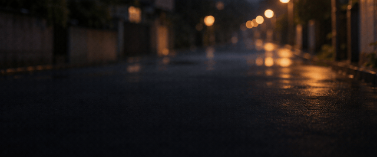

# Effect gallery

Pick an effect by its preview, then run its example from a source checkout.
Use the fonts in the example to match the lyric layout, and choose an export
format that supports the effect. [Get started](../getting-started.md) · [Output formats](../guides/choosing-output.md)

## Start with a whole song

**Built-in karaoke effects.** Mix an entrance, a timing treatment, and an exit
with `KaraokeEffects`. The preview shows four combinations using Sarasa UI J.


```sh
python -m examples.karaoke_catalog build/studio.hook --entry glow_in --exit dissolve_out
```

[Catalog source](../../examples/karaoke_catalog.py) · [Choose effects](../guides/karaoke-effects.md)

**Lead and harmony.** See how independent Tracks share a song clock, rotate
rows, and use different colors. [Row allocation](../../examples/lyric_orchestration.py) · [Track palettes](../../examples/karaoke_designs.py)

## Animate the lyric

### Fixed-cut lyric reveal


Each character slides into place before its first note. The default style puts
Sarasa UI J directly over the footage, then sweeps from off-white to amber.

```sh
python -m examples.slit_reveal build/slit-reveal.hook
```

[Source](../../examples/slit_reveal.py) · [Adapt the entrance to longer lyrics](../tutorials/karaoke-design.md#reveal-a-phrase-from-narrow-openings)

### Karaoke without a color wipe



The diamond lands on the note attack and the glyph briefly grows. The whole
glyph turns amber at release. The preview uses Sarasa UI SC over a night street.

```sh
python -m examples.lyric_no_sweep build/lyric-no-sweep.hook
```

[Source](../../examples/lyric_no_sweep.py) · [Align motion with the notes](../tutorials/karaoke-design.md#mark-timing-without-a-color-wipe)

For more custom motion, see the [lyric studies](../tutorials/lyric-studies.md) on
timed copies, particle reveals, and curved trails.

## Karaoke count-ins


The inline columns flash together. The stars clear one at a time above the
line. Both signals clear by the pickup. [Signal source](../../examples/karaoke_signals.py) · [Cue setup](../guides/text-and-cues.md)

### Paw countdown and character flips

Use `paw_countdown(step_seconds=...)` as a Track cue preset for four prints that
squash and vanish in step with the music. Use the built-in `spin_flip` exit with
`exit_unit="character"` to flip glyphs and their readings around their own pivots.
[Paw cue source](../../examples/paw_countdown.py) · [Entry and exit options](../guides/karaoke-effects.md#entry-and-exit)

## Add drawing and color

### Word backgrounds and decorations


Draw backgrounds, cue bars, and sparkles against measured lyric ranges. Edit
the range, cue factory, or lifetime to attach the drawing to a different phrase.

```sh
python -m examples.scene_cues build/word-backgrounds.ass
```

[Source](../../examples/scene_cues.py)

### GPU gradient


Export continuous shader color as `build/gpu-gradient.hook` alongside a plain
ASS version of the lyric.

```sh
python -m examples.gpu_gradient
```

[Source](../../examples/gpu_gradient.py) · [Render the hook](../guides/gpu-rendering.md)
