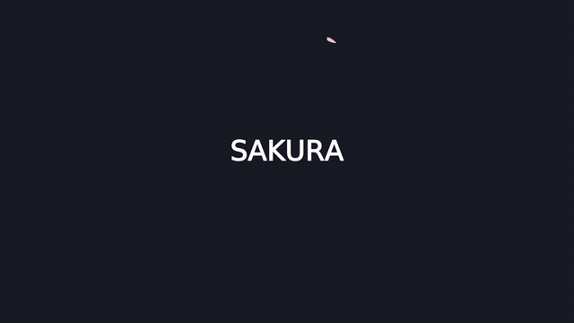
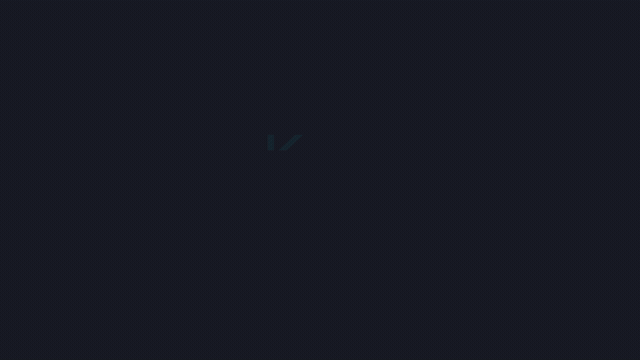
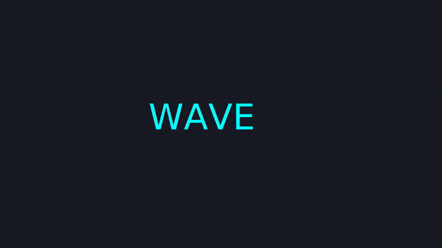

# Effect gallery

These previews are rendered from the ASS exported by the linked Python examples.
Each primary example uses fixed content and accepts an output path. From a source
checkout with the library installed, create `build/` and run the command shown.
The wheel does not install the `examples` package.

The previews use the repository test fonts, a dark background, 640-pixel width,
and 12 frames/s. The generated ASS retains its full script resolution and timing.
Supply the same fonts to your player for comparable text geometry. See
[fonts and preview](../guides/fonts-and-preview.md) for reproduction.

## Choose an effect

- [Layered lyric glow](#layered-lyric-glow)
- [Staggered entrance and exit](#staggered-entrance-and-exit)
- [Curved text and repeated highlights](#curved-text-and-repeated-highlights)
- [Sakura particles](#sakura-particles)
- [Text fragments](#text-fragments)
- [Word backgrounds and decorations](#word-backgrounds-and-decorations)
- [Animated outlines](#animated-outlines)
- [Writing and pen motion](#writing-and-pen-motion)
- [Gradients and echoes](#gradients-and-echoes)
- [Shape morphing](#shape-morphing)
- [Soft highlight sweep](#soft-highlight-sweep)
- [Inline and positioned lyric cues](#inline-and-positioned-lyric-cues)

## Layered lyric glow


Separate body, ruby, fill, outline, and constant glow layers share the original singing clock.

[Source: scene_lyrics.py](../../examples/scene_lyrics.py)

```sh
python -m examples.scene_lyrics build/lyrics.ass
```

Edit the lyric source, `pulse`, glow factories, and each color-front width.

## Staggered entrance and exit


Characters enter on offset timelines, move along custom curves, and return to their layout.

[Source: scene_staggered.py](../../examples/scene_staggered.py)

```sh
python -m examples.scene_staggered build/staggered.ass
```

Edit `bounce`, `orbit`, per-character delays, and animation envelopes.

## Curved text and repeated highlights


Lay out text and ruby along an arc with tangent rotation and repeated singing intervals.

[Source: scene_round.py](../../examples/scene_round.py)

```sh
python -m examples.scene_round build/round.ass
```

Edit the layout path, spacing, orientation, and repeat clocks.

## Sakura particles



Reusable petals drift along curves and emit from both ambient sources and the lyric front.

[Source: scene_sakura.py](../../examples/scene_sakura.py)

```sh
python -m examples.scene_sakura build/sakura.ass
```

Edit `PETAL`, the `petal` factory, emissions, named randomness, and seed.

## Text fragments



Split glyph geometry into independent pieces and animate them back into place.

[Source: scene_fragments.py](../../examples/scene_fragments.py)

```sh
python -m examples.scene_fragments build/fragments.ass
```

Edit the slicing grid, fragment birth times, offsets, and motion.

## Word backgrounds and decorations


Measured lyric ranges receive backgrounds, custom bars, numbers, and sparkle decorations.

[Source: scene_cues.py](../../examples/scene_cues.py)

```sh
python -m examples.scene_cues build/word-backgrounds.ass
```

Edit source ranges, cue factories, decorations, and their lifetimes.

## Animated outlines



Deform contours with an explicit geometry function and time envelope.

[Source: scene_outlines.py](../../examples/scene_outlines.py)

```sh
python -m examples.scene_outlines build/outlines.ass
```

Edit the deformation function, point bound, and envelope.

## Writing and pen motion


Explicit authored strokes reveal progressively while a separate pen follows their clock.

[Source: scene_writing.py](../../examples/scene_writing.py)

```sh
python -m examples.scene_writing build/writing.ass
```

Edit stroke paths, progress, lift intervals, and pen appearance; strokes are supplied by the author.

## Gradients and echoes


A spatial color field paints text while delayed copies preserve earlier appearance.

[Source: scene_gradient.py](../../examples/scene_gradient.py)

```sh
python -m examples.scene_gradient build/gradient.ass
```

Edit color stops, field coordinates, echo delays, and opacity.

## Shape morphing


Interpolate corresponding contours and control points over time.

[Source: scene_morph.py](../../examples/scene_morph.py)

```sh
python -m examples.scene_morph build/morph.ass
```

Edit the paired paths and interpolation; contour correspondence is explicit.

## Soft highlight sweep


Fill and outline have independently controlled soft fronts over a constant glow.

[Source: scene_sweep.py](../../examples/scene_sweep.py)

```sh
python -m examples.scene_sweep build/sweep.ass
```

Edit front widths, colors, timing, border, and glow; these are separate objects.

## Inline and positioned lyric cues


Document markers select custom cue content, independent placement, and ruby timing.

[Source: scene_lyric_cues.py](../../examples/scene_lyric_cues.py)

```sh
python -m examples.scene_lyric_cues build/lyric-cues.ass
```

Edit CueMarker declarations, CuePreset factories, text, placement, and timing.

## Further examples

These modules also generate ASS from a checkout. The command shape is
`python -m examples.MODULE build/output.ass` unless the input column says otherwise.

| Modules | Topic | Input |
| --- | --- | --- |
| `scene_tracks`, `scene_editable_tracks` | Native and editable Track content with custom Scene objects | Fixed |
| `scene_coverage_tracks` | Track material coverage and scoped opacity | Fixed |
| `track_colors` | Code-only per-range lyric colors | Fixed |
| `parallel_tracks` | Disjoint, priority, and translucent layered highlights | Fixed |
| `layered_glow` | K1/K2/LEAD glow configuration | `tests/fixtures/layered_glow.ass`, then output path |
| `syllable_pulse` | Grow on this syllable, shrink on the following one | `examples/karaoke.ass`, then output path |
| `scene_affine`, `scene_mirror` | Affine transforms, mirrored groups, and geometry lowering | Fixed |
| `scene_masks`, `scene_group_masks`, `scene_rectangle` | Local/shared masks and animated rectangles | Fixed |
| `scene_boolean`, `scene_word_glow` | Path boolean operations and shared word glow | Fixed |
| `scene_follow`, `scene_cue_follow` | World-space following and custom cue motion | Fixed |
| `scene_keyframes`, `scene_native_tween` | Keyframes and explicit native interpolation | Fixed |
| `scene_bilingual` | Multiple lyric rows and scripts | Fixed |
| `scene_composite`, `scene_coverage` | Explicit RGBA raster and coverage composition | Fixed; intentionally larger budgets |
| `scene_sweep_strategies` | Banded, layered, raster, and diffused sweep choices | Fixed; optional `--strategy` |
| `scene_legacy` | ASS-template output combined with Scene objects | Fixed |
| `scene_whole_song` | 180-second composition of the twelve primary effects | Fixed; intentionally larger budget |
| `output_layers` | Low-level ASS text-layer compilation | Fixed |

`characters` and `timeline` print measured layout or timeline data rather than
writing ASS. `layered_glow_classes` exports reusable Track subclasses for the CLI;
it has no standalone command. `_lyrics` is a small shared fixture helper.

For a minimal script that uses only the installed package, start with
[getting started](../getting-started.md). For your own callbacks and factories,
read the [custom animation tutorial](../tutorials/custom-animation.md) and
[task guides](../README.md).
