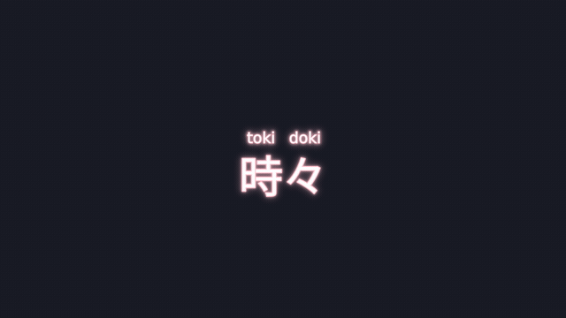
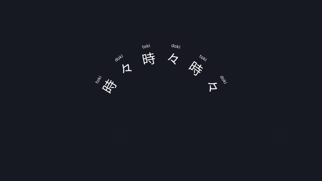
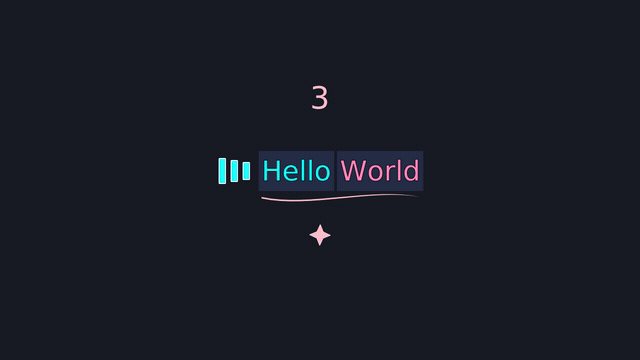
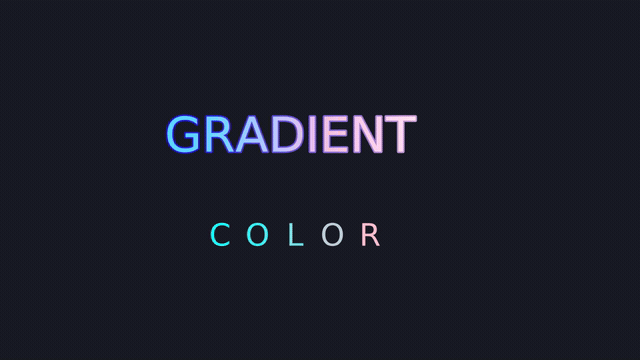
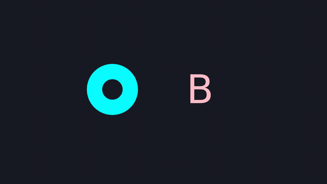
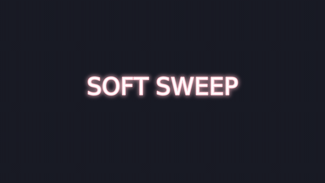
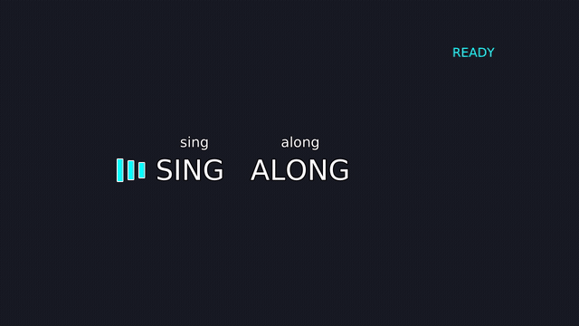

# Effect gallery

The gallery includes historical libass renders made with the former sampled ASS
exporter. The scene sources illustrate the effects. For current export support,
see [Choose an output](../guides/choosing-output.md).
The wheel does not install the `examples` package.

The previews use the repository test fonts, a dark background, 640-pixel width,
and 12 frames/s. The generated ASS retains its full script resolution and timing.
Supply the same fonts to your player for comparable text geometry. See
[fonts and preview](../guides/fonts-and-preview.md) for reproduction.

## Built-in karaoke catalog


[KaraokeEffects](../guides/karaoke-effects.md) covers the Studio animation-menu
families: entry/exit motion, singing pulses, luminous fronts, petals, stars,
ripples, notes and snow. One callable supplies the whole recipe to a Track.
The preview is a 15fps overview of actual 60fps ASS renders using Sarasa UI J;
use the videos for timing judgments.

```sh
python -m examples.karaoke_catalog build/studio.hook --entry glow_in --exit dissolve_out
```

[Source](../../examples/karaoke_catalog.py) · [Recommended combinations](../tutorials/karaoke-design.md#built-in-animation-combinations)

## Arrange karaoke lyrics

Start with [lyric_orchestration.py](../../examples/lyric_orchestration.py) for
ordinary lyric authoring: one rule binds each line's fade and each singing
segment's jump, while independent main/harmony Tracks choose their layouts.
Set `rows` to change the row count and `reset_on_lead` to choose whether a cue restarts the rotation. The custom allocator illustrates taking a solo line out of that rotation.

The effects below also include direct object and material examples for custom
geometry and composition. See [Tracks](../guides/tracks.md) for the authoring API.

## Custom lyric animation

The [motion studies](../tutorials/lyric-studies.md) demonstrate timed copies,
particle reveal, curved trails and independent ornament clocks. For a whole-song
starting point, use [karaoke layout and animation defaults](../tutorials/karaoke-design.md).
The [palette example](../../examples/karaoke_designs.py) shows how to give main
and harmony Tracks different materials while sharing one time axis.

## Karaoke count-ins


The inline columns flash together. Each changes its fill and outer outline when its step begins. The stars use the harmony track’s teal sung color and extinguish from
right to left. Both signals clear when singing begins; the lyric keeps its
reserved position. [Runnable example](../../examples/karaoke_signals.py).

### Paw countdown and character flips

The [paw countdown component](../../examples/paw_countdown.py) places four vector prints above the row and its readings. Each print squashes halfway through its step and vanishes on the boundary. The cue inherits the host’s size and singing colour. For a fast song, four two-beat steps give about three seconds at 156 BPM:

```python
from examples.paw_countdown import paw_countdown
from kara_templater import Track

track = Track(id="lead", cues={"paws": paw_countdown(step_seconds=2 * 60 / 156)})
```

Place an independent cue marker named `paws` at the desired pickup (for example, `CueMarker("intro", "paws", placement="independent")`). The Track handles the row position and reading clearance.

The flipping exit can be used independently. Add `KaraokeEffects(entry="tilt_pop", exit="spin_flip", exit_unit="character")` to a Track’s effects for a popping entrance and an exit in which each written character, including each kana in a reading, turns around its own pivot.

For the sticker lettering, give the face a light outline and a vertical `LyricGradient` for each sweep state. For a thick coloured side, place solid copies of the outlined silhouette progressively down and to the right beneath the face. Use the same measured text, ruby, row layout and character animation on every copy so the side follows the face during a flip. The side colour and depth belong to the lettering design; the song supplies its font and palette.

## Choose an effect

- [Layered lyric glow](#layered-lyric-glow)
- [Staggered entrance and exit](#staggered-entrance-and-exit)
- [Curved text and repeated highlights](#curved-text-and-repeated-highlights)
- [Sakura particles](#sakura-particles)
- [Text fragments](#text-fragments)
- [Word backgrounds and decorations](#word-backgrounds-and-decorations)
- [Animated outlines](#animated-outlines)
- [Writing and pen motion](#writing-and-pen-motion)
- [Gradients and echoes](#gradients-and-echoes)
- [Shape morphing](#shape-morphing)
- [Soft highlight sweep](#soft-highlight-sweep)
- [Inline and positioned lyric cues](#inline-and-positioned-lyric-cues)

## Layered lyric glow



Separate body, ruby, fill, outline, and constant glow layers share the original singing clock.

[Source: scene_lyrics.py](../../examples/scene_lyrics.py)

Edit the lyric source, `pulse`, glow factories, and each color-front width.

## Staggered entrance and exit


Characters enter on offset timelines, move along custom curves, and return to their layout.

[Source: scene_staggered.py](../../examples/scene_staggered.py)

Edit `bounce`, `orbit`, per-character delays, and animation envelopes.

## Curved text and repeated highlights



Lay out text and ruby along an arc with tangent rotation and repeated singing intervals.

[Source: scene_round.py](../../examples/scene_round.py)

Edit the layout path, spacing, orientation, and repeat clocks.

## Sakura particles


Reusable petals drift along curves and emit from both ambient sources and the lyric front.

[Source: scene_sakura.py](../../examples/scene_sakura.py)

Edit `PETAL`, the `petal` factory, emissions, named randomness, and seed.

## Text fragments


Split glyph geometry into independent pieces and animate them back into place.

[Source: scene_fragments.py](../../examples/scene_fragments.py)

Edit the slicing grid, fragment birth times, offsets, and motion.

## Word backgrounds and decorations



Measured lyric ranges receive backgrounds, custom bars, numbers, and sparkle decorations.

[Source: scene_cues.py](../../examples/scene_cues.py)

```sh
python -m examples.scene_cues build/word-backgrounds.ass
```

Edit source ranges, cue factories, decorations, and their lifetimes.

## Animated outlines


Deform contours with an explicit geometry function and time envelope.

[Source: scene_outlines.py](../../examples/scene_outlines.py)

Edit the deformation function, point bound, and envelope.

## Writing and pen motion


Explicit authored strokes reveal progressively while a separate pen follows their clock.

[Source: scene_writing.py](../../examples/scene_writing.py)

Edit stroke paths, progress, lift intervals, and pen appearance; strokes are supplied by the author.

## Gradients and echoes



A spatial color field paints text while delayed copies preserve earlier appearance.

[Source: scene_gradient.py](../../examples/scene_gradient.py)

Edit color stops, field coordinates, echo delays, and opacity.

## Shape morphing



Interpolate corresponding contours and control points over time.

[Source: scene_morph.py](../../examples/scene_morph.py)

Edit the paired paths and interpolation; contour correspondence is explicit.

## Soft highlight sweep



Fill and outline have independently controlled soft fronts over a constant glow.

[Source: scene_sweep.py](../../examples/scene_sweep.py)

Edit front widths, colors, timing, border, and glow; these are separate objects.

## Inline and positioned lyric cues



Document markers select custom cue content, independent placement, and ruby timing.

[Source: scene_lyric_cues.py](../../examples/scene_lyric_cues.py)

Edit CueMarker declarations, CuePreset factories, text, placement, and timing.

## Further examples

These modules demonstrate additional scene and track configurations.

| Modules | Topic | Input |
| --- | --- | --- |
| `scene_tracks` | Lyric animation and glow with ordinary Scene objects | Fixed |
| `scene_coverage_tracks` | Ruby/sweep/glow with shared parent motion and vector decoration | Fixed |
| `track_colors` | Code-only per-range lyric colors | Fixed |
| `parallel_tracks` | Disjoint, priority, and translucent layered highlights | Fixed; explicit 50,000-event preflight budget |
| `layered_glow` | K1/K2/LEAD glow configuration | `tests/fixtures/layered_glow.ass`, then output path |
| `syllable_pulse` | Grow on this syllable, shrink on the following one | `examples/karaoke.ass`, then output path |
| `scene_affine`, `scene_mirror` | Affine transforms, mirrored groups, and geometry lowering | Fixed |
| `scene_masks`, `scene_group_masks`, `scene_rectangle` | Local/shared masks and animated rectangles | Fixed |
| `scene_boolean`, `scene_word_glow` | Path boolean operations and shared word glow | Fixed |
| `scene_follow`, `scene_cue_follow` | World-space following and custom cue motion | Fixed |
| `scene_keyframes`, `scene_native_tween` | Keyframes and explicit native interpolation | Fixed |
| `scene_bilingual` | Multiple lyric rows and scripts | Fixed |
| `scene_whole_song` | 180-second composition of the twelve primary effects | Fixed; intentionally larger budget |
| `output_layers` | Shared animations with character-arrival, character and syllable bindings | Fixed |

The `layered_glow` example exports `build(document)` with per-layer clipped glow,
two-stage highlighting, ruby-specific glow widths and syllable attack/release.
For a minimal script that uses only the installed package, start with
[getting started](../getting-started.md). For your own callbacks and factories,
read the [custom animation tutorial](../tutorials/custom-animation.md) and
[task guides](../README.md).

## GPU gradient

[GPU gradient example](../../examples/gpu_gradient.py) exports ordinary fallback lyrics plus continuous shader color and eased motion. See [the GPU guide](../guides/gpu-rendering.md) for optional rendering requirements and limits.


