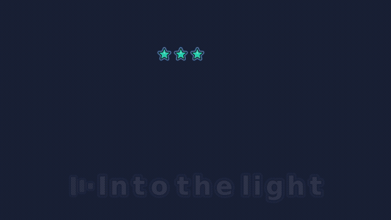

# Effect gallery

The gallery includes historical libass renders made with the former sampled ASS
exporter. The scene sources illustrate the effects. For current export support,
see [Choose an output](../guides/choosing-output.md).
The wheel does not install the `examples` package.

The previews use the repository test fonts, a dark background, 640-pixel width,
and 12 frames/s. The generated ASS retains its full script resolution and timing.
Supply the same fonts to your player for comparable text geometry. See
[fonts and preview](../guides/fonts-and-preview.md) for reproduction.

## Built-in karaoke catalog


[KaraokeEffects](../guides/karaoke-effects.md) covers the Studio animation-menu
families: entry/exit motion, singing pulses, luminous fronts, petals, stars,
ripples, notes and snow. One callable supplies the whole recipe to a Track.
The preview is a 15fps overview of actual 60fps ASS renders using Sarasa UI J;
use the videos for timing judgments.

```sh
python -m examples.karaoke_catalog build/studio.hook --entry glow_in --exit dissolve_out
```

[Source](../../examples/karaoke_catalog.py) · [Recommended combinations](../tutorials/karaoke-design.md#built-in-animation-combinations)

## Arrange karaoke lyrics

Start with [lyric_orchestration.py](../../examples/lyric_orchestration.py) for
ordinary lyric authoring: one rule binds each line's fade and each singing
segment's jump, while independent main/harmony Tracks choose their layouts.
Set `rows` to change the row count and `reset_on_lead` to choose whether a cue restarts the rotation. The custom allocator illustrates taking a solo line out of that rotation.

The effects below also include direct object and material examples for custom
geometry and composition. See [Tracks](../guides/tracks.md) for the authoring API.

## Custom lyric animation

The [motion studies](../tutorials/lyric-studies.md) demonstrate timed copies,
particle reveal, curved trails and independent ornament clocks. For a whole-song
starting point, use [karaoke layout and animation defaults](../tutorials/karaoke-design.md).
The [palette example](../../examples/karaoke_designs.py) shows how to give main
and harmony Tracks different materials while sharing one time axis.

## Karaoke count-ins



The inline columns flash together. Each changes its fill and outer outline when its step begins. The stars use the harmony track’s teal sung color and extinguish from
right to left. Both signals clear when singing begins; the lyric keeps its
reserved position. [Scene construction example](../../examples/karaoke_signals.py).

### Paw countdown and character flips

The [paw countdown component](../../examples/paw_countdown.py) places four vector prints above the row and its readings. Each print squashes halfway through its step and vanishes on the boundary. The cue inherits the host’s size and singing colour. For a fast song, four two-beat steps give about three seconds at 156 BPM:

```python
from examples.paw_countdown import paw_countdown
from kara_templater import Track

track = Track(id="lead", cues={"paws": paw_countdown(step_seconds=2 * 60 / 156)})
```

Place an independent cue marker named `paws` at the desired pickup (for example, `CueMarker("intro", "paws", placement="independent")`). The Track handles the row position and reading clearance.

The flipping exit can be used independently. Add `KaraokeEffects(entry="tilt_pop", exit="spin_flip", exit_unit="character")` to a Track’s effects for a popping entrance and an exit in which each written character, including each kana in a reading, turns around its own pivot.

Give the face a light outline and a vertical `LyricGradient` for each sweep state.
Set `Track.extrusion` to add a colored side that follows the lettering and ruby.
See [extruded lettering](../guides/gpu-rendering.md#extruded-lettering-and-shapes).

## Word backgrounds and decorations


Measured lyric ranges receive backgrounds, custom bars, numbers, and sparkle decorations.

[Source: scene_cues.py](../../examples/scene_cues.py)

```sh
python -m examples.scene_cues build/word-backgrounds.ass
```

Edit source ranges, cue factories, decorations, and their lifetimes.

## GPU gradient

[GPU gradient example](../../examples/gpu_gradient.py) exports ordinary fallback lyrics plus continuous shader color and eased motion. See [the GPU guide](../guides/gpu-rendering.md) for optional rendering requirements and limits.


