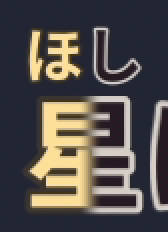

# Choose an output for your song

Lyrics can come from a timed ASS file or from structured Python input. Once
`prepare_tracks` has placed the lyrics and bound their animations, choose how
to deliver that scene. You can export either format directly or distribute both.
Use one subtitle layer at playback.

| What you want to deliver | Python entry point | What to expect |
| --- | --- | --- |
| A karaoke subtitle for an ordinary ASS player | `scene.export_compact_ass("song.ass")` on a prepared lyric scene | Eligible catalog recipes use compact karaoke timing, colors, line fades and cues. Character motion and decorations may be simplified. Some recipes and timings use ordinary scene compilation. |
| The authored motion and layers in a standard ASS file | `scene.compile(native_tweens=True).document.save("song.ass")` | The compiler can encode multiple events, clipped layers and samples. Detailed effects can cost more in file size and playback time. |
| A standalone libplacebo shader for mpv or FFmpeg | `scene.export_hook("song.hook", fps=60)` | The hook carries its own glyph coverage and can shade gradients continuously. The export frame grid and GPU feature limits apply. |

Compact ASS is an option on `LyricScene`, the result of `prepare_tracks`. A
general `Scene` offers ASS compilation and hook export. Native ASS events,
vector or inverse clips, and explicit coverage groups are examples that the
current hook exporter cannot draw. Check the features used by your recipe
before promising both outputs.

## One singing position, three renders

These crops show the first character and its reading in the
[README recipe](../../README.md), 0.50 seconds into its 0.90-second note.
All three use Sarasa UI J at the same resolution. Look at the right edge of
the gold fill and shaded outline on 星.

| Compact ASS · libass | Compiled ASS · libass | Hook · libplacebo |
| --- | --- | --- |
|  |  |  |

For this duotone recipe, compact ASS uses moving color strips, the ordinary
scene compiler produces a sharp wipe, and the hook interpolates the fill and
outline across a 12-pixel feather in the 72-pixel body and a 6-pixel feather in its 36-pixel reading. Compiled ASS can reproduce other details
that compact output simplifies, such as a per-syllable pulse. A different
recipe can explicitly build an ASS feather from color bands. Judge the
particular effect you plan to deliver.

For an ASS export, supply the playback fonts and check the result in your
target player. For a hook, use the export frame rate with FFmpeg or play by
video timestamp in mpv. See [ASS playback](../ass-and-playback.md),
[ASS compilation budgets](compilation.md) and [hook playback and limits](gpu-rendering.md).
