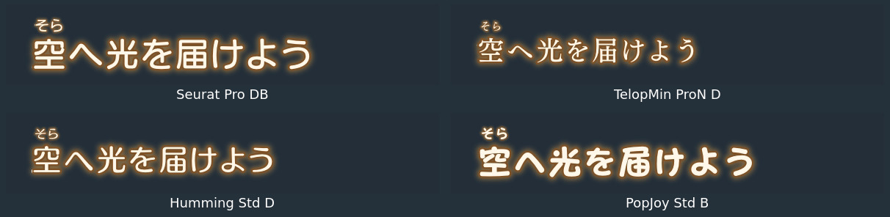

# Fonts and preview

Text metrics and glyph geometry depend on the actual selected font, fallback,
and shaping environment. Keep font selection consistent between compilation and
playback when comparing layout or pixels.

## Check the singing colours

Sample possible accents from the artwork. Compare the unsung fill and sung fill against the background directly behind the text, then compare those two fills with each other. When the backdrop already uses the dominant hue, try a smaller accent from the illustration or title. Inspect a half-sung line in colour and grayscale, including its ruby. On moving footage repeat this over bright and dark shots. Check harmony colours with both voices visible. [Text contrast](https://www.w3.org/WAI/WCAG22/Understanding/contrast-minimum.html) · [Use of colour](https://www.w3.org/WAI/WCAG22/Understanding/use-of-color.html)

## Choose a typeface for sung lyrics

Audition the face on the song itself. For Japanese lyrics, take one dense
kanji, a run of kana, and the longest line. If the song mixes scripts, include
an English phrase and punctuation from the same line. Compare candidates at
the intended playback size, with the actual outline and background.

| Lyric role | A starting point | What to look for in playback |
| --- | --- | --- |
| Main vocal | Try a medium or bold Japanese Gothic face for even strokes, or a Mincho face for a more delicate, print-like voice. | Pause halfway through a long sung character. Both colors should remain legible; inspect the fine horizontal strokes and the gaps inside dense characters. |
| Harmony | Start with a smaller size in the main family. For a different voice, try a contrasting face on the same phrase. | Play both voices together. Check lowercase letters at the smaller size and see whether the longest harmony line still fits its lane. |
| Ruby | Start with a plain face with clear kana at the final reading size. | Check small kana and voicing marks on a busy frame with the outline enabled. |

For example, compare Noto Serif CJK JP and Noto Sans CJK JP on the same
Japanese phrase. Keep size, outline, color and timing fixed for the first
pass. Then adjust weight and size for the chosen face: two families at the
same nominal size can occupy different widths and look different in height.
Apply the choice through [Track.styles](tracks.md#semantic-targets-and-appearance)
before layout so text, ruby and inline cue positions use its measurements.

## Use a font’s proportional kana spacing

For horizontal lyrics, set `Track(id="lead", palt=True)` to use the font’s OpenType
proportional alternate widths and placements. Body and ruby are measured before
row allocation. Fonts without this feature retain their ordinary metrics.
The hook and ASS exports draw the measured clusters at explicit positions.
ASS playback uses the same font and works with upstream libass. Horizontal
letter spacing still adds the style’s tracking to each advance.

## Match a Karaoke Studio font size

Studio specifies the font’s em in pixels. ASS font size depends on the selected
face’s vertical metrics. At the same script resolution and 100% text scale,
divide the desired Studio size by the face’s measured `em_ratio`. For example,
for a representative body character in an existing timed line:

```python
from kara_templater import layout_document_lyrics

layout = layout_document_lyrics(document, record_index)
glyph = next(g for g in layout.body.characters if g.fonts and g.object.text.strip())
ass_size = studio_em_px / glyph.fonts[0].em_ratio
```

Use the result as the source style’s `fontsize` before laying out the track.
Measure the ruby face separately if it differs from the body face. For Sarasa
UI J in the comparison fixture, a 40 px Studio em corresponds to ASS size
48.36. Other faces can give a different result. Small size differences can
change an integer cell width by a pixel and accumulate along the line.

## Pair Japanese lyrics with a Chinese translation

Start with the Japanese face and weight used for the song. Choose a Chinese
candidate for the translation's script, then preview the two lines together.
The table below gives selected starting pairs from the *中日字体匹配推荐表*
workbooks. The workbook names and Sheet1 row numbers identify the entries.

| Japanese lyric face | Simplified Chinese candidate | Traditional Chinese candidate | Workbook and row |
| --- | --- | --- | --- |
| Morisawa A-OTF A1 Mincho Std Bold | 方正标雅宋简体 | 華康中明體(P) for Taiwan | Morisawa v1.01, row 3 |
| DynaFont DFHSMincho Std/StdN W5 | 方正准雅宋简体 | 華康中明體(P) for Taiwan | DynaFont OpenType v1.00, row 7 |
| Fontworks FOT-Rodin Pro L | 思源黑体 family | 思源黑體 family | Fontworks v1.05, row 207 |

Compare a shared character such as 光 to judge stroke weight and how much of
the character cell each face fills. Then compare the actual Japanese kana with
a dense character and punctuation from the translation. This second check
matters for kana variants: the Fontworks entry for RodinBokutoh (row 219)
offers matches for its kanji and leaves its distinctive kana to visual judgment.

Use separate styles for the two lyric tracks and set each style's font family
to the name reported by the installed face. Preview at the translation's final
size with the intended outline. Check the actual simplified or traditional
lyrics for missing glyphs, especially when using a face marked 简繁扩充 in
the workbooks.

### Fontworks choices for a karaoke template

The [karaoke designs example](../../examples/karaoke_designs.py) accepts these names
through `--font-preset`. Each selects the listed Japanese face and its own weight
for body and ruby. The Chinese column gives a suggested translation style from
*Fontworks 日文字体 中日字体匹配推荐表 v1.05*, Sheet1.

| Preset | Japanese face | Simplified Chinese companion | Where to try it | Rows |
| --- | --- | --- | --- | --- |
| `seurat` | FOT-Seurat Pro DB | 方正兰亭圆 GBK, matching weight | Rounded main lyrics. The demi-bold weight keeps the short strokes visible on animated footage. | 359–361 |
| `telop-min` | FOT-TelopMin ProN D | 方正屏显雅宋 GBK | Ballads and held phrases. The heavier horizontal strokes give this Mincho a firmer outline on screen. | 65–69 |
| `humming` | FOT-Humming Std D | 汉仪润圆-55W | A gentler verse or answering voice. Compare its kana rhythm with Seurat on the same phrase. | 443 |
| `pop-joy` | FOT-PopJoy Std B | 方正少儿 GBK | Playful refrains and short calls. Check small voiced kana before using it for dense ruby. | 477 |



For example, run `uv run python -m examples.karaoke_designs build/seurat.ass --japanese --font-preset seurat`.
Install the face before compiling. On a fontconfig system, inspect the file and weight
with `fc-match -f '%{file} %{style}\n' ':family=FOT-Seurat Pro DB'`. The family
selector preserves the hyphen in Fontworks names. Check the actual rendered line as well.

## Register and select a font

`load_font(path)` makes that font's bytes available to the current interpreter's
native metrics renderer. It returns LoadedFont with family and SHA-256 metadata.
Select the family through Style.fontname, TextStyle.font_name, or TextObject.font.
Registration does not select a global font or embed it into every output ASS.
Duplicate font bytes are registered once per interpreter.

The playback application must also receive the font. Install the font, attach it
through your delivery container, or configure the preview renderer's font path.
A fallback can change advances, outlines, line positions, and supported glyphs.
Reported font-face names are diagnostics, not proof of identical file bytes.

The repository includes small fixed test fonts with separate licenses. Examples
that use them load bytes from tests/fonts while building. Those paths require a
checkout or source distribution; they are not wheel-installed example assets.

## Render the exported ASS

The gallery tool first saves ASS, then asks FFmpeg/libass to render that file:

```sh
python -m tools.render_gallery --case sweep
```

Run it from a checkout with FFmpeg/libass and the checks dependencies installed.
It writes ASS, copied preview fonts, and a provenance report under build/gallery,
and creates the selected GIF under docs/examples/assets. Omit --case to rebuild
the complete twelve-effect gallery. Override --output or --assets for a local
experiment without replacing tracked previews.

For detailed continuous-playback and seek checks of a particular example:

```sh
python -m tools.validate_scene_core --scene sweep build/preview-sweep
```

This writes its generated ASS and diagnostic report to the requested output
directory. It checks a fixed example in the configured libass environment; it
does not establish equivalent rendering in every player.

For ordinary playback, load the saved ASS in your target player and inspect
entrance, singing transitions, repeated highlights, and exit. For pixel-level
comparisons, keep resolution, fonts, timestamp, background, color matrix, and
RGB/chroma composition settings fixed. See [ASS and playback](../ass-and-playback.md).
