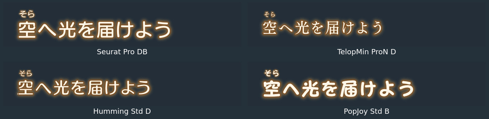

# Choose and register fonts

Pick readable typefaces for main vocals, harmonies, and ruby, adjust proportional kana spacing and font sizes, pair Japanese and Chinese scripts, and register local font files for layout measurement.

## Choose a typeface for lyrics

Audition candidate fonts on real lines from your song rather than generic test words. For Japanese lyrics, include a dense kanji, a run of kana, and your longest line; if the song mixes scripts, include an English phrase and punctuation from the same line. Compare candidates at final playback size with the real outline and background.

| Lyric role | Starting point | What to check in playback |
| --- | --- | --- |
| Main vocal | Medium or bold Japanese Gothic for even strokes, or Mincho for a lighter, print-like voice. | Pause midway through a held note. Both before and after fills must stay legible; check thin horizontal strokes and tight counters inside dense kanji. |
| Harmony | Smaller size in the main family, or a contrasting family for a distinct voice. | Play both voices together. Check lowercase letters at the smaller size and confirm the longest harmony line fits its row. |
| Ruby | Plain face with open, clear kana at the final reading size. | Check small kana (`ゃ`, `っ`) and voicing marks (`゛`, `゜`) over a busy frame with outlines enabled. |

For a fair comparison—for example, Noto Serif CJK JP versus Noto Sans CJK JP—keep size, outline, color, and timing fixed on the first pass. Then adjust weight and size for your winner, because two families at the same nominal `fontsize` can occupy different widths and visual heights. Apply your chosen styles through `Track.styles` (see [Lay out vocal tracks](tracks.md#build-a-scene-with-track)) so text, ruby, and inline cue spacing use the real font metrics.

## Check lyric colours and contrast

Sample accent candidates from the song's artwork or video, then check two contrasts:

1. Both the before-fill and after-fill against the video backdrop directly behind the lyrics.
2. The before-fill against the after-fill so the karaoke wipe edge is easy to follow.

When the backdrop already carries the dominant hue, pick a secondary accent from the illustration or title card. Inspect a partially swept line—including its ruby—in both color and grayscale over bright and dark shots, and verify harmony colors while both voices are on screen together. See the WCAG guidance on [Text contrast](https://www.w3.org/WAI/WCAG22/Understanding/contrast-minimum.html) and [Use of colour](https://www.w3.org/WAI/WCAG22/Understanding/use-of-color.html).

## Enable proportional kana spacing

For horizontal lyrics, set `palt=True` on a `Track` to apply the font's OpenType proportional alternate widths (`palt`) to both body text and ruby before row layout:

```python
from kara_templater import Track

lead = Track(id="lead", palt=True)
```

Fonts without `palt` metrics keep their normal advances, and `Style.spacing` still adds extra tracking. Both Hook and ASS outputs place every measured cluster at its explicit position, so ASS playback works with standard libass as long as the same font is available.

> [!NOTE]
> Setting `palt=True` disables `KaraokeRows`'s implicit Studio cell spacing so the font's proportional advances take effect. Pass `studio_spacing=...` explicitly if you want to combine them.

## Match a Karaoke Studio font size

Karaoke Studio specifies a font's em height in pixels, whereas ASS `fontsize` depends on the selected face's internal vertical metrics. At the same script resolution and 100% scale, divide your desired Studio em size by the face's measured `em_ratio`:

```python
from kara_templater import Document, Line, Style, layout_document_lyrics

document = Document.create(
    styles=(Style(fontname="DejaVu Sans", fontsize=50, shadow=0),)
)
document.records.append(Line(start_time=0, end_time=2000, text=r"{\k200}Sample"))
record_index = len(document.records) - 1

studio_em_px = 40
layout = layout_document_lyrics(document, record_index)
glyph = next(g for g in layout.body.characters if g.fonts and g.object.text.strip())
ass_size = studio_em_px / glyph.fonts[0].em_ratio
```

Use `ass_size` as `Style.fontsize` before laying out the track, and measure the ruby font separately if it differs from the body font. For example, a 40 px Studio em in Sarasa UI J corresponds to an ASS `fontsize` of about `48.36`; other families give different ratios. Even small size differences can shift an integer cell width by 1 px and accumulate across a long line.

## Pair Japanese lyrics with a Chinese translation

Start from the Japanese face and weight you chose for the song, pick a Chinese companion for the translation's script, and preview both tracks together. The table below lists starting pairs from the *中日字体匹配推荐表* workbooks (Sheet1 row numbers noted for reference):

| Japanese lyric face | Simplified Chinese candidate | Traditional Chinese candidate | Workbook and row |
| --- | --- | --- | --- |
| Morisawa A-OTF A1 Mincho Std Bold | 方正标雅宋简体 | 華康中明體(P) (Taiwan) | Morisawa v1.01, row 3 |
| DynaFont DFHSMincho Std/StdN W5 | 方正准雅宋简体 | 華康中明體(P) (Taiwan) | DynaFont OpenType v1.00, row 7 |
| Fontworks FOT-Rodin Pro L | 思源黑体 family | 思源黑體 family | Fontworks v1.05, row 207 |

Compare a shared character such as `光` to match stroke weight and how much of the character box each face fills. Next, compare Japanese kana alongside dense characters and punctuation from the translation—distinctive kana designs (such as RodinBokutoh, Fontworks row 219) match kanji by table but need visual judgment for kana rhythm.

Give the Japanese and Chinese tracks separate styles using each installed family name, then check the rendered lines for missing glyphs at final size and outline (especially with faces marked `简繁扩充`).

### Fontworks presets in the design example

The runnable [karaoke_designs.py](../../examples/karaoke_designs.py) script includes four Fontworks presets via `--font-preset`, each applying the face and weight to body and ruby. The Chinese column gives the matching recommendation from *Fontworks 日文字体 中日字体匹配推荐表 v1.05* (Sheet1):

| Preset | Japanese face | Simplified Chinese companion | Where to try it | Rows |
| --- | --- | --- | --- | --- |
| `seurat` | FOT-Seurat Pro DB | 方正兰亭圆 GBK (matching weight) | Rounded main lyrics; demi-bold weight stays crisp over animated footage. | 359–361 |
| `telop-min` | FOT-TelopMin ProN D | 方正屏显雅宋 GBK | Ballads and held phrases; heavier horizontal strokes hold their outline on screen. | 65–69 |
| `humming` | FOT-Humming Std D | 汉仪润圆-55W | Gentler verses or answering voices; compare its kana rhythm against Seurat. | 443 |
| `pop-joy` | FOT-PopJoy Std B | 方正少儿 GBK | Playful refrains and short calls; check small voiced kana before using for dense ruby. | 477 |



Install the desired face before running the example:

```sh
uv run python -m examples.karaoke_designs build/seurat.hook --japanese --font-preset seurat
```

On fontconfig systems, check the resolved file and weight (keeping the hyphen in Fontworks names):

```sh
fc-match -f '%{file} %{style}\n' ':family=FOT-Seurat Pro DB'
```

## Register local font files with load_font

Call `load_font(path)` to load a local `.ttf` or `.otf` font file into the current Python process's native metrics renderer. It returns a `LoadedFont(family, sha256)` value and skips reloading if the same file bytes are already registered.

```python
from kara_templater import (
    Document,
    KaraokeEffects,
    Line,
    Style,
    Track,
    build_lyric_scene,
    load_font,
)

loaded = load_font("MyFont.ttf")

document = Document.create(
    styles=(Style(fontname=loaded.family, fontsize=54, shadow=0),)
)
document.records.append(Line(start_time=1000, end_time=3000, text=r"{\k200}Hello"))

scene = build_lyric_scene(
    document,
    tracks=(Track(id="main", effects=(KaraokeEffects(),)),),
)
scene.export("custom_font.hook")
```

Select the registered family through `Style.fontname`, `TextObject.font`, or `TextCue.font`.

> [!IMPORTANT]
> `load_font` does not set a global default font and does not embed fonts into exported ASS files. Standalone Hook files bake rendered glyph masks at export time, so `load_font` is sufficient for Hook playback. For ASS playback, you must also install the font or attach it in your video container so the player does not fall back to a different face.

Reported font-face names are diagnostics rather than proof of identical font files. Note also that small test fonts under `tests/fonts` in a source checkout carry separate licenses and are not bundled in wheel installations.

## Next steps

- [Lay out vocal tracks](tracks.md)
- [Play and render a Hook](../output/hook.md)
- [Export standard ASS](../output/ass.md)
- [Text measurement API reference](../reference/text.md)
