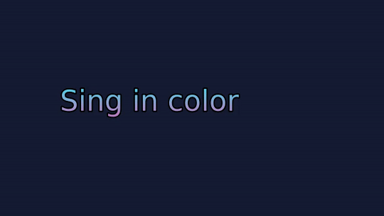

# Render a standalone GPU shader with FFmpeg



Use a standalone hook for shader playback in mpv or video rendering in FFmpeg.
[Compare the export paths](choosing-output.md) to choose a delivery format.
The hook includes glyph coverage, timing, gradients, clips and motion. The
rendering machine needs FFmpeg with libplacebo and a working Vulkan device.
The fonts and the Python authoring environment are needed at export time.

For a timed lyric wipe, the hook can draw each glyph mask once and select its
before/after paint in the fragment shader. This also applies to matching
secondary outlines, gradients and feathered edges. The exporter combines
adjacent draws when they share geometry and motion and their clips meet at
one moving edge. Different stroke widths keep their own masks.

Export a prepared lyric scene with `scene.export("song.hook", fps=60)`.
See [Export a song](karaoke-effects.md#export-a-song) for a Track-based entry point.
The lower-level example below supplies its own fallback for a raw Scene.

```python
from kara_templater import (
    Color, ColorRamp, ColorStop, Document, Lifetime, Line,
    LinearGradient, Scene, TextObject, Vec2, VisualState,
)

fallback = Document.create(width=640, height=360)
fallback.records.append(Line(
    text=r"{\an7\pos(100,140)\fs56}Sing in color", end_time=3000,
))
scene = Scene(fallback).add(TextObject(
    id="lyric", text="Sing in color", font_size=56, lifetime=Lifetime(0, 3),
    state=VisualState(position=Vec2(100, 140), border=2),
    material=LinearGradient(axis="y", space="local", fill=ColorRamp((
        ColorStop(5, Color.hex("#60E8FF")),
        ColorStop(65, Color.hex("#F075CB")),
    ))),
))
fallback.save("song.ass")
scene.export("song.hook", fps=60)
```

The [gradient example](../../examples/gpu_gradient.py) writes both files.
For a matching-aspect, opaque SDR video starting at song time zero:

```sh
ffmpeg -init_hw_device vulkan=vk -i video.mp4 \
  -vf 'fps=60,libplacebo=custom_shader_path=song.hook' \
  -c:v libx264 -pix_fmt yuv420p -c:a copy output.mp4
```

Use the hook as the only subtitle layer. Loading the ordinary ASS on top draws
the lyrics twice. Audio stream copy requires a compatible output container.

## Extract a scene interval

```python
scene.export("chorus.hook", fps=60, start=36, duration=8)
```

```sh
ffmpeg -init_hw_device vulkan=vk -ss 36 -i video.mp4 -t 8 \
  -vf 'fps=60,libplacebo=custom_shader_path=chorus.hook' \
  -c:v libx264 -pix_fmt yuv420p -c:a aac chorus.mp4
```

With the FFmpeg frame-counter clock, the first filter frame corresponds to
the exported start. Use the export frame rate and seek the input to that point.

## Seek with mpv

```sh
mpv --vo=gpu-next --gpu-api=vulkan --sub-auto=no --glsl-shader=song.hook video.mp4
```

mpv supplies the current video frame's presentation timestamp (PTS) in seconds.
The hook uses that timestamp to evaluate the animation on the export grid, including after
forward and backward seeks. Open the original video on the same timeline as the
lyrics. An interval hook exported for 36–44 seconds draws only during that
interval on the original video. A host that leaves PTS unset uses a sequential
frame counter, as in the FFmpeg command above.

## Data and limits

Static draws persist until an event changes them. Linear rectangle keyframes,
including lyric wipes, interpolate on the GPU. Isolated fades, position/scale/
opacity tweens, pulses, drift-outs with one easing, and Studio slides carry
timing and endpoint parameters. Each instance can have its own duration and
pivot. All instances use the same shader.

Use `linear_rate`, `smooth_rate`, or `smoother_rate` for built-in easing. A
custom piecewise-linear easing such as
`FadeIn(rate=ProgressCurve(((0, 0), (0.3, 0.8), (1, 1))).at)` stores its
normalized knots once across instances and durations. The built-in quadratic easings also run directly on the GPU.
Use `ProgressCurve.cubic_bezier(.17, .17, 0, 1).at` for a measured Bézier
timing curve with control values in 0..1. The curve uses the same interpolated
knots in Scene evaluation and the standalone hook.
Unsupported animation, reference or clip callbacks raise a SceneCompileError
with the object, time and source location. Use a GPU motion for custom equations.

The shader draws text/static paths in layer order, with affine transforms,
opacity, ordinary rectangle clips and continuous fill/outline linear gradients
(up to 16 stops). Static glyphs and paths use aggdraw for fills and the FreeType round stroker for fixed borders. Pillow applies blur to the coverage masks.
Dynamic stroke flashes and stretch halos share shaped contour segments. The shader computes round stroke coverage from the current pen radius. A fade on outlined
text can reuse two native masks. The shader selects the translucent border
when the fill fades so that the border does not show through the letter.
Normal screen-space rectangles on a group intersect the clips of each child
drawing. A group's `RectangleKeyframes` use that group's clock, and each child
keeps its own clip coordinates and clock. Group transforms move the content
inside the fixed screen coordinates. The group mask also cuts lyric color
layers and extrusion sides.

Use standard ASS compilation for native events. Vector and inverse clips,
group-local clips, deformed paths and explicit coverage groups are unsupported
by this backend.

Textures in the mpv hook format use hexadecimal text. Complex or long scenes
can produce large files; compress the hook for transport and extract it before
rendering. The command texture uses exact float indices (up to 2²⁴ scalar
entries). The coverage atlas is 2048 pixels wide and up to 8192 pixels high.
Split into frame-aligned intervals if a scene reaches a limit.

## Extruded lettering and shapes

Give a track, text object or path object an `Extrusion` for a solid colored side.
The offset points from the front face to the back in local script pixels.
For example, this track puts the back six pixels right and eleven pixels down.

```python
from kara_templater import Color, Extrusion, Track, Vec2

side = Extrusion(Vec2(6, 11), Color.hex("#C08087"))
track = Track(id="lead", extrusion=side)
```

For a shaded side, use `Extrusion(Vec2(2, 5), Color.hex("#CEDAD1"), back_color=Color.hex("#929F86"))`. The color follows depth around each contour, including holes in the glyph. Translucency and soft edges use the same side coverage as a solid extrusion.

The hook sweeps the filled silhouette and its hard border along the offset
once per distinct shape, then caches the exposed side as a coverage mask.
An outline-only path sweeps just its stroke. Transforms and fades move the
face and side together. Within a scene layer all sides draw before the faces.
A track applies the side to body and ruby and keeps singing paint on the face.
Layout uses the front face's ordinary metrics. This appearance supports hook
output, and an explicit ASS export reports the unsupported extrusion.

## Author a GPU motion

A `ShaderMotion` supplies a reusable GLSL function body, numeric instance
parameters, and a Python evaluator for state capture. The program receives
normalized clip progress `p`, local affine channels, opacity `alpha`, and
normalized RGB vectors `fill` and `outline`. Declare the color channels the
program writes.
Use `item(data + i)` to read the ith numeric parameter. The renderer composes
the result with parent and child transforms before testing the coverage mask.

For Python-generated GLSL, install Metashade and generate helper functions
once in the template module. Pass the generated text as `functions` on
`ShaderMotion`. Use unique function names across a template. For example:

```python
from io import StringIO
from dataclasses import replace
from metashade.targets.glsl.frag import Generator
from kara_templater import ShaderMotion

out = StringIO()
sh = Generator(out, glsl_version="")
with sh.function("karaSparkFade", sh.Float)(phase=sh.Float):
    with sh.if_(sh.phase < sh.Float(0.5)):
        sh.return_(sh.Float(1.0))
    sh.return_((sh.Float(1.0) - sh.phase) * 2.0)

fade = ShaderMotion(
    lambda base, p: replace(base, opacity=base.opacity * min(1, 2*(1-p))),
    frozenset({"opacity"}),
    "alpha *= karaSparkFade(p);",
    functions=out.getvalue(),
)
```

## Repeated window exports

For a preview host that requests multiple time windows, call
`prepared = scene.prepare_hook()` once after building the scene.
`prepared.export_resources(directory, start=..., duration=..., fps=...)`
reuses the resolved hierarchy and glyph coverage across sequential requests,
including backward seeks. Create a new snapshot when the scene changes.
