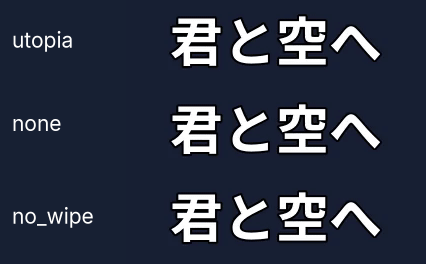

# Built-in karaoke effects

`KaraokeEffects` puts entry, singing, exit, particles and outline flash in one
`Track.effects` entry. Each option expands into the same Scene objects and lyric
rules available to custom effects. You do not schedule each character manually.

## Read the singing position from the lettering

Use `Track(id="main", effects=(KaraokeEffects.duotone(),))` for a timed wipe
that changes the fill and outline together. Unsung letters have dark ink with a
pale rim. As the front crosses a letter, the sung side takes on a warm pale fill
and a copper outline. The holes remain transparent. Four keyword colors
(`unsung`, `unsung_outline`, `sung`, `sung_outline`) control the two looks.
The default transition is 24 script pixels wide and centered on the singing
position. Set `feather` to roughly a third of the displayed glyph width and
preview a held note. The GPU hook interpolates both color pairs continuously.
For simple timed lyrics, compact ASS approximates the same profile with up to
8 moving color strips plus the two endpoint colors per cluster. Set
`feather=0` for a sharp boundary and smaller ASS.

## Recommended main vocal


A narrow dark outline keeps the letter legible on a bright frame. A wider
lavender rim separates it from a dark frame. Behind both, a violet halo softens
the silhouette. Inside the letter, a 14 px transition mixes white into apricot
as the word is sung. The note reaches 112% scale just over a third of the way
through its own duration and settles back by the end. In the preview, compare
the short first note with the held final note.

```python
from kara_templater import (
    Color, Document, FadeIn, FadeOut, Glow, Layout, Line, LyricHighlights,
    LyricRule, LyricSweep, ScalePulse, StatePatch, Style, Track, Vec2, prepare_tracks,
)

document = Document.create(width=640, height=360, styles=(
    Style(fontname="Sarasa UI J", fontsize=60, bold=True, outline=2, shadow=0),
))
document.records.extend((
    Line(start_time=1000, end_time=3000, text=r"{\k30}風{\k50}の{\k120}色"),
    Line(start_time=3100, end_time=4600, text=r"{\k45}空{\k35}の{\k70}音"),
))

motion = (
    LyricRule("line", "enter", FadeIn(), duration=0.18),
    LyricRule("syllable", "singing", ScalePulse(peak=1.12, peak_at=0.36)),
    LyricRule("line", "exit", FadeOut(), duration=0.22),
)
rim = StatePatch(outline=Color.hex("#D4B6FF"), border=5)
halo = Glow(Color.hex("#8054CD"), border=8, blur=4, opacity=0.75)
back = LyricHighlights.from_singing(rim, base_paint=rim, glow=halo, base_glow=halo)
face = LyricSweep(fill=Color.hex("#FF984A"), width=14, step=1)
layout = Layout(rows=2, position=Vec2(42, 110), gap=100)

scene = prepare_tracks(document, tracks=(
    Track(id="rim", layout=layout, effects=(back, *motion)),
    Track(id="face", layout=layout, reserved_border=5, effects=(face, *motion)),
))
scene.compile(native_tweens=True).document.save("karaoke.ass")
```

The two tracks draw the same timed lyrics at the same positions, back layer
first. Both views reserve the outer 5 px hard rim so their glyphs stay aligned. The face retains the source style's 2 px outline. Tune `width` to change
how much of the letter contains intermediate colors; tune `halo.blur` to change
how far the light spreads outside it. The sizes above accompany a 60 px font.
For an existing song, load its Document and select the same main-vocal sources
for both views. Render a verse before compiling a whole song: the soft front
uses color bands in standard ASS, and the pulse moves those bands with the text.

## Choose the singing motion

`Track.effects` defaults to an empty tuple. Add `KaraokeEffects()` to get the
catalog defaults: a 0.30 s fade at each end of the line and a white-to-coral
wipe during singing. Watch the final held syllable in these synchronized
renders; only the singing setting changes.



| What you want the singer to see | What to write |
| --- | --- |
| The color travels across the word and the glyph briefly grows | `KaraokeEffects()` (default singing mode `utopia`) |
| The color travels across the word while the glyph stays still | `KaraokeEffects(singing="none")` |
| The entire timed unit changes color when singing finishes | `KaraokeEffects(singing="no_wipe")` |

To check a template, pause halfway through a long note. The wipe leaves
both colors visible; the onset switch has already painted the whole unit.
The full scene and hook carry the pulse. Compact ASS keeps the color timing
and line fades and simplifies glyph motion. For Studio spacing or additional outline clearance,
compact ASS positions clusters separately to retain the measured spacing. For count-in direction see
[Choose the countdown order](text-and-cues.md#choose-the-countdown-order).

The catalog covers the animation menus in
[Karaoke Studio / Lin-K Lyrics](https://github.com/karaoke-studio/karaoke-studio):
19 entry choices, 19 exit choices, 7 singing choices and 8 singing-decoration
choices, including `none`, plus outline flash. This is an independent implementation
of those visual families, not an importer or a pixel-identical replacement for
its Qt/Direct2D renderer.

## Lyric-building elements

| Studio element | Available in this library | Coverage |
| --- | --- | --- |
| Timed lyrics, independent voices, ruby and repeat readings | `Document`, `Track`, `LyricLine` | Source syllable clocks and measured body/ruby. Separate main and harmony tracks can use different styles. |
| Horizontal lyric lanes | `KaraokeRows`, `Layout.allocate` | One to eight Studio-style rotations, top/center/bottom blocks, independent row alignment and offsets. Custom allocators handle exceptional lines and lead resets. |
| Singing paint, stroke, shadow, glow, ramps and particles | `KaraokeEffects`, `LyricHighlights`, materials | The catalog implements the animation families. Appearance depends on font metrics, rendering backend and selected material. |
| Inline volume signal | `VolumeCue` | Whole-group flashes, then successive sung-color fills. In this library the cue ends at its own boundary, even when the host lyric stays visible. |
| Floating shape lamps, count-in text and vector guide marks | `SignalCue`, `TextCue`, `CuePreset` | Seven built-in lamp shapes and custom paths. Cues can be inline or independently positioned. Shape lamps inherit the sung palette. Their colors and size can be overridden. |
| Studio page timing and writing direction | `KaraokeRows`, `Track` | Short pages, authored section breaks, synchronized entry/exit and smart margins. Horizontal rows support right-to-left placement. Vertical tracks allocate columns from right to left, place readings beside the host and sweep downward. See [vertical Japanese lyrics](tracks.md#vertical-japanese-lyrics). |
| Role-linked signal styling and timed character replacement | Signal palettes, `Track.guide_symbols` | Signals inherit lyric colors or take an explicit palette. Leading inline volume bars share a sung horizontal gradient with their lyric line. Independent lamps keep a fixed gradient over all countdown slots. A [vector guide](text-and-cues.md) replaces a timed marker in its lyric cell and follows the same wipe. |

See [Tracks](tracks.md), [text and cues](text-and-cues.md) and the
[signal preview](../examples/README.md#karaoke-count-ins).

## Entry and exit

| Entry | Exit | Appearance |
| --- | --- | --- |
| `none` | `none` | Keep the ordinary display lifetime |
| `fade` | `fade` | Whole-line opacity |
| `slide_in` | `slide_out` | Whole-line horizontal movement and opacity |
| `rise` | `rise` | Whole-line upward movement |
| `char_fade` | `char_fade` | Staggered character opacity. On exit the waiting and sung colors fade together. |
| `char_drip` | `char_drip` | Vertical shear about the character’s right edge. The outline tilts with the face. |
| `spin_flip` | `spin_flip` | Scale and shear the face and outline around the character center. |
| `utopia` | `utopia` | Overshooting entrance; rotating, flipping, shrinking exit |
| `tracking_in` | `converge_out` | Spread letters settle; letters converge toward the measured line center |
| `wave_in` | `scatter_out` | Staggered upward arrival; seeded radial scatter |
| `stretch_in` | `stretch_out` | Each glyph stretches horizontally with five fading white outline layers. The core outline and halo widen along with the glyph. |
| `glow_in` | `glow_out` | Synchronous glow with horizontal echoes and a sharp text layer |
| `assemble_in` | `dissolve_out` | Square particles converge on points within each glyph box or scatter outward |
| `sparkle` | `sparkle` | A 14-star burst sweeps across the line, left to right on entry and right to left on exit |
| `ripple` | `ripple` | Thin hollow rings expand and fade |
| `note` | `note` | Musical notes float upward |
| `petal` | `petal` | Petals sway and turn while entering/leaving |
| `snow` | `snow` | Six-branched snowflakes with an open center |
| `snow_solid` | `snow_solid` | Six-branched snowflakes with a filled center |

A timed space still occupies a character slot. Petals, snow and other per-character transition particles can appear there during entry and exit. Singing decorations skip spaces.

A line whose first note starts at video time zero skips the `char_fade`, `char_drip` and `spin_flip` entrances. With positive preroll, their 600 ms stagger can continue across the first note. The ordinary color wipe follows its authored clock during entry. On the next ASS tick after entry, the scanline and pulse resume at the current singing position. A short line with a following exit can shorten the entry window.

For `char_fade`, `char_drip` and `spin_flip`, all kana in one annotation enter and leave with its first main character. A single-character line finishes its exit at the display end. For `tracking_in` and `wave_in`, kana share that main character’s translation and reveal time throughout entry. Stretch, glow, spin-flip, scatter and converge transform the reading around a shared center. The stretch halos and glow echoes belong to the main text. With particle transitions the reading follows its host’s reveal or fade. A Utopia exit waits for the next visible main character to finish. A reading and the main characters it covers share this departure time.

`entry_duration` and `exit_duration` are seconds for the complete transition.
`stagger` is the fraction of that duration assigned to delay between the first
and last character (default 7/12); the remainder is each character's travel.
Studio’s character fade, drip and flip use a 600 ms window. Utopia uses 700 ms for entry (200 ms stagger and 500 ms motion) and 750 ms per departing glyph. Geometric/particle transitions accept 120–3000 ms. Whole-line fades/slides and glow transitions are synchronous. Zero duration
turns off that transition.

The entry fades to full opacity early enough that its movement stays visible.
Exit reserves time after the last singing interval, including a zoom release.
At Scene zero, an entry is shortened or disabled rather than shifting singing
clocks. Explicit effect occupancy can require an additional row or cause a layout
capacity error; reduce the effect duration or adjust the allocator in that case.

Utopia exit begins after the following character finishes. The final character
uses the remaining display tail. Each departure lasts 750 ms. Snow uses a
six-branch vector with an open center. Assembly combines moving squares with
a separate glyph fade. Sampled ASS animations hold their state between events,
which is most visible during fast shears and tracking entrances.

## Singing and decoration

| `singing` | Behavior |
| --- | --- |
| `none` | Ordinary timed color wipe; the name follows the source menu |
| `no_wipe` | Recolor the entire timed unit at completion, including zero-duration units |
| `utopia` | Linear rise to 1.15× over the first quarter of the note (up to 100 ms), then linear release. Horizontal glyphs scale about the left edge of their cell on the baseline |
| `scanline` | Ordinary wipe with a narrow luminous leading edge |
| `utopia_scanline` | Pulse plus leading edge |
| `zoom_pulse` | Grow to 1.25× throughout singing, then return to normal over 0.30 seconds |
| `zoom_pulse_scanline` | Sustained growth plus leading edge |

A repeated interval restarts the pulse; its release is shortened if the next
interval begins sooner. Multi-character units share one moving front. Ruby uses
its own measured reading width but the same source interval. In Studio spacing,
the sweep includes the primary hard outline. Glow and secondary outlines add
no travel time. At a shared note boundary the scanline reaches the previous
letter’s edge, then joins the incoming trajectory within the first 10 ms.
For example, with a zero-duration space between two words, the forward scanline
lights the last letter of the outgoing word on the boundary frame.

`decoration` accepts `none`, `twinkle`, `twinkle_classic`, `note`, `ripple`, `petal`,
`snow` and `snow_solid`. Modern twinkle drifts; classic twinkle stays in place and
breathes in size/opacity. Ornaments attach to the original glyph's parent and
move independently after birth. They are emitted from body text, not ruby.

- `particle_size`: fraction of the shaped font’s em size, default 0.40.
- Snow enters across the full line and is already falling when the line appears. Petals arrive glyph by glyph. A longer ripple exit increases the delay between characters as well as each ring’s lifetime. Later rings can reach the end of the line’s display window before they finish expanding.
- Singing emits one burst per glyph onset. The defaults are three ripple rings, four petals or snowflakes, seven moving stars, or three classic stars or notes. Set `particle_rate` to choose a density per second of singing. Ripple keeps its three-ring timing.
- `particle_color` accepts a single color or a pair, for example `(Color.hex("#FFB7C5"), Color.hex("#FFD7E0"))`. Two different colors split each burst between two seeded patterns. The first receives the extra particle for odd counts and the second draws on top where particles overlap. Equal colors use the single-color pattern. By default singing particles are white, and transitions use two cherry pinks or, for snow, two icy whites.
- Use `"follow_before"` for the character’s waiting fill, `"follow_after"` for its sung fill, or `"follow_mix"` for both. Each gradient contributes the RGB average of its color stops. Line-wide sparkles in a single follow mode take their color from their current horizontal position as they move across roles. In mixed mode they use the first character’s pair. This setting applies to both singing and transition particles.
- Set `particle_layers="stroke"` with a follow color mode to inherit the character’s primary outline and hard secondary rim. Both radii scale with the moving sprite. Ripple rings keep their thin contour. Line-wide sparkles in `"follow_before"` and `"follow_after"` use only the color at their horizontal position. With a vertical fill gradient, each ripple ring changes color as it expands. For a horizontal gradient, each particle samples the fill and primary outline independently at its current position across the line. A material with only an outline ramp leaves the face in the chosen lyric color. On petals, snow, notes and stars, vertical fill and primary outline gradients rotate with the shape. ASS approximates one em with about five color bands. The pen extends past this range using its endpoint colors. Each moving band adds ASS drawing events. The standalone hook shades both ramps continuously.
- With a follow color, `particle_layers="decor"` adds the source character’s soft glow or offset black shadow. `"all"` also includes the available hard outlines. `particle_glow_concentration` selects one, two or three glow passes at levels 0, 1 and 2. Level -1 hides the soft glow. Each pass adds five translucent outlines per decorated particle.
- `max_particles`: total entry/exit/singing particle budget per line, default 512;
  exceeding it raises before particle factories execute.
- `seed`: deterministic variation, independent of rendering or seeking order.
- `zoom_pulse_curve_level` controls the zoom attack and release. Levels 0 and 1 are linear (Studio default 1). Levels 2–5 ease toward the peak and accelerate away from it.
- `scanline_mode="brighten"` lifts the brightness of each side’s fill and outline independently, including the stops of each side’s linear gradient. `follow_before` and `follow_after` use one side’s palette across the whole band. `scanline_brightness` sets the fraction of remaining HSV value to add (default 0.60).
- `scanline_mode="role"` takes a reusable paint or a per-target factory in `scanline_material`. For example, pass a singer’s `LyricGradient` to color both the glyph and its outline inside the band. A missing paint falls back to `scanline_color`. With horizontal role gradients,
  the resting text uses each singer’s full ink span. The static scanline samples
  the current contiguous run; a zoom-pulse scanline uses the moving glyph’s advance.
- In the default `color` mode, `scanline_color` sets the band color for both fill and outline (default white). `scanline_softness` sets the inward falloff on each side, default 8 px at 1080p. Zero gives a hard band. For an ordinary single-pass wipe using solid colors or linear gradients on a shared axis and coordinate space, the soft band interpolates both the fill and outline RGB inside the original glyph silhouette. Each channel can combine up to 16 distinct stop positions across the brushes. During Utopia and zoom pulses the adjustment follows the transformed glyph, preserving the original stroke above and below its fill. More stops, mixed-axis or custom materials, overlapping passes and a separate hook feather use clipped color overlays.
- When a unit gets its timing from its reading, the main text keeps its ordinary color wipe and the bright band follows the kana. Set `ruby_scanline="both"` to also light the main text. Consecutive reading checkpoints divide the main text’s wipe into equal distances. To give each visible kana an equal share of the main wipe, set `ruby_reading_units=True`. For example, with timed parts おおぞ and ら, the main wipe reaches three quarters at their boundary. An empty part holds the main wipe in place. For a horizontal reading shared by two main glyphs, the wipe changes glyphs halfway through the reading’s progress, even when one glyph is wider. A zero-duration checkpoint colors its share of the main text immediately. A zero-duration kana at the very start of the reading stays in its waiting color on the onset frame and switches on the next ASS tick. With `no_wipe`, the whole annotated reading switches together at its end. If the first of two readings lasts 100 ms and the second lasts 400 ms, the main text reaches its midpoint at 100 ms. Within each timed reading, the wipe gives each shaped character an equal share of that interval. Utopia and zoom pulse each kana on its own interval. When a reading spans several main characters, each main character pulses as the wipe crosses it. A combining dakuten stays with its kana. An empty timed reading (`#|`) introduces a rest. The band reaches the previous kana’s edge, disappears during the rest, and returns at the next kana when singing resumes. Custom rules bound to the reading’s singing interval still receive the authored interval.
- For a second outline that changes color under the sweep, supply both `base_glow` and `glow` with zero blur and a border wider than the main outline. With a single pass, the band crosses this outer stroke during ordinary wipes and during Utopia or zoom pulses. The brightness and follow modes use the outer stroke’s own waiting and sung colors.
- With Utopia or zoom pulse, each sung kana carries its own scanline across its font advance. The band disappears at the exact handoff and returns on the incoming kana. A hard scanline repaints the reading with the host character’s primary outline width. In color and role modes a matching hard secondary rim on both sides of the wipe contributes its full width too. A feathered adjustment retains the reading’s own coverage. If an opaque reading has a thicker outline than the host (including a hard secondary outline present and opaque both before and after singing), the color or role band leaves the outer ink in its lyric color when the two radii differ by at least 1.5 script pixels.

- Set `reverse_wipe=True` to sweep each timed unit from its right edge. Each reading keeps its own start time, and the scanline follows the reversed front. For example, a single timed word sweeps across all its letters from right to left. Two separately timed words still sing in their authored order.
- Use `Track(right_to_left=True, ...)` to place the first shaped character on the right. Readings follow their hosts, inline cues reserve space on the leading side, and the built-in wipe advances to the left. Source indices and note times stay in input order. Combining this setting with `reverse_timing=True` makes the last unit sing first, sweeping toward the right. This matches Studio’s cell layout for horizontal lyrics.
- For a whole line sung from the last timed unit to the first, set `Track(reverse_timing=True, ...)`. The track assigns the original time windows from right to left before binding cues and animations, and sets the built-in wipe direction automatically. To select individual lines, use a predicate such as `reverse_timing=lambda source: source.actor == "reverse"`. The body text keeps its positions. As in Studio, whole-line reversal hides ruby and uses the host note for contiguous reading checkpoints. The source still contains the readings. Empty timing tags keep their pauses, including the lead-in before the first word.
- `scanline_width`: script pixels, omit for a band of 16 px at 1080p, scaled to script height. An explicit width uses script pixels. Stretching or condensing the font with the ASS style keeps the band width and feather distance in those same pixels. During Utopia and zoom pulses the front follows the enlarged glyph while the band keeps its width in script pixels. At a syllable handoff the band can light ink on both neighboring glyphs. On horizontal lyrics, the band appears when the first pixel has been sung. At a pause it reaches the previous note’s endpoint, disappears during the rest, and resumes from that endpoint when the next note begins. ASS represents these boundary frames on its centisecond clock.
- For a soft color change in the standalone GPU hook, use
  `KaraokeEffects(singing="utopia", hook_feather=17, sung_outline=Color.hex("#522432"))`.
  The final 17 script pixels behind a single-interval sweep edge mix the unsung
  and sung inks inside the glyph and outline masks. Both the waiting and sung gradients retain their colors through the feather. To carry the same transition into a halo, supply both glow
  colors with matching border, blur and opacity. Ordinary ASS and repeated
  intervals retain the basic wipe. Choose a scanline mode when you want an
  additional bright stripe. With a feathered hook, set `front_color` to give
  the moving edge a distinct color inside the fill and hard outline. The halo
  retains its softer color transition.
- `stroke_flash=True`: a 0.24-second white pulse along the measured body outline, beginning at the body note’s onset. The flash draws over the scanline and stays in place while the glyph pulses. Reading checkpoints do not retrigger it.

`sung` and `unsung` set the basic fill colors. `material`, `glow` and `base_glow`
accept the same fields/factories as `LyricHighlights.from_singing`, including
`LyricGradient`. The recipe owns highlight masks: do not stack another highlight
factory on the same glyphs. Additional custom effects can use `line.schedule(...)`
or ordinary `LyricRule`; overlapping writes retain the normal conflict diagnostics.

## Recommended combinations and previews


Each panel uses identical lyrics, timing, font and layout. These are actual
libass renders, not mockups. Read [recommended designs](../tutorials/karaoke-design.md#built-in-animation-combinations)
for when to use each combination.

```sh
uv run python -m examples.karaoke_catalog build/petals.ass --entry wave_in --exit petal --singing zoom_pulse --decoration petal
uv run python -m tools.render_karaoke_catalog build/karaoke-catalog
```

[Example source](../../examples/karaoke_catalog.py) and
[catalog renderer](../../tools/render_karaoke_catalog.py). The renderer writes a
640×360/60fps video and ASS for each choice,
plus four combinations, with event counts and hashes in its manifest.
Use `--only design-` to regenerate just the recommendations.

## Output and costs

All catalog options can compile to standard ASS. Rotations, dynamic blur and
particles can generate many events; the catalog is not a promise of small ASS
files. Inspect `Scene.compile()` reports and keep ordinary player limits in mind.

The same Scene can use [GPU-enhanced output](gpu-rendering.md). Continuous gradients
then avoid ASS color bands. Changing native blur still requires different coverage
masks in the current GPU adapter; it is not a general GPU blur shader. The tests
exercise draw preparation for every catalog choice. Local validation includes
actual libass videos and a GPU-enhanced example; Windows Direct2D parity is not claimed.

For custom timing curves, independent ornament clocks or different particle
geometry, use [animation](animation.md) and [particles](particles.md). Built-ins
are a short authoring path into those same mechanisms.

## Export a song

Keep the visual recipe in a module that accepts a prepared Document and returns
the LyricScene from `prepare_tracks`. A separate entry point can load the lyrics
and write both playback files from that same scene.

```python
from kara_templater import Document

from l4ts_template import build

scene = build(Document.load("L4TS.document.ass"))
scene.export_compact_ass("L4TS.ass")
scene.export_hook("L4TS.hook", fps=60)
```

To play the full catalog effects in a regular ASS player, use
`scene.compile(native_tweens=True).document.save("L4TS.full.ass")`.
This includes the scanline, per-character motion, particles and outline flashes
in the subtitle file. Complex scenes can generate many more events.

The compact ASS approximates catalog motion, materials and particles with native
karaoke timing, the recipe's sung/unsung colors and line fades. It keeps inline
cue space and drawings. Duotone lyrics retain ruby positions and reading clocks
in compact output. Other ruby recipes, complex timing and internal inline cue
reservations use ordinary scene compilation, so their output can be larger. The hook carries the
full effects. Choose one of the two outputs for playback.
