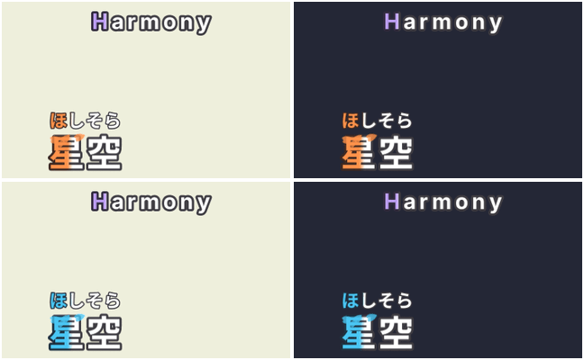
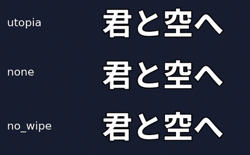
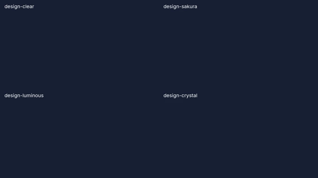

# Built-in karaoke effects

`KaraokeEffects` combines entry, highlight, exit, particles and outline flash in one
`Track.effects` entry. Each option expands into the same Scene objects and lyric
rules available to custom effects. You do not schedule each character manually.

## Show progress with a karaoke wipe

Use `Track(id="main", effects=(KaraokeEffects.duotone(),))` for a timed wipe
that changes the fill and outline together. The catalog starts with white and coral ink. Duotone derives
a contrasting outline for each state. Set `before_fill` and `after_fill` to choose the
two fills, or supply either outline explicitly. The default feather spans one
sixth of each target's authored font size (12 px on a 72 px lyric, 6 px on
a 36 px reading). Set `feather=12` to give both the same width, or
`feather=Glyph.font_size / 8` for a narrower proportional edge. The GPU hook interpolates both color pairs continuously.
For standard ASS use `feather=0` to select a hard boundary.


From left to right, the first pair uses a 36 px reading with a fixed 12 px
edge and the automatic 6 px edge. The second pair uses a 48 px reading with
12 px and 8 px edges. All four show the same frame of the hook. Only the
reading changes; the 72 px body keeps its 12 px edge.

## Share a palette across tracks

Pass `theme=KaraokeTheme(after_fill=Color.hex("#FF964A"))` to `build_lyric_scene` to
change the highlight color across catalog effects, their inherited count-ins and
following particles. A Track can override individual roles, for example
`Track(id="harmony", theme=KaraokeTheme(after_fill=CYAN), effects=(ink,))`.
A color set on the effect itself takes priority for that channel. Set
`shine` for glints, echoes and scanlines, or `scanline_color` for the band alone.
Duotone picks a light or dark tinted outline from each fill. Ordinary recipes
keep source outlines until you choose outline colors.

A Track without a catalog effect keeps the source paint. A catalog recipe
owns both sides of the color transition, including text with inline ASS
colors. Use an explicit material or `LyricHighlights.from_timing` with
segment colors for per-word palettes. Explicit cue paint wins over inheritance.
The RGB roles leave paint and glow opacity independent;
`glow=None` leaves the optional halo off.



These hook frames use an orange highlight role in the upper pair and cyan in the
lower pair. The harmony Track overrides its highlight role with violet in both.
The left and right columns show the same frame on light and dark backgrounds.

## Recommended main vocal


A narrow dark outline keeps the letter legible on a bright frame. A wider
lavender rim separates it from a dark frame. Behind both, a violet halo softens
the silhouette. Inside the letter, a 14 px transition mixes white into apricot
as the wipe crosses the word. The note reaches 112% scale just over a third of the way
through its own duration and settles back by the end. In the preview, compare
the short first note with the held final note.

```python
from kara_templater import (
    Color, Document, FadeIn, FadeOut, Glow, Layout, Line, LyricHighlights,
    LyricRule, ScalePulse, SecondaryOutline, StatePatch, Style, Track, Vec2, build_lyric_scene,
)

document = Document.create(width=640, height=360, styles=(
    Style(fontname="Sarasa UI J", fontsize=60, bold=True, outline=2, shadow=0),
))
document.records.extend((
    Line(start_time=1000, end_time=3000, text=r"{\k30}風{\k50}の{\k120}色"),
    Line(start_time=3100, end_time=4600, text=r"{\k45}空{\k35}の{\k70}音"),
))

motion = (
    LyricRule("line", "enter", FadeIn(), duration=0.18),
    LyricRule("syllable", "timing", ScalePulse(peak=1.12, peak_at=0.36)),
    LyricRule("line", "exit", FadeOut(), duration=0.22),
)
halo = Glow(Color.hex("#8054CD"), border=8, blur=4, opacity=0.75)
paint = LyricHighlights.from_timing(
    StatePatch(fill=Color.hex("#FF984A")),
    secondary_outline=SecondaryOutline(Color.hex("#D4B6FF"), width=3),
    glow=halo, base_glow=halo, hook_feather=14,
)
layout = Layout(rows=2, position=Vec2(42, 110))
scene = build_lyric_scene(document, tracks=(Track(id="main", layout=layout, effects=(paint, *motion)),))
scene.export("karaoke.hook", fps=60)
```

The preview shows the lavender rim outside a 2 px primary outline.
The track reserves the full 5 px radius for lyric layout. Adjust `hook_feather`
to change the width of the color transition and `halo.blur` to change how far
the light spreads. The sizes above accompany a 60 px font.

## Choose a highlight mode

`Track.effects` defaults to an empty tuple. Add `KaraokeEffects()` to get the
catalog defaults: a 0.30 s fade at each end of the line and a white-to-coral
wipe over each timed interval. Watch the final held syllable in these synchronized
libass renders of compiled ASS. Only the highlight mode changes.



| What you want the singer to see | What to write |
| --- | --- |
| The color travels across the word and the glyph briefly grows | `KaraokeEffects()` (default highlight mode `utopia`) |
| The color travels across the word while the glyph stays still | `KaraokeEffects(highlight="none")` |
| The entire timed unit changes color at the end of its interval | `KaraokeEffects(highlight="no_wipe")` |

To check a template, pause halfway through a long note. The wipe leaves
both colors visible; the completion switch keeps the waiting color until the unit ends.
For count-in direction see
[Choose the countdown order](text-and-cues.md#choose-the-countdown-order).

The catalog covers the animation menus in
[Karaoke Studio / Lin-K Lyrics](https://github.com/karaoke-studio/karaoke-studio):
entry, exit, highlight and decoration presets, plus outline flash. This is an independent implementation
of those visual families, not an importer or a pixel-identical replacement for
its Qt/Direct2D renderer.

## Lyric-building elements

| Studio element | Available in this library | Coverage |
| --- | --- | --- |
| Timed lyrics, independent voices, ruby and repeat readings | `Document`, `Track`, `LyricLine` | Source syllable clocks and measured body/ruby. Separate main and harmony tracks can use different styles. |
| Horizontal lyric lanes | `KaraokeRows`, `Layout.allocate` | One to eight Studio-style rotations, top/center/bottom blocks, independent row alignment and offsets. Custom allocators handle exceptional lines and lead resets. |
| Timing paint, stroke, shadow, glow, ramps and particles | `KaraokeEffects`, `LyricHighlights`, materials | The catalog implements the animation families. Appearance depends on font metrics, rendering backend and selected material. |
| Inline volume signal | `VolumeCue` | Whole-group flashes, then successive highlight-color fills. In this library the cue ends at its own boundary, even when the host lyric stays visible. |
| Floating shape lamps, count-in text and vector guide marks | `SignalCue`, `TextCue`, `CuePreset` | Seven built-in lamp shapes and custom paths. Cues can be inline or independently positioned. Shape lamps inherit the highlight palette. Their colors and size can be overridden. |
| Studio page timing and writing direction | `KaraokeRows`, `Track` | Short pages, authored section breaks, synchronized entry/exit and smart margins. Horizontal rows support right-to-left placement. Vertical tracks allocate columns from right to left, place readings beside the host and sweep downward. See [vertical Japanese lyrics](tracks.md#vertical-japanese-lyrics). |
| Role-linked signal styling and timed character replacement | Signal palettes, `Track.guide_symbols` | Signals inherit lyric colors or take an explicit palette. Leading inline volume bars share a highlight horizontal gradient with their lyric line. Independent lamps keep a fixed gradient over all countdown slots. A [vector guide](text-and-cues.md) replaces a timed marker in its lyric cell and follows the same wipe. |

See [Tracks](tracks.md), [text and cues](text-and-cues.md) and the
[signal preview](../examples/README.md#karaoke-count-ins).

## Entry and exit

| Entry | Exit | Appearance |
| --- | --- | --- |
| `none` | `none` | Keep the ordinary display lifetime |
| `fade` | `fade` | Whole-line opacity |
| `slide_in` | `slide_out` | Whole-line horizontal movement and opacity |
| `rise` | `rise` | Whole-line upward movement |
| `char_fade` | `char_fade` | Staggered character opacity. On exit the waiting and highlight colors fade together. |
| `char_drip` | `char_drip` | Vertical shear about the character’s right edge. The outline tilts with the face. |
| `spin_flip` | `spin_flip` | Scale and shear the face and outline around the character center. |
| `utopia` | `utopia` | Overshooting entrance; rotating, flipping, shrinking exit |
| `tilt_pop` | | Tilted, overshooting character entrance with the Utopia stagger and scale envelope. |
| `tracking_in` | `converge_out` | Spread letters settle; letters converge toward the measured line center |
| `wave_in` | `scatter_out` | Staggered upward arrival; seeded radial scatter |
| `stretch_in` | `stretch_out` | Each glyph stretches horizontally with five fading outline layers in the theme’s shine color. The core outline and halo widen along with the glyph. |
| `glow_in` | `glow_out` | Synchronous glow with horizontal echoes and a sharp text layer |
| `assemble_in` | `dissolve_out` | Square particles converge on points within each glyph box or scatter outward |
| `sparkle` | `sparkle` | A 14-star burst sweeps across the line, left to right on entry and right to left on exit |
| `ripple` | `ripple` | Thin hollow rings expand and fade |
| `note` | `note` | Musical notes float upward |
| `petal` | `petal` | Petals sway and turn while entering/leaving |
| `snow` | `snow` | Six-branched snowflakes with an open center |
| `snow_solid` | `snow_solid` | Six-branched snowflakes with a filled center |

Set `exit_unit="character"` to apply the chosen exit to each shaped glyph of both
the body and its readings. For example, `exit="spin_flip"` keeps the flip, with
an independent pivot and stagger slot for every glyph. Body and ruby each run
in reading order within the same transition window. `entry_unit` makes the same
choice for the entrance. Both default to `"preset"`, preserving each preset's
normal grouping. Custom rules can also target `"syllable"` or `"line"`.
Timing spans and highlight clocks are independent of this choice.

A timed space still occupies a character slot. Petals, snow and other per-character transition particles can appear there during entry and exit. Timing decorations skip spaces.

A line whose first note starts at video time zero skips the `char_fade`, `char_drip` and `spin_flip` entrances. With positive preroll, their 600 ms stagger can continue across the first note. The ordinary color wipe follows its authored clock during entry. On the next ASS tick after entry, the scanline and pulse resume at the current timing position. A short line with a following exit can shorten the entry window.

For `char_fade`, `char_drip` and `spin_flip`, all kana in one annotation enter and leave with its first main character. A single-character line finishes its exit at the display end. For `tracking_in` and `wave_in`, kana share that main character’s translation and reveal time throughout entry. Stretch, glow, spin-flip, scatter and converge transform the reading around a shared center. The stretch halos and glow echoes belong to the main text. With particle transitions the reading follows its host’s reveal or fade. A Utopia exit waits for the next visible main character to finish. A reading and the main characters it covers share this departure time.

`entry_duration` and `exit_duration` are seconds for the complete transition.
`stagger` is the fraction of that duration assigned to delay between the first
and last character (default 7/12); the remainder is each character's travel.
Studio’s character fade, drip and flip use a 600 ms window. Utopia uses 700 ms for entry (200 ms stagger and 500 ms motion) and 750 ms per departing glyph. Geometric/particle transitions accept 120–3000 ms. Whole-line fades/slides and glow transitions are synchronous. Zero duration
turns off that transition.

The entry fades to full opacity early enough that its movement stays visible.
Exit normally follows the last timing interval and zoom release. On a dense automatic track, the host can cut the zoom release short and run its transitions and their decorations faster.
At Scene zero, an entry is shortened or disabled rather than shifting timing
clocks. Explicit effect occupancy can require an additional row or cause a layout
capacity error; reduce the effect duration or adjust the allocator in that case.

Utopia exit begins after the following character finishes. The final character
uses the remaining display tail. Each departure lasts 750 ms. Snow uses a
six-branch vector with an open center. Assembly combines moving squares with
a separate glyph fade. Export these animated effects as a hook.

## Timing and decoration

| `highlight` | Behavior |
| --- | --- |
| `none` | Ordinary timed color wipe; the name follows the source menu |
| `no_wipe` | Recolor the entire timed unit at completion, including zero-duration units |
| `utopia` | Linear rise to 1.15× over the first quarter of the note (up to 100 ms), then linear release. Horizontal glyphs scale about the left edge of their cell on the baseline |
| `scanline` | Ordinary wipe with a narrow luminous leading edge |
| `utopia_scanline` | Pulse plus leading edge |
| `zoom_pulse` | Grow to 1.10× throughout the timed interval, then return to normal over 0.30 seconds |
| `zoom_pulse_scanline` | Sustained growth plus leading edge |

A repeated interval restarts the pulse; its release is shortened if the next
interval begins sooner. Multi-character units share one moving front. Ruby uses
its own measured reading width but the same source interval. In Studio spacing,
the sweep includes the primary hard outline. Glow and secondary outlines add
no travel time. At a shared note boundary the scanline reaches the previous
letter’s edge, then joins the incoming trajectory within the first 10 ms.
For example, with a zero-duration space between two words, the forward scanline
lights the last letter of the outgoing word on the boundary frame.

`decoration` accepts `none`, `twinkle`, `twinkle_classic`, `note`, `ripple`, `petal`,
`snow` and `snow_solid`. Modern twinkle drifts; classic twinkle stays in place and
breathes in size/opacity. Ornaments attach to the original glyph's parent and
move independently after birth. They are emitted from body text, not ruby.

- `particle_size`: fraction of the shaped font’s em size, default 0.40.
- Snow enters across the full line and is already falling when the line appears. Petals arrive glyph by glyph. A longer ripple exit increases the delay between characters as well as each ring’s lifetime. Later rings can reach the end of the line’s display window before they finish expanding.
- The highlight effect emits one burst per glyph onset. The defaults are three ripple rings, four petals or snowflakes, seven moving stars, or three classic stars or notes. Set `particle_rate` to choose a density per second of the timed interval. Ripple keeps its three-ring timing.
- `particle_color` accepts a single color or a pair, for example `(Color.hex("#FFB7C5"), Color.hex("#FFD7E0"))`. Two different colors split each burst between two seeded patterns. The first receives the extra particle for odd counts and the second draws on top where particles overlap. Equal colors use the single-color pattern. Particles follow the effective highlight ink by default. Set `particle_color="illustrated"` for white highlight particles, cherry-pink transition petals and icy transition snow.
- Use `"follow_before"` for the character’s waiting fill, `"follow_after"` for its highlight fill, or `"follow_mix"` for both. Each gradient contributes the RGB average of its color stops. Line-wide sparkles in a single follow mode take their color from their current horizontal position as they move across roles. In mixed mode they use the first character’s pair. This setting applies to both highlight and transition particles.
- Set `particle_layers="stroke"` with a follow color mode to inherit the character’s primary outline and hard secondary rim. Both radii scale with the moving sprite. Ripple rings keep their thin contour. Line-wide sparkles in `"follow_before"` and `"follow_after"` use only the color at their horizontal position. With a vertical fill gradient, each ripple ring changes color as it expands. For a horizontal gradient, each particle samples the fill and primary outline independently at its current position across the line. A material with only an outline ramp leaves the face in the chosen lyric color. On petals, snow, notes and stars, vertical fill and primary outline gradients rotate with the shape. The standalone hook shades both ramps continuously.
- With a follow color, `particle_layers="decor"` adds the source character’s soft glow or offset black shadow. `"all"` also includes the available hard outlines. `particle_glow_concentration` selects one, two or three glow passes at levels 0, 1 and 2. Level -1 hides the soft glow. Each pass adds five translucent outlines per decorated particle.
- `max_particles`: total entry, exit and highlight particle budget per line, default 512;
  exceeding it raises before particle factories execute.
- `seed`: deterministic variation, independent of rendering or seeking order.
- `zoom_pulse_curve_level` controls the zoom attack and release. Levels 0 and 1 are linear (Studio default 1). Levels 2–5 ease toward the peak and accelerate away from it.
- `scanline_mode="brighten"` lifts the brightness of each side’s fill and outline independently, including the stops of each side’s linear gradient. `follow_before` and `follow_after` use one side’s palette across the whole band. `scanline_brightness` sets the fraction of remaining HSV value to add (default 0.60).
- Set `scanline_material` to a gradient or per-target factory in the default color mode. For example, pass a singer’s `LyricGradient` to color both the glyph and its outline inside the band. A missing paint falls back to `scanline_color`. With horizontal role gradients,
  the resting text uses each singer’s full ink span. The static scanline samples
  the current contiguous run; a zoom-pulse scanline uses the moving glyph’s advance.
- In the default `color` mode, `scanline_color` sets the band color for both fill and outline (default theme shine, derived from the effective highlight fill). `scanline_softness` sets the inward falloff on each side, default 8 px at 1080p. Zero gives a hard band. For an ordinary single-pass wipe using solid colors or linear gradients on a shared axis and coordinate space, the soft band interpolates both the fill and outline RGB inside the original glyph silhouette. Each channel can combine up to 16 distinct stop positions across the brushes. During Utopia and zoom pulses the adjustment follows the transformed glyph, preserving the original stroke above and below its fill. More stops, mixed-axis or custom materials, overlapping passes and a separate hook feather use clipped color overlays.
- When a unit gets its timing from its reading, the main text keeps its ordinary color wipe and the bright band follows the kana. Set `ruby_scanline="both"` to also light the main text. Consecutive reading checkpoints divide the main text’s wipe into equal distances. To give each visible kana an equal share of the main wipe, set `ruby_reading_units=True`. For example, with timed parts おおぞ and ら, the main wipe reaches three quarters at their boundary. An empty part holds the main wipe in place. For a horizontal reading shared by two main glyphs, the wipe changes glyphs halfway through the reading’s progress, even when one glyph is wider. A zero-duration checkpoint colors its share of the main text immediately. A zero-duration kana at the very start of the reading stays in its waiting color on the onset frame and switches on the next ASS tick. With `no_wipe`, the whole annotated reading switches together at its end. If the first of two readings lasts 100 ms and the second lasts 400 ms, the main text reaches its midpoint at 100 ms. Within each timed reading, the wipe gives each shaped character an equal share of that interval. Utopia and zoom pulse each kana on its own interval. When a reading spans several main characters, each main character pulses as the wipe crosses it. A combining dakuten stays with its kana. An empty timed reading (`#|`) introduces a rest. The band reaches the previous kana’s edge, disappears during the rest, and returns at the next kana when timing resumes. Custom rules bound to the reading’s timing interval still receive the authored interval.
- Set `secondary_outline=SecondaryOutline(Color.hex("#473264"), width=2)` for a solid 2 px ring beyond the primary border on body text and ruby. Both sides of the wipe inherit it. Set `after_secondary_outline` to change its color or thickness under the wipe, or use a zero width to hide the highlight ring. The separate `base_glow` and `glow` layers draw behind both outlines. With a single pass, the band crosses this outer stroke during ordinary wipes and during Utopia or zoom pulses. The brightness and follow modes use the outer stroke’s own waiting and highlight colors.
- With Utopia or zoom pulse, each highlighted kana carries its own scanline across its font advance. The band disappears at the exact handoff and returns on the incoming kana. A hard scanline repaints the reading with the host character’s primary outline width. In color and role modes a matching hard secondary rim on both sides of the wipe contributes its full width too. A feathered adjustment retains the reading’s own coverage. If an opaque reading has a thicker outline than the host (including a hard secondary outline present and opaque both before and after timing), the color or role band leaves the outer ink in its lyric color when the two radii differ by at least 1.5 script pixels.

- Set `reverse_wipe=True` to sweep each timed unit from its right edge. Each reading keeps its own start time, and the scanline follows the reversed front. For example, a single timed word sweeps across all its letters from right to left. Two separately timed words still highlight in their authored order.
- Use `Track(right_to_left=True, ...)` to place the first shaped character on the right. Readings follow their hosts, inline cues reserve space on the leading side, and the built-in wipe advances to the left. Source indices and note times stay in input order. Combining this setting with `reverse_timing=True` highlights the last timed unit first, sweeping toward the right. This matches Studio’s cell layout for horizontal lyrics.
- To highlight a whole line from the last timed unit to the first, set `Track(reverse_timing=True, ...)`. The track assigns the original time windows from right to left before binding cues and animations, and sets the built-in wipe direction automatically. To select individual lines, use a predicate such as `reverse_timing=lambda source: source.actor == "reverse"`. The body text keeps its positions. As in Studio, whole-line reversal hides ruby and uses the host note for contiguous reading checkpoints. The source still contains the readings. Empty timing tags keep their pauses, including the lead-in before the first word.
- `scanline_width`: script pixels, omit for a band of 16 px at 1080p, scaled to script height. An explicit number uses script pixels. For resolution-relative and reading-relative bands, pass `scanline_width=Canvas.height / 90` or `scanline_softness=Glyph.font_size / 8`. Stretching or condensing the font with the ASS style keeps the band width and feather distance in those same pixels. During Utopia and zoom pulses the front follows the enlarged glyph while the band keeps its width in script pixels. At a syllable handoff the band can light ink on both neighboring glyphs. On horizontal lyrics, the band appears once the wipe reaches the first pixel. At a pause it reaches the previous note’s endpoint, disappears during the rest, and resumes from that endpoint when the next note begins. ASS represents these boundary frames on its centisecond clock.
- For a soft color change in the standalone GPU hook, use
  `KaraokeEffects(highlight="utopia", hook_feather=17, after_outline=Color.hex("#522432"))`.
  The final 17 script pixels behind a single-interval sweep edge mix the base
  and highlight inks inside the glyph and outline masks. Both the waiting and highlight gradients retain their colors through the feather. To carry the same transition into a halo, supply both glow
  colors with matching border, blur and opacity. For ASS, use a hard wipe on a single timing interval. Choose a scanline mode when you want an
  additional bright stripe. With a feathered hook, set `front_color` to give
  the moving edge a distinct color inside the fill and hard outline. The halo
  retains its softer color transition.
- `stroke_flash=True`: a 0.24-second pulse in the shine color along the measured body outline, beginning at the body note’s onset. The flash draws over the scanline and stays in place while the glyph pulses. Reading checkpoints do not retrigger it.

`before_fill` and `after_fill` set the color before and after the wipe reaches
each point. The same pair applies when the whole unit switches at once. `material`, `glow` and `base_glow`
accept the same fields/factories as `LyricHighlights.from_timing`, including
`LyricGradient`. The recipe owns highlight masks: do not stack another highlight
factory on the same glyphs. Additional custom effects can use `line.schedule(...)`
or ordinary `LyricRule`; overlapping writes retain the normal conflict diagnostics.

## Recommended combinations and previews



Each panel uses identical lyrics, timing, font and layout. These are actual
libass renders, not mockups. Read [recommended designs](../tutorials/karaoke-design.md#built-in-animation-combinations)
for when to use each combination.

```sh
uv run python -m examples.karaoke_catalog build/petals.hook --entry wave_in --exit petal --highlight zoom_pulse --decoration petal
```

## Output and costs

For ordinary ASS players, use hard-edged wipes, native fades and
supported transforms. Gradient text, feathered wipes, soft scanlines and
particle trajectories requiring frame callbacks raise SceneCompileError.
[Choose an output](choosing-output.md) describes the limits of both formats.

For custom timing curves, independent ornament clocks or different particle
geometry, use [animation](animation.md) and [particles](particles.md). Built-ins
are a short authoring path into those same mechanisms.

## Export a song

Keep the visual recipe in a module that accepts a prepared Document and returns
the LyricScene from `build_lyric_scene`. A separate entry point can load the lyrics
and write a standalone hook from that same scene.

```python
from kara_templater import Document

from l4ts_template import build

scene = build(Document.load("L4TS.document.ass"))
scene.export("L4TS.hook", fps=60)
```

Use `scene.ass.compile().document.save("L4TS.ass")` for ASS-compatible recipes.
[Choose an output](choosing-output.md) lists the supported strategies.
