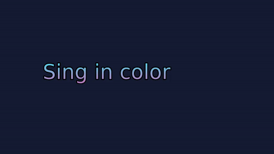

# Play and render a Hook

Export a scene as a standalone libplacebo shader hook to preview live in mpv or burn directly into video with FFmpeg. The hook bundles glyph coverage, gradients, clips, and animation parameters so the rendering machine needs neither Python nor your fonts.

## Export and render with FFmpeg



Authoring requires Python and the chosen fonts. The machine that plays or encodes the Hook only needs mpv or FFmpeg with `libplacebo` and a working Vulkan device.

For a `Track`-based lyric scene, call `scene.export("song.hook")` (60 fps by default). The self-contained example below builds a raw `Scene` with a vertical gradient and also saves a plain ASS fallback:

```python
from kara_templater import (
    Color, ColorRamp, ColorStop, Document, Lifetime, Line,
    LinearGradient, Scene, TextObject, Vec2, VisualState,
)

fallback = Document.create(width=640, height=360)
fallback.records.append(Line(
    text=r"{\an7\pos(100,140)\fs56}Sing in color", end_time=3000,
))
scene = Scene(fallback).add(TextObject(
    id="lyric", text="Sing in color", font_size=56, lifetime=Lifetime(0, 3),
    state=VisualState(position=Vec2(100, 140), border=2),
    material=LinearGradient(axis="y", space="local", fill=ColorRamp((
        ColorStop(5, Color.hex("#60E8FF")),
        ColorStop(65, Color.hex("#F075CB")),
    ))),
))
fallback.save("song.ass")
scene.export("song.hook")
```

See the full [gradient example](../../examples/gpu_gradient.py) for an animated version. To burn `song.hook` onto an opaque SDR video with a matching aspect ratio starting at song time zero:

```sh
ffmpeg -init_hw_device vulkan=vk -i video.mp4 \
  -vf 'fps=60,libplacebo=custom_shader_path=song.hook' \
  -c:v libx264 -pix_fmt yuv420p -c:a copy output.mp4
```

> [!WARNING]
> Use the Hook as the only subtitle layer. Loading the fallback `.ass` on top draws the lyrics twice. Copying audio with `-c:a copy` requires a compatible output container; otherwise re-encode with `-c:a aac`.

## Play and seek in mpv

Load the Hook directly in mpv while editing your template:

```sh
mpv --vo=gpu-next --gpu-api=vulkan --sub-auto=no --glsl-shader=song.hook video.mp4
```

mpv supplies each video frame's presentation timestamp (`PTS`) in seconds. The shader uses that timestamp to evaluate animations on the export grid, so seeking forward and backward stays accurate.

Open the original video on the same timeline as the lyrics. An interval Hook exported for 36–44 seconds draws only during 36–44 seconds of that video. Hosts that leave `PTS` unset, such as FFmpeg's `libplacebo` filter, fall back to a sequential frame counter starting at the exported `start`.

## Export a time interval

Export a slice of a song to preview a chorus quickly or to split a very large scene into smaller files:

```python
scene.export("chorus.hook", fps=60, start=36, duration=8)
```

With FFmpeg's sequential frame counter, seek the input video to the same `start` time and match the exported `fps`:

```sh
ffmpeg -init_hw_device vulkan=vk -ss 36 -i video.mp4 -t 8 \
  -vf 'fps=60,libplacebo=custom_shader_path=chorus.hook' \
  -c:v libx264 -pix_fmt yuv420p -c:a aac chorus.mp4
```

`start` must be nonnegative and aligned to the `fps` frame grid. `duration` defaults to the rest of the scene and must cover between 1 and 250,000 frames.

## Supported effects and limits

The Hook shader draws text and static paths in layer order with affine transforms, opacity, normal rectangle clips, fill and outline `LinearGradient` ramps (up to 16 stops), feathered wipes, soft scanlines, blended glows, 3D `Extrusion`, custom `ShaderMotion`, and WGSL `MaterialEffect`. See [Colour and materials](../guides/materials.md), [Animation and timing](../guides/animation.md), and [Shapes, clips and masks](../guides/geometry.md) to author those effects.

How the Hook handles common karaoke features:

- **Wipes and color bands**: adjacent wipe draws that share geometry and motion fuse into one mask pass; soft scanlines and blended glows also share one coverage pass per plane when adjacent strips partition the same moving band.
- **Animations and easings**: static draws persist until changed. Linear rectangle keyframes interpolate on the GPU. Isolated `FadeIn`, `FadeOut`, `ScalePulse`, `Slide`, `Jump`, single-easing `DriftOut`, and `Tween` over `position`, `scale`, or `opacity` export directly with `linear_rate`, `smooth_rate`, `smoother_rate`, `ease_in`, `ease_out`, `ease_in_out`, or a `ProgressCurve` (including `ProgressCurve.cubic_bezier(0.17, 0.17, 0, 1).at` with control values in 0..1).
- **Outlines and fades**: fixed outlines stay in script pixels while scaling unless you set `scale_border=True`. Fading outlined text switches masks automatically so the border does not bleed through the face.
- **Group clips**: normal screen-space `RectangleClip` masks on an `ObjectGroup` (static or `RectangleKeyframes` on the group's clock) intersect every child clip, including lyric color layers and extrusion sides.

The Hook exporter rejects `AssDialogue` records, vector clips, inverse clips, group-local clips, deformed paths (`PathObject.deform`), reference-dependent transforms, overlapping varying animations on the same node, and unsupported animation callbacks. Each failure raises `SceneCompileError` with the object ID and timestamp.

To keep playback smooth, Hook export enforces hard resource limits:

| Limit | Maximum | If exceeded |
| --- | --- | --- |
| Frame rate (`fps`) | Integer `1`–`240` | Raises `ValueError`. |
| Interval length | `250,000` frames | Split into frame-aligned intervals. |
| Gradient stops | `16` per ramp | Reduce stops on fill or outline. |
| Single coverage mask width | `2,048` px | Split or reduce object size. |
| Coverage atlas (`KARAMASK`) | `2,048 × 8,192` px | Export a shorter interval. |
| Data texture (`KARADATA`) | `2,048 × 8,192` `rgba32f` (67,108,864 floats, texel-aligned above 2²⁴) | Export a shorter interval. |
| Candidate planes per 64 × 64 px tile | `1,024` | Reuse masks or tighten motion bounds. |
| Per-frame pixel checks | `128 × min(scene area, 1920 × 1080)` | Reduce overlapping planes or split effects. |
| File size (`max_bytes`) | Optional positive integer | Checked before replacing the destination file. |

> [!TIP]
> For a custom `ShaderMotion` that moves or scales geometry, Hook export uses its Python evaluator on the frame grid to compute tile bounds. Make sure the Python callback matches the GLSL pose across the whole clip, and test custom shaders on your target GPU.

Because `.hook` files store textures as hexadecimal text, long or complex songs can produce large files. Compress `.hook` files for transfer and extract them before rendering.

## Repeated window exports

Preview hosts that scrub across a song can prepare the scene once and export multiple time windows without re-measuring glyphs:

```python
prepared = scene.prepare_hook()
defaults = prepared.material_inputs()
prepared.export_resources("preview-window", start=36, duration=8, fps=60)
```

`prepared.material_inputs()` lists every named `PaintInput` default across the whole scene, including inputs that first appear later in the song. `prepared.export_resources` writes binary `.bin` textures, `textures.json`, and `scene.frag` to a new directory while reusing the resolved hierarchy and glyph cache across requests, including backward seeks. Preview hosts can update `PaintInput` uniforms declared in `textures.json` without re-exporting.

Create a new `PreparedHook` whenever you modify the `Scene`.

## Next steps

- [Choose an output](README.md)
- [Colour and materials](../guides/materials.md)
- [Animation and timing](../guides/animation.md)
- [Troubleshooting](troubleshooting.md)
