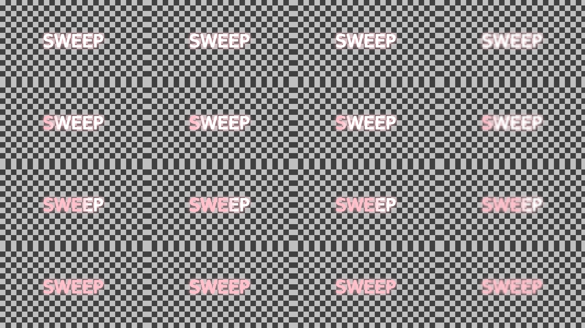

# 柔和扫色策略比较

默认使用互斥颜色分条；保留显式栅格出口。16 层透明叠加可减少事件，但本例改变抗锯齿边缘和内部颜色，不能自动替换分条。着色合成后再模糊是单独的视觉效果。

固定示例为 `examples.scene_sweep_strategies`：320×180、2 秒、10 Hz、44 px SWEEP、24 px 白到粉过渡、恒定整字辉光。四模式使用相同输入和采样网格，全部输出标准 ASS。实验配置不替换 [E11 验收](e11-acceptance.md) 的画布、帧率及质量要求。

复现命令：

```sh
uv run python -m tools.compare_sweep_strategies build/ass-engine/sweep-strategies-comparison
```

[原始报告](sweep-strategies-validation.json)记录字体、背景、输出哈希与真实 FFmpeg/libass 版本。四背景为黑、白、棋盘和 RGB 渐变；每种策略各渲染 20 个共享中点（50–1950 ms），共 320 帧，产生 240 项相对分条的比较。

| 策略 | 事件 / 活动峰值 | ASS 字节 | 整帧最大 RGB 差 | 不透明内部最大 RGB 差 |
| --- | ---: | ---: | ---: | ---: |
| bands 分条 | 419 / 27 | 178330 | 基准 | 基准 |
| layers 16 层 | 290 / 18 | 124882 | 85/255 | 7/255 |
| raster 整组 RGBA | 51887 / 4365 | 17804049 | 2/255 | 0 |
| diffused 着色后模糊 | 83979 / 7022 | 28826025 | 116/255 | 51/255 |

内部掩膜来自基准的不透明覆盖，并向内收缩一像素；此处不使用双方共同内部掩膜，避免把候选方案造成的覆盖损失排除。所有颜色的红通道均为 255，因此黑背景红通道可测量最终有效覆盖 alpha（含渲染取整）。

| 相对分条的覆盖变化 | 最大损失 | 最大增加 | 基准内部最大损失 |
| --- | ---: | ---: | ---: |
| layers | 0 | 85/255 | 0 |
| raster | 2/255 | 1/255 | 0 |
| diffused | 106/255 | 70/255 | 46/255 |

叠层没有产生额外透明缝隙，但重复绘制部分覆盖像素增加了边缘不透明度，预览中表现为更厚、更亮的轮廓；即使理想内部累计 alpha 用 1/(N-i) 权重校正，仍有颜色阶梯和量化差异。该实现不满足等价替换要求。

零额外模糊的栅格方案在全部测试背景与时刻内最多相差 2/255，基准内部没有覆盖损失；没有检测到超过该舍入级别的新增接缝。代价是约 100 倍文件体积和 124 倍事件数。此结果验证本例实际输出相对分条的保持程度，并非独立证明任意 RGBA 重建算法，也不证明任意字号、变换或分辨率下的接缝上界。

`diffused` 对整组施加 2 px 模糊，边缘外扩且细笔画透明度下降，预览可见字形变软。这符合不同的作者意图；不能把它用于无损优化或默认自动降级。

本机单次四背景共 80 帧的渲染进程耗时分别约 0.26、0.30、1.02、1.49 秒，包含进程启动和图像读取，仅作成本线索，不是跨机器性能保证。栅格例显式采用 250000 事件、10000 活动事件、128 MiB 预算，普通场景预算不变。



列顺序为 bands、layers、raster、diffused；行时间为 350、750、1150、1750 ms。预览已检查。报告中的 `remaining` 是生成时的研究提示：默认策略解释由本文完成；独立 RGBA 参考不属于此次相对策略实验的证明范围，相关通用栅格实现仍由其专门测试覆盖。
