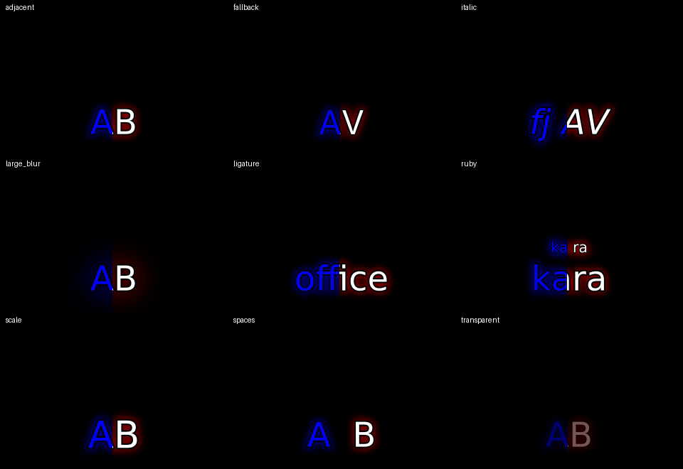
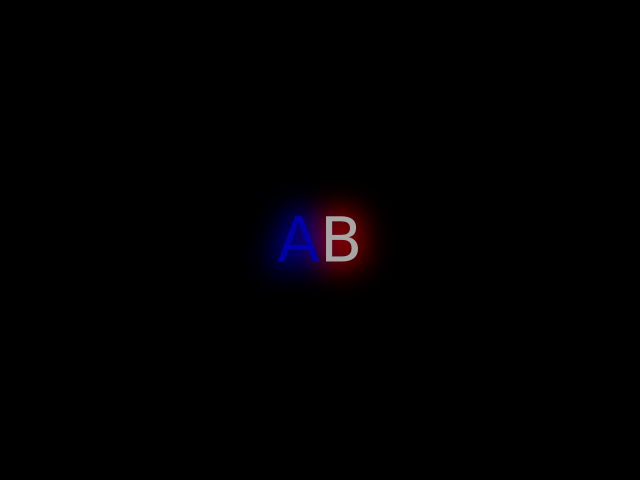
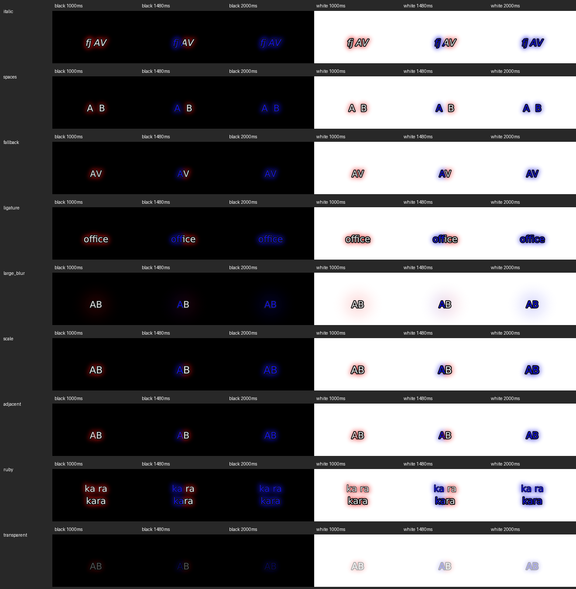

# Track 后端合成与边界审计

本文按审计阶段保留早期复现、缺陷和修复过程；早期“当前/待实现”描述对应当时阶段。最终实现与能力边界以 [逐项验收](track-effects-acceptance.md) 为准。


本记录证明了当前实现的行为和局限，不是理想材质合成的完成声明。复现：

```sh
python -m tools.validate_track_matrix /tmp/kara-track-matrix
```

报告见 [track-matrix-validation.json](track-matrix-validation.json)。工具保存每个案例的 ASS、黑白背景各 8 个时刻、静态 before/after 参考、独立整行文字参考、ffmpeg 日志和拼图。报告包含 ASS/帧/字体 SHA256、字体选择、事件数、编译与渲染用时。单线程 ffmpeg 实际渲染 300 帧再抽取 8 帧；渲染用时包含启动、解码、ASS 渲染与 PNG 写入，不能当作纯逐帧 libass 性能。

## 测量与渲染边界

- 布局 advance 用于演唱进度，不等于实际 ink 边界；斜体、空格与连写不能混用两者。
- 字形绘制边界还包含描边和 blur。当前实现使用描边宽度及 `width + 4*radius` 的有限工作边界；它不是无限尾部的严格误差证明。
- 动态描边与 blur 的已知端点参与边界计算；未知几何回调要求 PaintBounds，并在采样时检查上限。这个值域声明不修改演唱时间。
- 几何变换与 clip 使用同一个最终仿射结果；多个中心的组合转为受预算约束的采样。

本次直接调用原生塑形记录了实际字形。缺失字体场景选择 Sarasa UI SC Regular，报告保存该机器所选 TTC 的散列；不是跨平台固定回退保证。`office` 输出 4 个轮廓，包含 `ffi` 连写字形 5044，确实覆盖了连写而非只测试六个独立字母。

## libass 能力来源

仓库固定源码在 `vendor/libass-0.17.5.tar.gz`，原有补丁集中于 metrics/字形来源；下文原型新增了独立覆盖率 blur API，但没有改变标准 ASS 标签的执行顺序。解包后 `libass/ass_render.c` 的 `render_and_combine_glyphs` 构造组合位图，并调用 `ass_synth_blur`；随后 `render_text` 才调用 `render_glyph` 进行空间裁剪，最后调用 `blend_vector_clip`。`libass/ass_bitmap.c` 的 `ass_synth_blur` 调用高斯模糊。

因此，改变矩形 clip 或换成矢量 clip，都不会让裁剪先于 blur。提高时间采样频率也不会改变这一空间顺序。延长 lead/tail 或隐藏 padding 只能改变扫过时刻，不能实现“按字形区域选择材质后再模糊”。编译器已针对不同描边/辉光的空间交界返回包含目标和时间区间的能力诊断。

## 实测矩阵



每个案例分别测试黑、白背景。基础几何用无描边/无 blur 的 Track 输出，与直接写入完整原文的原生 ASS 参考比较；该参考不经过 Track 的字符拆分。九例基础几何最大通道误差均为 **0**。

扫色前 500 ms、完成时 2000 ms、完成后 2500 ms，与对应静态材质参考逐像素相同。但 1000 ms 刚开始扫色时，字形左侧已经绘制的辉光会被提前染色：

| 案例 | 起点最大通道误差 /255 | 事件数 | ASS 字节 | 编译 ms | 黑底渲染 ms |
| --- | ---: | ---: | ---: | ---: | ---: |
| 斜体 fj AV | 46 | 32 | 9692 | 1.96 | 107.91 |
| 首尾和连续空格 | 0 | 16 | 5095 | 1.37 | 83.47 |
| 字体回退 | 60 | 16 | 5096 | 1.09 | 88.63 |
| office 连写 | 63 | 32 | 9707 | 1.80 | 102.40 |
| radius=24 | 32 | 16 | 5103 | 1.12 | 146.12 |
| 动态缩放 | 63 | 400 | 132415 | 13.05 | 102.06 |
| 相邻音节 | 60 | 16 | 5087 | 1.14 | 87.10 |
| 正文和注音 | 73 | 40 | 11940 | 2.12 | 112.22 |
| opacity=0.35 | 22 | 16 | 5095 | 1.14 | 83.80 |

这些是一次实测值，不是时间上界或通用误差容限。中间帧可见大 blur 的竖直截断，与代码顺序一致。黑白背景比较验证了当前输出在端点与当前静态材质输出的一致性；静态材质仍由多绘制层组成，因此这个比较**不能证明**整个文字组已经实现“先离屏合成，再统一施加 alpha”。理想透明合成还需要独立参考和实现。

## 采样与成本解释

动态缩放案例使用 `scale = 1 + 0.2*p`，持续 3000 ms，默认 40 ms 保持采样。相对连续函数，采样保持带来的缩放值偏差小于 `0.2*40/3000 ≈ 0.002667`；该数值不包含 ASS 光栅取整、clip 整数化和形状覆盖误差。静态 before/after 对照使用相同采样时钟，不能将其零差异宣称为连续动画的零误差。任意 lambda 无法由采样间隔自动推出误差上限。

普通两字案例 16 个事件；该动态案例 400 个事件，文件从约 5 KB 增至 132 KB。库在执行回调前提供预算预估，并在实际输出时执行事件上限；预算预估不是最终事件数的数学上界。

layered_glow 的迁移后基线为 302 事件/88 计划图层，旧示例为 389 事件。直接配置和子类版本输出相同，13 帧回归也相同，见 [复验报告](track-effects-validation-current.json)。视觉差异来自移除两套独立 Halo、采用文字材质扫色及新的 release 时序，不代表与旧版像素等价，也不代表已解决辉光硬裁剪。

## 后续实现验收条件

当前报告完成能力审计、最小复现和成本基线。P2 的自然扩散与完整透明合成仍未满足：

1. 对填充、描边、辉光分别在 blur 前分配材质，保持原字形几何；不能用对拆开的字形重新描边产生内部接缝。
2. 分区材质按预乘 alpha 合成，整体透明度最后施加一次；不能用两套完整文字的 source-over 近似相加。
3. 若通过栅格预合成再编码 ASS 实现，必须限定采样、尺寸、像素/路径和事件预算，预检可拒绝超预算任务；不能将昂贵编码隐藏为无上限操作。
4. 黑白背景上的起点、终点、颜色前沿、透明边缘均要与独立参考比较；包含动态 blur、不同中心缩放与注音。精度与输出成本一起报告。

单纯保留现有诊断或调整完成标记不足以满足这部分原始语义。现有原生路径可以作为明确的能力受限路径保留，但不能冒充理想合成。

## 预模糊材质后端原型

新增 `native/metrics.cpp` 的独立栅格渲染器与 `vendor/006-libass-coverage-blur.patch`。前者输出有坐标、类型、颜色和紧密排列覆盖率数据的位图副本，不改变文字测量缓存。后者复用 libass 原来的半径量化与高斯核，并在分配输入/过滤工作区前检查预算；0..100 ASS 像素半径之外明确拒绝，不静默截断。

`_material_raster.paint_coverage` 先将字形覆盖率分为材质区域，再对预乘 RGB 与 alpha 四个平面分别模糊。alpha 的结果不随颜色区域数增加。分区使用像素横向交叠比例；输入和过滤平面为 8 位，有量化误差。RasterCanvas 在合成所有绘制层之后施加组透明度。基础描边和辉光使用原完整字形的覆盖率，避免对切开的字形重新描边产生内部边。

`_raster.encode_frame` 将结果编码成不重叠的整数矩形，合并相邻行上的相同颜色跨度。单独画一像素矢量矩形会产生最高 4/255 的边缘误差，因此实际输出使用足够大的实色块加精确整数矩形 clip。这里的 clip 作用于已经完成材质、blur 和 alpha 合成的像素，不会再次裁掉辉光颜色前沿。

```sh
python -m tools.validate_material_raster /tmp/kara-material-raster
```



[单帧报告](material-raster-validation.json) 记录了这个原型的成本与误差。原生 RGBA 编码往返误差为零；ffmpeg 独立渲染对黑白背景参考的最大通道误差均为 1/255。该夹具显式使用 `YCbCr Matrix: None`，排除视频色彩矩阵转换；不代表库会改写输入文档的色彩矩阵。若使用默认 TV-range 转换，相对直接 RGB 参考会出现约 13/255 的差异，需要区分色彩转换与编码误差。

无损编码成本很高：两个字符的一帧有 12,598 个事件、2,658,696 字节。原型约 73 ms 合成、69 ms 编码、142 ms 原生重渲染；这些为一次本机测量。默认 10,000 事件预算会明确拒绝该场景；验证工具显式提高到 50,000，才生成此帧。像素、复制的位图数量、路径字符和最终事件均设有限额；栅格提取的这些预算不等同于对 libass 内部缓存或解析过程的硬内存上限。原生 ASS 输入解析还限定 16 MiB 脚本大小。

运行时测试覆盖颜色/alpha 无损往返、单独组透明度、坐标裁切、预算拒绝、位图所有权与测量缓存隔离。0、0.1、1、3、10、50、100 的模糊半径与直接原生 ASS 输出逐像素一致。分区原型验证交界两侧都有两种颜色贡献，同时 alpha 与单色模糊参考完全相同。

后续已通过 `OutputSettings(raster=RasterSettings())` 绑定 Track 时间轴、来源、动态材质、不同区域半径及动画预算，支持相邻事件合并和已知线性组透明度的原生表达。当前 Track 默认输出仍采用前文的原生裁剪路径；局部透明度组合和完整动态视觉矩阵尚未完成，不能将此单帧证据当作 P2 完整完成证明。


## 精确空间边界与整段预算复验

补丁增加 `ass_blur_padding`，与实际 blur 一样量化半径，然后由 `find_best_method` 的 radius/level 推导空间范围。左扩展为 `((radius + 4) << level) - 4`；扣除左扩展后的右扩展受输出位图对齐影响，其最大值为 `((radius + 5) << level) - 5`。上下方向同理。该查询不分配位图，Track 使用它生成视口外工作区；不再以 `4*r + 32` 估算核支持，也不改变 sweep 时间。

原生测试覆盖八种输入半径（含零与量化到零的极小半径），每种遍历 64 个宽高对齐组合，实测每一侧扩展均不超过查询值，并且能达到该上界。四个视口边缘的文字/辉光与扩大画布后裁切的参考逐像素一致。输入无效半径被明确拒绝。

`max_output_chars` 现由一次 render 中全部栅格计划共享，计算生成事件 Text 字段字符，不包含文件头或事件元数据；`max_events` 仍限制全部生成事件。测试用两行各自低于字符预算、合计超过预算的输入，验证第二行报错，保留来源信息且不修改输入。完整 layered_glow 的成本限制仍见实施记录，未因这些修复而宣称成本达标。

## Track 栅格矩阵、字体修复和色度限制

实际九例矩阵暴露了 mask 临时样式的序列化缺陷：原先只放入 Underline/StrikeOut 的 fields 字典，使 `Style.serialize()` 输出缺少字体等列，libass 回退到默认字体。现按完整 STYLE_FORMAT 构造字段并保留正文的显式字体属性；新增六例与独立整行 ASS 的逐像素测试覆盖斜体、空格和连写，避免仅比较同一错误后端的前后状态。

复现命令：

```sh
python -m tools.validate_track_matrix /tmp/kara-track-raster-matrix-rgb --raster --rgb --font-size 24
python -m tools.validate_track_matrix /tmp/kara-track-raster-matrix-fixed --raster --font-size 24
```

[RGB 报告](track-raster-rgb-validation.json) 包含九例、八个时刻和黑白两种背景。独立整行文字几何、扫色起点、前后静态材质端点的最大通道误差均为零。中间帧已捕获并检查，图中可见前沿两侧的模糊扩散；这不等于中间帧已全部与独立材质合成器定量比对。动态材质组合和局部透明度的完整验收仍需继续。



成本未隐藏：该矩阵使用 24px 字号、3 秒窗口。扫色输出为 18,490–110,821 个事件、约 3.45–20.72 MB，本机编译约 0.85–4.24 秒，具体环境与每例耗时见报告。验证工具显式将总事件预算设为 2,000,000、Text 字符预算设为 256,000,000。临时像素样式已去除重复默认标签；编码测试字符数下降超过 30%，像素不变。实际完整 layered_glow 在字体修复和精简后仍超过默认 64,000,000 Text 字符预算；这不是实用成本验收通过。

[YUV420 报告](track-raster-yuv420-validation.json) 保留了不可忽略的另一项限制：相同 RGBA 像素在 ffmpeg YUV420 字幕混合时，会因相邻像素矩形对同一低分辨率色度样本多次更新而产生分组相关色边。九例完成态最大差为 56/255。对同一个 spaces 场景分别以 rgb24、yuv444p、yuv420p 混合，完成态差异依次为 0、0、49/255。这不是字体修复后的文字几何错误，也不能用 RGB 报告覆盖它。

栅格结果现在明确提示 RGB/完整色度合成要求；库不能控制普通播放器的字幕混合像素格式。需要精确结果时，先在 RGB 或 YUV444 上混合字幕，再将最终帧转换为交付格式。默认原生文字路径不受这次输出策略变化影响；尚未将栅格路径设为默认或宣称普通 YUV420 播放已达到相同精度。


## 最终独立参考与完整成本

原生文字路径也已将 `border + 4*blur` 估算替换为量化后的实际有限核边界。0.1、1、10、50 四种半径的完整字形对照逐像素一致，新原生 layered_glow 的 13 帧保持重构基线不变；硬裁剪和按绘制层应用 alpha 的能力限制仍明确诊断。

独立材质验证新增两组证据：动态 blur/scale、正文/注音组件透明度和整组透明度，对直接原生 ASS 参考在黑白背景上不超过 2/255；不同模糊半径的扫色中间帧，对独立 Pillow 高斯近似不超过 4/255。测试没有读取 Track 私有几何、材质分区或合成结果作为参考。

新增默认关闭的空间量化 `max_channel_error`，分别分配 RGB 与 alpha 预算。对任意不透明背景，其显示颜色误差由两部分预算之和界定，所有 8 位颜色/alpha 组合经过测试；不包含 ASS 变换、时间采样和下游视频色彩转换误差。

完整 layered_glow 已在显式 4/255 颜色误差和 256,000,000 Text 字符预算下生成并渲染 13 帧，不再只依赖单帧原型。结果约 113 MB，默认字符预算仍拒绝。旧双 Halo、新原生文字与新栅格的有意视觉差异、事件数量、编译/渲染成本和时间保持误差，分别见 [成本报告](track-raster-cost-validation.json)、[采样报告](track-raster-sampling-validation.json) 和 [验收记录](track-effects-acceptance.md)。完整输出对保持时刻的无损快照最高差 4/255，但保持状态对精确时刻的局部差最高 170/255；两者没有混为同一个精度承诺。


### 最终透明度补齐

先前记录的不同材质/范围/根组 alpha 能力错误已由覆盖率加权合成替代。未加权覆盖率负责组件内部遮挡，加权颜色与 alpha 携带局部、音节和组权重，逐层结束作用域。详见 `_coverage_stack.py`、`test_coverage_stack.py` 和 `test_track_material_reference.py`。均匀透明度仍走原有单平面路径。

移除已结束 alpha 变换同时解决相对 t2=0 的 ASS 语义问题，完整示例现在约 100 MB，而非之前的 113 MB；默认字符预算下成功，事件预算仍显式提高。当前成本和误差以 `track-raster-cost-validation.json`、`track-raster-sampling-validation.json` 为准，前面的数值保留为阶段记录。
