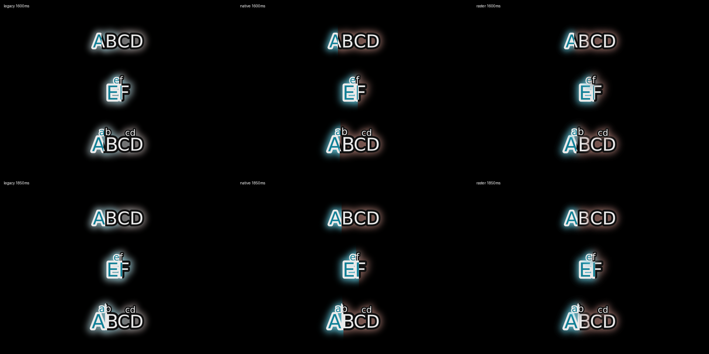

# Track 重构验收

本文件按 `track-effects-plan.md` 的原始条目逐项核对实现、可执行语法、视觉结果和成本。后端能力限制单独列出；不能把原生文字路径的诊断当作自然辉光的像素证明，也不能把颜色误差预算当作时间误差上界。最终质量命令结果见末尾。

## 原始计划与证据

编号为各 P 阶段 TODO 的原顺序。

| 条目 | 验收证据 |
| --- | --- |
| P0.1 职责审计 | 实施记录的模块表和依赖图；track.py、components.py、motion.py、_track_compiler.py、render.py 分别承担声明、组件、动画、绑定和输出 |
| P0.2 显式构造与继承 | tests/test_tracks.py 的 ordinary_subclasses；tests/typing/tracks.py；实例/子类两份 layered_glow CLI 输出一致 |
| P0.3 动画参数、事件与返回类型 | tests/typing/tracks.py 的 Accent、assert_type 与错误参数用例；tests/test_typing.py 逐个检查公开构造/方法的注解和 Any |
| P0.4 替换、级联、禁用、隔离 | immutable_style_replace、stylesheet_and_explicit_range_overrides、explicit_items_and_repeated_render；组件逐绑定副本，样式为不可变值 |
| P0.5 Overlay 类型化角色 | overlay_role_override_disable_and_target_validation；TextStyle 不能传入 Overlay，Ruby 缺失时显式引用报错 |
| P0.6 行位与跨 Track | tests/test_track_groups.py；SingleLine/DoubleLine 默认位置、容量与扩展窗口测试 |
| P0.7 libass 能力审计 | track-backend-audit.md；原生矩阵、RGB/YUV420 矩阵、原生核逐像素测试和完整成本报告 |
| P1.1 Track 渲染入口 | render_karaoke(tracks=...)、CLI 的 tracks 导出加载；parsed ASS 和显式 KaraokeItem 均覆盖 |
| P1.2 直接配置与子类共同路径 | tests/test_cli.py 的 direct_and_subclass_examples_are_equivalent；两者均进入 bind_track，无 compose/configure 阶段 |
| P1.3 绑定隔离与来源策略 | unmatched_sources_preserved_and_restored、dispatch_rejects_multiple_matches、repeated_render_are_isolated |
| P1.4 两类 Document 与显式输入 | three_colors_from_code_on_parsed_and_constructed_documents 的两个参数分支；显式 items 和 rerender 测试 |
| P1.5 入口迁移/互斥 | track-migration.md；effect/tracks 同时传入或同时缺失会报错 |
| P2.1 正文/注音/范围级联 | TextSpan、RubySpan 与 StyleSheet 测试；字体几何在排版前解析，不允许局部样式悄悄重排字形簇 |
| P2.2 Overlay/Sweep 共享几何 | test_track_hierarchy.py 的一次仿射变换和跟随测试；Overlay 只接受绘制字段 |
| P2.3 共用样式、局部覆盖与独立时钟 | 正文/注音不同 stroke/blur 宽度保留；ruby_sweep_uses_own_segment_clock、局部禁用和复用测试 |
| P2.4 blur、透明合成和动态边界 | 原生/栅格路径均查询量化后的 libass 核边界；四边裁切对照逐像素一致；独立原生参考验证动态 blur/scale 与组件/整组 alpha，独立 Pillow 高斯参考验证不同半径和不同透明度的扫色中间帧；范围 alpha、选择性组/音节 alpha、Ruby 退出跟随均有像素对照，coverage stack 有解析公式测试 |
| P2.5 有预算的方案或明确诊断 | RasterSettings、预检回调、单帧/全局事件及字符限制、无部分输出测试；原生硬裁剪/分层 alpha、栅格不支持的旋转/描边模式与 YUV420 限制明确诊断；旧 Effect/Halo 的独立装饰和示例保留并由完整测试覆盖 |
| P2.6 排版占位 | tests/test_tracks.py、test_track_groups.py 覆盖默认位置、共享容量、延长后重新占位、来源顺序与重复匹配 |
| P3.1 独立 Animation 与统一绑定 | motion.py 返回统一属性/材质规则，不依赖具体 Track 子类或 ASS 绘制；AnimationContext 与 @on 类型用例 |
| P3.2 普通动画预设 | FadeInAnimation、FadeOutAnimation、SingingPulseAnimation 直接构造、类默认替换及实际输出测试 |
| P3.3 通用描述与组合 | Keyframes、Envelope、lambda、Sequence/Parallel、递归嵌套、release 参与排程的测试 |
| P3.4 冲突、能力、层级和跟随校验 | multiple_animations_conflict、material_conflicts、sweep_and_material_writes、target_capabilities；test_track_hierarchy.py；栅格静态能力失败先于用户采样函数，运行时边界失败带来源 |
| P3.5 生命周期边界 | 原显示时钟、extend_display、短/零时长、重复目标与重复触发、末段重叠和回落测试 |
| P4.1 layered_glow 两种写法 | examples/layered_glow.py 与 layered_glow_classes.py；CLI 逐字节一致；完整脚本实际生成并捕获 13 帧 |
| P4.2 Lead/K1/K2 与行排版 | fixture 三种 style 的实际输出；SingleLine/DoubleLine/TrackGroup 测试；库内不特判这些名称 |
| P4.3 共享配置与覆盖 | 子类参数、不可变样式派生、逐 Track/逐行副本及重复渲染测试 |
| P4.4 共用扫色和不同几何 | role override、Ruby 跟随、正文/注音绘制宽度、禁用及真实视觉矩阵 |
| P4.5 三色交替 | examples/track_colors.py；parsed/constructed Document 的同一行三色参数化测试，未增加逐行样式输入字段 |
| P4.6 视觉矩阵 | 九例 × 八时刻 × 黑白背景；RGB 的起点/端点和独立文字几何误差为零；YUV420 差异单独保留，没有删除失败证据 |
| P4.7 视觉差异/成本/采样 | 下文三个版本的完整成本、13 帧捕获、量化误差和保持采样误差；旧脚本取自 61c86e6 并在本轮重跑 |
| P5.1 公开导出和文档 | README、tracks.md、track-migration.md、计划 Python 示例实际执行；tests/test_typing.py 检查公开注解；新配置、诊断和预算表与实现一致 |
| P5.2 运行时/视觉/类型用例 | test_tracks、test_track_groups、test_track_hierarchy、test_track_materials、test_raster、test_track_raster、test_track_material_reference、tests/typing/tracks.py |
| P5.3 严格质量检查 | Ruff/ty 配置未放宽；完整测试和从 sdist 构建、安装 wheel 后的测试见最终结果 |
| P5.4 本轮独立记录 | 本文件、后端审计及新增 JSON/PNG 报告；历史 513/576 等结果仅保留为实施过程，不用作最终完成依据 |

## 视觉与成本

完整输入为 tests/fixtures/layered_glow.ass，640×480、56px 源样式、4 秒窗口。本轮重跑旧脚本、新 Track 原生路径及新 Track 栅格路径，使用同一字体、输入和 RGB 字幕合成。旧脚本来自提交 61c86e6 的 examples/layered_glow.py，通过保留的 Effect 入口运行。

| 版本 | 事件 | ASS 大小 | 编译时间 | 捕获 13 帧的渲染时间 |
| --- | ---: | ---: | ---: | ---: |
| 旧 Effect/双 Halo | 389 | 126,221 B | 约 0.023 s | 约 1.12 s |
| Track 原生文字 | 302 | 99,062 B | 约 0.025 s | 约 0.68 s |
| Track 栅格，颜色误差 4/255 | 464,670 | 100,265,032 B | 约 50.49 s | 约 18.07 s |

时间为本机测量，不是跨设备性能承诺。栅格实验显式使用 1,000,000 事件预算，保留默认 64,000,000 Text 字符预算。移除已结束的 alpha 变换标签后，完整输出约 55.77 M Text 字符；原先约 68.26 M 字符的拒绝记录作为优化前实验保留。完整数据、散列及字体/渲染器信息见 [成本报告](track-raster-cost-validation.json)。没有提高库的默认预算来隐藏成本，也没有自动启用有损量化。

有意的视觉变化：旧示例叠加 base/sung 两套独立 Halo；新示例只有文字自身的 blur，扫色选择其材质。去掉 padding/lead/tail 测量补偿，保留源演唱时钟；缩放使用显式 attack=80、release=160，回落可越过 singing.end。原生 Track 的不同颜色辉光仍有硬边界；栅格路径先分配材质再模糊，前沿自然混色，并在合成后施加组透明度。三者并非像素等价。

[采样报告](track-raster-sampling-validation.json) 将两类误差分开：

- 完整有损输出对照相同保持时刻的无损快照，13 帧最大通道差不超过 4/255。
- 相同渲染器的保持状态对照精确时刻状态，1300/1700/1850 ms 的最大局部通道差为 158/170/133，平均通道差均小于 0.058；这些时刻有 10–20 ms 的状态保持。大差异集中在移动的颜色/文字边缘，不能用小的平均值宣称不存在。
- 对齐采样点的帧一致。该比较仅量化时间保持，不是独立材质算法参考；独立参考由 tests/test_track_material_reference.py 提供。动态 blur/scale/alpha 对直接原生 ASS 参考不超过 2/255；不同半径的扫色对独立 Pillow 高斯近似不超过 4/255。

要减少时间保持，应显式缩小 SamplingSettings.step_ms 并承担更高成本。任意 lambda 不具备自动连续性上界；max_channel_error 不包含时间误差。

## 按原计划保留的能力边界

原计划 P2 明确要求“对 ASS 表达能力不足提供受预算限制的方案或明确诊断”。验收据此包含成功输出和拒绝/诊断两条路径，不声称所有 ASS 播放器都能无损实现任意合成：

- 默认原生文字路径有不同材质的描边/辉光硬裁剪，以及绘制层分别应用 alpha 的限制；结果明确诊断。栅格路径实现预模糊材质分配和合成后的 alpha，必须显式选择。
- 栅格支持正文/注音、同一组件的不同范围、基础/覆盖材质及不同动画目标的透明度。遮挡使用所属层级的未加权覆盖率，透明度只在该层级结束时生效；不同颜色的贡献按各自权重混合。均匀透明度保留单平面快速路径；不同值不会改变源组件的分组身份。
- 栅格对非零样式 Angle、非普通 BorderStyle、缩放后大于 100 的 ASS blur 半径明确报错；尺寸、采样、缓存、事件和字符预算也会拒绝过大输出。
- RGB/YUV444 上的像素验证不能代表 YUV420 字幕混合。[YUV420 报告](track-raster-yuv420-validation.json) 保留最高 56/255 的分块色边；需要精确结果时先以完整色度混合，再转换交付视频格式。
- 旧 Effect/Halo、独立装饰、逐字扫过事件及并行区域接口保留；Track 与旧入口互斥，不伪造等价迁移。详见迁移表。

## 最终质量结果

本机 Linux x86_64 / CPython 3.14 验证结果：

- `ruff check .`、`ty check`、`git diff --check` 均通过，未放宽检查规则。
- 工作树完整测试 **664 passed**；文档与 README 示例 **4 passed**，包含在完整测试中。
- sdist 构建成功；从解压后的 sdist 重建原生扩展与 wheel 成功；两份发行文件的 `twine check --strict` 通过。
- wheel 安装到隔离目录后，从不含源码包的测试目录执行 **664 passed**，无跳过；已确认 Python 模块及原生扩展均来自该安装目录。
- 工作树、sdist 和 wheel 的 44 个 Python/stub/py.typed 文件一致；9 个原生构建输入与工作树一致。文档可执行代码与发行包一致，验收状态文字在检查结束后填写。

散列与测试耗时见 [质量报告](track-quality-validation.json)。没有声称本机执行了 Windows 构建。
