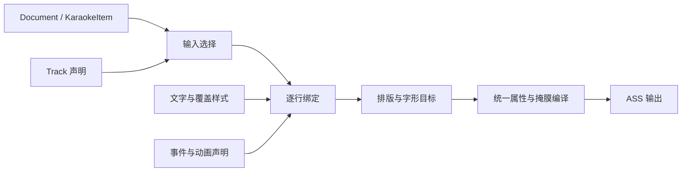

# Track 重构实施记录

以下按实施阶段保留当时的结果与未完成项，不将旧测试计数作为当前完成证明。当前接口见 [使用说明](tracks.md)，最终逐项证据和后端能力边界见 [验收记录](track-effects-acceptance.md)。

## 模块与依赖

| 模块 | 职责 |
| --- | --- |
| text_style.py | 不可变 TextStyle/PaintStyle/Blur/TextSpan、部分绘制样式解析 |
| components.py | 从旧 effect.py 提取的文字/装饰组件；兼容旧构造形式 |
| matching.py | 输入 LineMatch、否定匹配和类型化 SourceMatch |
| track.py | Track/Overlay 的显式构造与组合 |
| track_layout.py | 无共享运行状态的单行/双行分配与位置变换 |
| motion.py | 独立 Animation、事件、Animate、Envelope、序列/并行、内置预设 |
| _track_compiler.py | 每行绑定、范围绘制、角色覆盖、原时间锚点和输出窗口、属性编译适配 |
| render.py | Track 分派、未匹配源保留、与旧 effect 入口互斥、输出所有权 |



新路径不实例化 Effect，也不调用 compose/configure。已有输出编译、冲突分析、原生属性降低和采样机制继续复用。普通组件与 Animation 采用显式 __init__，不引入自动字段收集或构造签名生成。@on 保留被装饰方法的具体返回类型。

## 已验证行为

- 直接 Body(style=...)、Overlay(...)、Track(...) 与显式子类构造均可执行。
- 公共覆盖样式分别以正文/注音的自身几何为基底；支持角色局部覆盖、禁用和不可变常量复用。
- 单行/双行分配使用包含动画延长的显示窗口；未指定 layout 时保持输入位置。
- Envelope 支持独立 attack/release 与 lambda 曲线；尾段可超出 singing。短音节和零时长均有测试。
- Display 组动画覆盖正文及注音，不依赖注音是否跟随音节；覆盖层复用同一次属性求值。
- 用户提供的 Display 时间关键帧先绑定到原窗口，再处理 extend_display，避免延长输出改变原动画时钟。
- 动画过滤、继承方法覆盖、Sequence/Parallel 与同属性冲突检测通过测试。
- parsed ASS、直接构造 Document 和显式 KaraokeItem 均可使用 Track。两种 Document 路径验证一行三色交替，不修改 ASS 协议。
- 重复输入匹配报错；未匹配对白保留；修改 Track 选择后重渲染会恢复不再处理的对白。
- 新增正反类型契约检查构造参数、事件、具体返回类型、错误参数与回调类型。未放宽 Ruff/ty 配置。

## 验证命令与证据

```sh
ruff check .
ty check
python -m pytest -q
python -m examples.track_colors /tmp/kara-track-colors.ass
python -m tools.capture_layered_glow /tmp/kara-track-validation
```

本轮完整测试：513 passed。三色示例：36 个事件。layered_glow：302 个事件、88 个计划图层，ffmpeg/libass 生成 13 帧；报告记录输入和字体 SHA256、渲染器版本、帧像素散列与诊断，见 [本轮渲染报告](track-effects-validation.json)。实际查看了 1600 ms 中间帧，观察到预期扫色与仍存在的硬裁剪边界。

旧示例的 CLI 基准为 389 个事件，新基准是 302 个；CLI 重复渲染仍逐字节一致。该数量变化来自移除双 Halo、采用文字材质扫色及新的 release 时间，不表示像素等价或已提高视觉精度。

## 尚未完成

ASS 当前实现仍会在空间边界硬裁剪不同的描边/辉光。诊断明确指出“先合成外观再 blur”不可由当前输出路径实现，不再建议用户增加 padding。13 帧报告是当前实现记录，不是理想辉光合成的验收报告。

该阶段结束时，Ruby 范围分色、时间驱动颜色/blur、不同中心变换、嵌套组合等仍未完成；后续进展见下文。跨 Track 布局容器、全字体精度矩阵仍未完成。旧 Effect、StyleSheet 和独立 Halo 保留，避免在迁移覆盖之前删除现有能力。

## 目标继续执行：范围级联与嵌套动画

本轮依据当前工作树重新核对计划，补充如下实现，而非仅调整完成标记：

- Sequence/Parallel 支持递归嵌套；时间偏移和 release 纳入父序列排程，空组合明确报错。
- AnimationTarget 校验引用形状、重复项、实际 syllable/segment/reading，以及 Track 是否提供可见 Ruby；避免目标无效时静默丢动画。
- AnimationContext.events 保留具体事件类型；正反类型用例继续验证没有 Any/Unknown 泄漏。
- 新增 RubySpan，可选中 reading 内的 codepoint 范围。字形切分经过现有原生塑形验证，并复用整个 reading 的扫色区域与变换中心。
- Track.styles 接入现有 StyleSheet；范围可赋予 classes，显式范围样式与基础/sung 状态统一级联。几何字段在排版前解析；范围或 sung 中改变字号会报错。
- 布局分配使用副本，避免自定义 Layout 的分配状态写回共享配置；旧 Effect 对不支持的新声明会给出迁移错误。

验证：ruff、ty 通过；完整测试 526 passed。新增测试覆盖嵌套排程、尾段、引用错误、Ruby 三色输出、字形簇边界、共享中心、CSS 级联、显式覆盖、字号约束和旧入口防静默忽略。原有 CLI/LayeredGlow 基准仍通过。

这不是完整目标验收。材质动画、不同中心的组/局部变换合成、后端自然辉光合成、成本/精度矩阵和其余迁移工作仍需完成；目标保持 active。

## 目标继续执行：分层变换与材质动画

- 几何按局部、音节、组依次组合，允许不同缩放中心；整体 alpha 逐层相乘。复杂组合通过现有预算约束的采样输出，图层裁剪与文字使用同一个仿射结果。
- 新增类型化颜色过渡/关键帧；Animate 支持颜色、描边宽度及 blur 的颜色、半径、宽度、透明度。支持 Envelope、关键帧和 lambda。
- 几何端点自动推导上限；未知回调须给出 PaintBounds，预检不调用回调，实际采样超过上限时报错。上限不能小于已知基础样式或动画端点。
- 素材动画与 Sweep 的同属性冲突要求显式 override；禁用 blur 的目标不能被悄悄加上辉光动画。目标与来源时钟保留，显示延长不会重定时关键帧。
- layered_glow 改为普通 Track 实例配置；layered_glow_classes 提供普通子类写法，CLI 验证两者输出逐字节一致。

验证：ruff、ty 通过，完整测试 546 passed。新增覆盖不同中心和 follow、材质实际绘制值、动态绘制边界、冲突、原时间锚点、回调预算预检及类型正反用例。重新运行 13 帧 layered_glow 捕获，与上一轮逐帧像素 SHA256 全部一致，仍为 302 事件、88 图层；比较结果见 [本轮复验](track-effects-validation-current.json)。该示例验证重构未改变已有输出，不作为新增材质动画的完整视觉证据。

后端跨扫色前沿的自然辉光合成仍未完成；本轮不勾选 P2 的完整透明合成项。跨 Track 容器、视觉精度/成本矩阵、迁移文档逐项验收仍需继续，完整目标保持 active。

## 目标继续执行：共享布局、迁移与视觉边界审计

- 新增 TrackGroup，显式共享 SingleLine/DoubleLine 等 Layout。强制共同绝对位置、拒绝子 Track 同时配置 layout，按来源顺序和延长后的显示窗口分配行位；全局重复匹配仍报错。布局副本不泄漏状态，CLI 与类型契约覆盖新容器。
- SourceMatch 的输入参数改为 positional-only，避免限制用户 lambda 的参数名。
- 新增旧查询式配置的迁移对照，以及读取 AnimationContext 原输入的动画示例。计划、指南、迁移文档中的 Python 示例均实际执行，并将组件、动画、Track 声明绑定到真实歌词后渲染。
- 完成九例字体/绘制边界矩阵和 libass 合成顺序审计。与独立整行 ASS 对照时，基础文字几何误差为零；缺失字体实际回退与 ffi 连写字形均有记录。黑白背景下，扫色前后与静态材质端点相同，但起点辉光提前染色，最大通道差 73/255。中间帧可见大 blur 的硬边界。
- [后端审计](track-backend-audit.md) 保存复现命令、图像、源码函数路径、成本与精度范围；[矩阵报告](track-matrix-validation.json) 保存散列、字体环境和逐例数据。P0 的能力/基线审计据此完成；完整透明合成和自然扩散保持未完成。

验证：ruff、ty、git diff --check 通过，完整测试 **557 passed**。本轮不是完整目标验收：预模糊材质分配与统一 alpha 仍需新的后端实现，理想前沿的精度/成本验收也尚未通过。目标继续保持 active。

## 目标继续执行：预模糊材质与栅格输出基础

- 新增独立原生栅格渲染器，返回拥有独立内存的坐标/覆盖率位图，复用已注册字体但不改变测量缓存。
- 新增 libass 覆盖率 blur 补丁，沿用原生半径量化和过滤核。工作区预算在过滤前检查；0..100 ASS 像素之外明确报错。
- 新增预乘 alpha 合成、材质分区后模糊、最终统一组透明度，以及受像素/事件/路径预算约束的 ASS 矩形编码。整数 clip 只裁剪已经合成好的像素，避免一像素矢量边缘的抗锯齿损失。
- 实际两字辉光原型已无颜色前沿硬截断；原生 RGBA 往返差异为零，独立 ffmpeg 黑白背景最大通道差为 1/255。夹具明确使用 YCbCr Matrix: None，排除了色彩矩阵转换影响。
- 成本同样保留：单帧 12,598 事件、约 2.66 MB。默认事件预算确实拒绝该场景，工具显式提高预算后才输出；不把这个昂贵实现悄悄接成默认路径。

验证：原生扩展完整重建成功；ruff、ty、git diff --check 通过；完整测试 **576 passed**。七种 blur 半径与直接 ASS 原生模糊逐像素一致；另覆盖无损像素往返、共享 alpha、覆盖率所有权、缓存隔离、坐标及预算拒绝。Linux 本机已验证，Windows 本轮未执行。

证据见 [后端审计](track-backend-audit.md) 与 [单帧报告](material-raster-validation.json)。原型尚未接入 Track 时间轴，未处理不同材质半径和整段动画预算/合并，故 P2 与完整目标仍未完成，保持 active。

## 目标继续执行：Track 栅格时间轴与透明度输出

- `RasterSettings` 显式接入 `OutputSettings`，CLI 提供 `--raster`。Track 的目标、来源、sweep 时钟、材质动画和分层几何进入统一栅格计划；旧 Effect 明确拒绝不支持的模式。
- 正文与各 reading 独立合成，再应用音节和组透明度。基础/覆盖材质可使用不同 blur 半径、宽度及禁用状态；扫色起点不提前分配覆盖材质。最终裁切发生在模糊之后。
- 相邻区间的相同像素矩形合并。连续且已知的线性组透明度转为原生 ASS alpha 变换，避免只因淡入淡出而重复编码；不连续或未知回调保留采样。修复 alpha 取整，使常量透明度与栅格合成一致。
- 提供类型化 RasterEstimate，预检不调用用户函数；帧、工作像素、缓存、单帧/总事件及字符预算分别限制。预算失败不写部分输出。当前输出字符限制按绑定行计划执行，全局事件限制覆盖所有计划。
- 明确诊断尚不支持的不同材质组件透明度、同组件不同局部透明度、非统一组透明度，以及 Angle/BorderStyle。不是完整透明合成验收。

验证：完整测试 **589 passed**，ruff、ty 通过。新增集成测试覆盖 sweep 两端与保持、正文/注音整体 alpha、预检取消、预算拒绝、动态材质和分层缩放、解析输入重新渲染的稳定性、空目标、显示延长，以及原生淡入与采样参考的 alpha 差不超过 1/255。文档示例与公开类型再次验证。

成本实验：`python -m kara_templater tests/fixtures/layered_glow.ass /tmp/layered-glow-raster.ass --effect examples/layered_glow.py --raster --max-events 1000000` 在引入原生组透明度优化后，仍触发 `raster animation exceeds output character budget`；默认每个绑定行计划限制 64,000,000 字符，没有生成部分文件。预检 1436 个目标采样，15,350,000 个事件为帧数乘单帧预算的保守上界，不是实际事件计数。默认原生文字路径继续保留，不能宣称完整 layered_glow 栅格成本已达标。

剩余工作：整体输出成本优化、mask 边缘扩展的严格核边界依据、完整字体/透明边缘矩阵、上述局部透明度能力，以及 P2/P3/P4/P5 的最终逐项验收。目标仍为 active。


## 目标继续执行：精确模糊边界与全局字符预算

- 新增原生 `ass_blur_padding` 查询，直接复用 blur 的半径量化和降采样核参数，取代 Track 的 `4*r + 32` 空间估算。没有新增用户侧补偿字段或更改扫色时间。
- 覆盖八种半径、各 64 个位图对齐组合，验证查询上界可达且不被实际过滤超出。四边越界文字的辉光与扩大画布后裁切逐像素一致。
- 修正输出字符预算为全部栅格计划共享，验证两行分别低于预算但合计超限时，在第二行报告来源并保持输入不变。指南注明该预算计算 Text 字段，而非完整文件字节数。

原生扩展已重建，ruff、ty、git diff --check 通过，完整测试 **606 passed**。本轮完成精确核边界和跨行预算修复；输出成本、局部透明度组合与完整视觉矩阵仍待完成，目标保持 active。


## 目标继续执行：独立视觉矩阵发现并修复字体丢失

- 精简已验证中性样式下的重复像素标签，测试 Text 字符数下降超过 30%，保持 RGBA 逐像素一致。
- 扩展矩阵工具支持栅格后端、RGB 合成、字号及指定案例。九例独立几何对照暴露了临时 mask 样式只输出两列的问题，导致实际字体丢失；已改为完整样式格式。新增六例独立整行文字测试，覆盖斜体、空格、连写。
- 字体修复后的九例 RGB 矩阵完成：文字几何、起点与前后材质端点均为零差异。图片、事件数量、文件大小、编译/渲染耗时、字体与输出散列已保存。
- YUV420 矩阵揭示像素矩形在低分辨率色度混合下出现分组相关色边，最大 56/255；独立格式对照确认 RGB/YUV444 没有同样差异。结果增加明确诊断，指南说明应先在完整色度下混合，再转换交付格式。

ruff、ty、git diff --check 通过，完整测试 **613 passed**。修复后重跑完整 layered_glow 的显式栅格输出，仍因全局 64,000,000 Text 字符预算被拒绝，没有生成部分文件。新的视觉证据见 [后端审计](track-backend-audit.md)、[RGB 报告](track-raster-rgb-validation.json) 和 [YUV420 报告](track-raster-yuv420-validation.json)。

本轮发现并修复真实几何缺陷，也确认新的后端适用范围；局部透明度组合、动态材质中间帧的独立参考、完整示例成本和最终逐项审计尚未完成。目标保持 active。


## 最终核对：独立材质参考、完整成本与发行资源

- 添加独立参考：动态 blur/scale 与组件/整组 alpha 对直接原生 ASS 不超过 2/255；不同模糊半径的扫色中间帧对独立 Pillow 高斯近似不超过 4/255。
- 添加默认关闭的 max_channel_error，数学上界和全部 8 位颜色/alpha 组合均验证。CLI 要求显式 --raster-color-error，诊断区分空间精度、时间保持和视频色彩转换。
- 完整 layered_glow 在显式 4/255 与提高字符预算后生成 464,670 事件、112,760,314 B，编译约 42.92 秒，13 帧 RGB 捕获约 19.84 秒。旧脚本取自 61c86e6 本轮重跑，389 事件；新原生路径 302 事件。默认 64,000,000 字符预算仍拒绝栅格输出。
- 完整输出对保持时刻无损快照误差不超过 4/255；精确时刻对照另量化时间保持，最大局部差为 170/255，不能将其归入颜色量化上界。报告分别保留两类误差。
- 原生文字路径也改用 libass 精确核边界，移除旧 4*blur 估算；四种半径与独立整字 ASS 参考逐像素一致。新原生示例的 13 帧仍与重构基线一致。原生按层 alpha 的限制新增明确诊断。
- README 和文档 Python 示例实际运行；补齐 sdist/wheel 测试所需的文档、ASS 夹具、类型检查配置与 Pillow 测试依赖。从 sdist 构建并安装 wheel 后的隔离目录测试也执行，最终结果见验收记录。

逐项复核发现非均匀透明度合成仍需实现，P2.4 保持未完成。最终质量与发行包复验也尚未完成，目标保持 active。


## 非均匀透明度合成与 alpha 时间边界

- 补齐先前未完成的 P2.4：材质、文字范围、音节及选择性组 alpha 使用覆盖率/加权颜色分离的合成。组件内部遮挡采用未加权覆盖率，完成组件后才进入父级 alpha；原来按当前透明度数值拆组的方式已移除。
- 独立 Pillow 高斯参考增加覆盖材质 opacity=0/0.25/0.75/1 的三个扫色时刻。增加范围 alpha、组/音节选择、Ruby 退出跟随和解析式合成测试，不通过放宽原有容差使结果通过。
- 修复 libass 将相对 t2=0 解释为事件时长而导致的淡入终点错误；六种事件出生时刻与全局原生参考逐帧比对。结束的变换不再写入新事件，完整栅格输出从 112,760,314 B 降到 100,265,032 B，在显式量化4及一百万事件上限下使用默认字符预算成功。
- 单帧字符预算也统计原生 alpha 变换后的实际 Text。最终检查与发行包结果以验收记录为准。


## 验收完成

P0–P5 按原始条目完成核对，非均匀透明度已实现。工作树与 sdist 构建后安装的 wheel 均为 **664 passed**，严格 Ruff/ty、文档示例、diff 检查、发行元数据检查均通过；代码与原生构建输入已比对。完整记录见 `track-effects-acceptance.md` 与 `track-quality-validation.json`。原生后端和视频混合格式的明确能力边界保留，不将它们描述为已修复。

## 后续动画重构：时间采样与组合

增加 `Animation.sample(t, context)`、函数构造、`Composition` 和 `Timeline.play`。
新接口使用秒数与歌词 `TimeSpan`；原事件动画的毫秒接口保持兼容。
组合按开始时间捕获状态、按属性接管，嵌套组合可整体伸缩；重复或倒序采样不依赖上一帧。
内置线性变换保留原生关键帧，其他曲线继续走采样后端。调度边界现在会切开采样网格，
避免短动画推迟到下一个网格点才开始；首个 play 前的空闲区间不占用属性。

`examples/syllable_pulse.py` 实现当前音节放大、下一音节缩小，并显式处理间隔、
无时间的直接后继、零时长和最后一个音节。文档见 `animation-timelines.md`。
本轮工作树完整测试 **692 passed**，Ruff、ty、文档示例和命令行生成通过。
之前的发行包与图像验收记录保留为历史快照，本轮未重新执行完整发行包验收。
