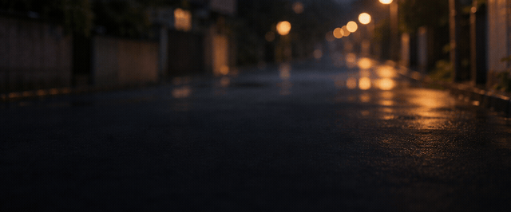

# Effect recipes

Stand-alone karaoke recipes you can copy into any template and tune for your own song. Each recipe shows the visual result, the core Python setup, and the main parameters to adjust.

## Combine built-in entry, highlight, exit, and ornaments

`KaraokeEffects` lets you mix an entrance, a timing highlight, an exit, and a particle ornament in one declaration.


| Recipe | Entry / highlight / exit | Ornament | Good for |
| --- | --- | --- | --- |
| Clear | `tracking_in` / `scanline` / `char_fade` | `stroke_flash=True` | Whole-song readability with restrained motion |
| Sakura | `wave_in` / `zoom_pulse` / `petal` | `petal`, rate 5, size 0.18 | Gentle passages with slow drifting petals |
| Luminous | `glow_in` / `utopia_scanline` / `stretch_out` | `twinkle` | Emphatic chorus lines where light streaks settle before timing |
| Crystal | `assemble_in` / `scanline` / `dissolve_out` | `snow`, rate 4 | Selected transitions where particles gather and disperse |

```python
from kara_templater import Color, KaraokeEffects

sakura = KaraokeEffects(
    entry="wave_in",
    highlight="zoom_pulse",
    exit="petal",
    decoration="petal",
    after_fill=Color(255, 160, 205),
    particle_size=0.18,
    particle_rate=5,
    seed=17,
)
```

**What to tweak:**

- Put harmony on a separate `Track` with fewer particles and a simpler exit so layers do not clutter the screen.
- Particle rate is per timed glyph, so English words with many letters emit more particles than a single CJK character of the same length. Lower `particle_rate` for alphabetic lyrics.
- Try every built-in option interactively with [karaoke_catalog.py](../../examples/karaoke_catalog.py).

## Mark timing without a color wipe

Instead of wiping across each character, hop a small marker from syllable to syllable on the note attack, pulse the active syllable briefly, and flip the entire glyph to the highlight color on release.



```python
from itertools import pairwise
from kara_templater import (
    Color,
    Lifetime,
    LyricHighlights,
    LyricLine,
    LyricRule,
    PathObject,
    ScalePulse,
    SceneEvaluator,
    StateKeyframe,
    StatePatch,
    Timeline,
    Vec2,
    VectorPath,
    VisualState,
    smooth_rate,
)

WAITING = Color.hex("#EFEDE3")
COMPLETED = Color.hex("#F4BB73")
EDGE = Color.hex("#192027")

effects = (
    LyricHighlights.from_timing(
        StatePatch(fill=COMPLETED, outline=EDGE),
        wipe=False,
        base_paint=StatePatch(fill=WAITING, outline=EDGE),
    ),
    LyricRule("syllable", "timing", ScalePulse(peak=1.13, peak_at=0.24)),
)


def note_marker(line: LyricLine, evaluator: SceneEvaluator) -> PathObject:
    notes = [target for target in line.query("syllable") if target.timing]
    first, last = notes[0].timing[0].start, notes[-1].timing[-1].end
    top = line.state.position.y + line.layout.body.bounds.top - 31
    stops = [
        (
            note.timing[0].start - first,
            Vec2(
                evaluator.at(note.node_id, note.timing[0].start)
                .transform.apply(note.center)
                .x,
                top,
            ),
        )
        for note in notes
    ]
    keys: list[StateKeyframe] = []
    for (prev_t, prev_pos), (onset, target_pos) in pairwise(stops):
        travel = min(0.12, (onset - prev_t) * 0.45)
        peak = prev_pos.lerp(target_pos, 0.52) + Vec2(0, -13)
        keys.extend(
            (
                StateKeyframe(onset - travel, StatePatch(position=prev_pos)),
                StateKeyframe(onset - travel * 0.48, StatePatch(position=peak), smooth_rate),
                StateKeyframe(onset, StatePatch(position=target_pos), smooth_rate),
            )
        )
    diamond = VectorPath.polygon(Vec2(-10, 0), Vec2(0, -8), Vec2(10, 0), Vec2(0, 8))
    return PathObject(
        id=f"{line.id}/note-marker",
        path=diamond,
        lifetime=Lifetime(first, last),
        layer=2,
        state=VisualState(position=stops[0][1], fill=Color.hex("#FFC67F"), outline=EDGE, border=1.6),
        animations=Timeline().keyframes(*keys).clips if keys else (),
    )
```

**What to tweak:**

- Scale `travel` with the gap between onsets (`min(0.12, gap * 0.45)`) so the marker stays readable in fast passages.
- Adjust `peak` height (`-13`) and `top` offset (`-31`) to clear ruby readings if present.
- See the full runnable script in [lyric_no_sweep.py](../../examples/lyric_no_sweep.py).

## Reveal a phrase from narrow openings

Each character slides horizontally out of a stationary invisible cut just past its final ink edge, so letters appear to emerge from beneath the surface before the first note.


```python
from dataclasses import replace
from kara_templater import (
    Lifetime,
    RectangleClip,
    StateKeyframe,
    StatePatch,
    TextObject,
    Timeline,
    Vec2,
    VisualState,
    outline_text,
    path_bounds,
)

FPS = 30
DISPLACEMENT = (1.0, 0.573, 0.347, 0.213, 0.127, 0.067, 0.033, 0.013, 0.0)


def slit_entrance(text: TextObject, state: VisualState, start: float, end: float) -> TextObject:
    path = outline_text(text).path
    if path is None:
        raise ValueError(f"missing outline for {text.id}")
    ink = path_bounds(path.map(state.transform.apply))
    padding = 9
    distance = ink.width + 2 * padding
    return replace(
        text,
        id=f"{text.id}/entrance",
        lifetime=Lifetime(start, end),
        clock_start=None,
        state=replace(state, position=state.position + Vec2(distance, 0)),
        clip=RectangleClip(
            ink.left - padding,
            ink.top - padding,
            ink.right + padding,
            ink.top + ink.height + padding,
        ),
        animations=Timeline()
        .keyframes(
            *(
                StateKeyframe(
                    frame / FPS,
                    StatePatch(position=state.position + Vec2(distance * remaining, 0)),
                )
                for frame, remaining in enumerate(DISPLACEMENT[1:], start=1)
            )
        )
        .clips,
    )
```

**What to tweak:**

- On compact phrases (4–6 glyphs), stagger adjacent characters by one frame at 30 fps so the last glyph settles cleanly before timing.
- On longer lines with ruby, group characters by syllable and compute one shared `RectangleClip` around the combined body-and-ruby ink bounds (including any outline), finishing about 0.40 s before pickup.
- On footage with shifting brightness, add a thin outline around the glyphs and increase `padding` to cover it.
- See the complete script in [slit_reveal.py](../../examples/slit_reveal.py).

## Bring fixed lyrics in and out of focus

Keep the lyric anchored on its baseline while softening it into focus on entry, holding it sharp through the entire timing interval, and defocusing again on exit.

For Hook playback, `KaraokeEffects` includes built-in blur transitions (`glow_in` and `glow_out`) that work directly with the GPU renderer:

```python
from kara_templater import KaraokeEffects

focus_fade = KaraokeEffects(
    entry="glow_in",
    exit="glow_out",
    entry_duration=0.36,
    exit_duration=0.36,
)
```

For a custom defocus curve or a digital pixel-grid reveal in Hook, apply a `MaterialEffect` or `ShaderPaint` that blends between sampled coverage masks over fixed screen cells (for example, 7 px cells on a 92 px body at 1080p) and finishes before timing starts.

> [!NOTE]
> Animating the `blur` channel directly with `Tween(StatePatch(blur=0))` from `VisualState(blur=5)` works in ASS export, but raises `SceneCompileError` on Hook export. Use `glow_in` / `glow_out` or a shader material for Hook.

**What to tweak:**

- Hold the sharp lyric for roughly 0.30 s before the first note so singers can read ahead.
- Keep body and ruby completely sharp throughout the timed interval, and inspect small readings at delivery resolution.

## Type the lyric in and erase it after timing

Reveal shaped units left to right before pickup with a caret travelling beside the last visible glyph, hide the caret once the line is ready, and erase the line right to left after the final note.

```python
from dataclasses import replace
from kara_templater import Lifetime, LyricLine, PathObject, Vec2, VectorPath, VisualState


def typewriter_caret(line: LyricLine, *, step: float = 0.075, lead: float = 0.35) -> LyricLine:
    cells = line.layout.body.characters
    if not cells:
        return line
    pickup = min(span.start for span in line.query("line")[0].timing)
    start = max(line.lifetime.start, pickup - lead - len(cells) * step)
    bar = VectorPath.rectangle(3, line.layout.body.bounds.height)
    carets = []
    for index, cell in enumerate(cells):
        t0 = start + index * step
        carets.append(
            PathObject(
                id=f"{line.id}/caret:{index}",
                path=bar,
                lifetime=Lifetime(t0, t0 + step),
                state=VisualState(position=Vec2(cell.bounds.right + 4, line.layout.body.bounds.top)),
            )
        )
    return replace(line, children=(*line.children, *carets))
```

**What to tweak:**

- Set `step` around `0.075` s per character or syllable group, finishing roughly `0.35` s before pickup.
- Keep each ruby reading paired with its host unit so readings appear and disappear with their kanji rather than floating alone.
- Keep glyphs on their final baseline and preserve their original timing clocks while trimming their pre-pickup and post-release visibility.

## Bring syllables in from different edges

Slide each syllable (with its ruby) into place from a different edge of a clipped viewport—left, top, bottom, right—sharing one decelerating Bézier curve so all syllables settle at the same instant.

```python
from kara_templater import ProgressCurve, StatePatch, Tween, Vec2

fast_settle = ProgressCurve.cubic_bezier(0.17, 0.17, 0, 1).at


def enter_from_edge(rest_position: Vec2, direction: Vec2, distance: float) -> tuple[Vec2, Tween]:
    start_position = rest_position + direction * distance
    motion = Tween(StatePatch(position=rest_position), rate=fast_settle)
    return start_position, motion
```

**What to tweak:**

- Measure each syllable's `RectangleClip` viewport from its combined body, ruby, and outline ink bounds, and move the syllable group so body and reading travel together.
- Shorten `distance` or clip duration on dense lines so the entire phrase is visible before pickup and does not collide with an outgoing row.
- Pair a pale waiting fill with a brighter highlight color over dark scenes so the converging paths stay crisp.

## Give each timing state its own outline

Switch both the fill and the outline color at the sweep front—for example, white fill with a cyan outline while waiting, turning deep blue with a white outline when sung—over a small dark shadow that stays visible beneath both states.

```python
from kara_templater import WHITE, Color, LyricHighlights, StatePatch, Vec2

two_state = LyricHighlights.from_timing(
    StatePatch(
        fill=Color.hex("#000EFF"),
        outline=WHITE,
        border=2.4,
        shadow=Vec2(1.5, 2),
    ),
    base_paint=StatePatch(
        fill=WHITE,
        outline=Color.hex("#349DEA"),
        border=2.4,
        shadow=Vec2(1.5, 2),
    ),
)
```

For a quick catalog preset with the same idea, you can also use `KaraokeEffects.duotone(before_fill=..., before_outline=..., after_fill=..., after_outline=...)`.

**What to tweak:**

- Scale `border` with font size (around `2.4` px for a 1080p main line) and give ruby a thinner outline so small counters stay open.
- Preview a partially faded frame during `FadeIn` or `FadeOut` as well as the resting style: the drop shadow shows through translucent letter faces.

## Break only the last glyph after release

Keep the phrase intact through the final note. After a brief hold, convert the last glyph to a vector path, slice it into angled bands with `split_path`, and drift each band away in a different direction.

```python
from kara_templater import (
    DriftOut,
    PathObject,
    TextObject,
    Vec2,
    path_bounds,
    split_path,
    text_to_path,
)


def shatter_glyph(glyph: TextObject, *, duration: float = 0.5) -> tuple[PathObject, ...]:
    source = text_to_path(glyph)
    box = path_bounds(source.path)
    mid = box.top + box.height / 2
    cells = (
        (
            Vec2(box.left - 20, box.top - 10),
            Vec2(box.right + 20, box.top - 10),
            Vec2(box.right + 20, mid - 8),
            Vec2(box.left - 20, mid + 8),
        ),
        (
            Vec2(box.left - 20, mid + 8),
            Vec2(box.right + 20, mid - 8),
            Vec2(box.right + 20, box.top + box.height + 10),
            Vec2(box.left - 20, box.top + box.height + 10),
        ),
    )
    offsets = (Vec2(-18, -22), Vec2(28, 16))
    return tuple(
        shard.animate(DriftOut(offset=offset), duration=duration)
        for shard, offset in zip(split_path(source, cells=cells), offsets, strict=True)
    )
```

**What to tweak:**

- Keep the uncut `TextObject` visible during the hold and swap in the shards only when the breakup starts, avoiding hairline raster seams between adjacent cuts.
- Fade the last glyph's ruby as it releases, and leave the incoming row on its normal timing and position.

## Next steps

- [Design a song layout](karaoke-design.md) to combine these effects into a multi-track song.
- [Motion studies](lyric-studies.md) to compare eight motion techniques side by side.
- [Built-in karaoke effects](../guides/karaoke-effects.md) for the full `KaraokeEffects` reference table.
- [Shapes, clips and masks](../guides/geometry.md) for `RectangleClip`, `outline_text`, `text_to_path`, and `split_path`.
