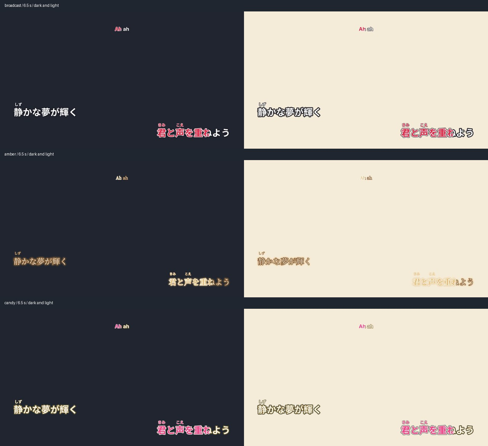
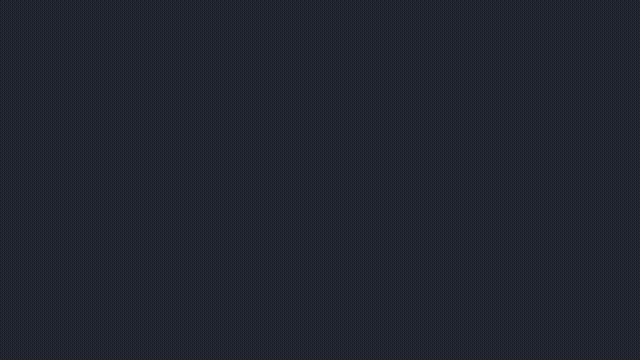

# Design karaoke that stays readable

A successful karaoke effect lets a singer find the next line, see where the
current syllable is, and recognize who is singing. Decoration should support
those tasks. This tutorial recreates three visual approaches observed in real
Bilibili karaoke videos, using one original lyric fixture for comparison.



The examples export standard ASS. The comparison is an actual libass render at
6.5 seconds, with the upcoming upper line, active lower line and separate harmony.
These are studies of the references' visual principles, not exact copies of their
fonts, music, text, timing or production files.

## Run and compare

From a source checkout, install DejaVu Sans and DejaVu Serif, then run:

```sh
uv run python -m examples.karaoke_designs build/broadcast.ass --style broadcast
uv run python -m examples.karaoke_designs build/amber.ass --style amber
uv run python -m examples.karaoke_designs build/candy.ass --style candy
```

[Source](../../examples/karaoke_designs.py). `--font "Your font family"` replaces
the demo font for body and ruby; confirm coverage and recheck layout after changing
it. The supplied original English phrases include pronunciation ruby, a leading
bar cue, 150 ms syllables, held notes and overlapping harmony.

For the Japanese scenes shown here, install Sarasa UI J and Noto Serif CJK JP,
then add `--japanese`. This switches to original Japanese phrases with kana ruby
and the corresponding Japanese font family while preserving the same singing intervals:

```sh
uv run python -m examples.karaoke_designs build/candy-ja.ass --style candy --japanese
```

Both language fixtures were rendered; neither establishes fit for arbitrary
longer lyrics or replacement fonts. See [fonts and preview](../guides/fonts-and-preview.md).

For nine 720p60 validation videos per language, saved ASS, selected frames and a local
cost/provenance report:

```sh
uv run python -m tools.render_karaoke_designs
uv run python -m tools.render_karaoke_designs --japanese
```

The renderer writes to ignored `build/karaoke-design-study/rendered/` and refreshes
the gallery GIFs and comparison image for the selected language. It uses dark, light and moving
high-contrast test backgrounds. GIFs are 640 pixels wide at 15 fps: inspect the
60 fps videos when judging fast sweeps. No downloaded reference media is needed.
The report records Fontconfig's resolved families and paths: local font aliases
can substitute a different face even when the requested family is installed.
The [English comparison](../examples/assets/karaoke-design-comparison.jpg) uses
the same settings with a different number of glyphs.

## Three recipes

### Broadcast contrast: strong information, little motion



[English preview](../examples/assets/karaoke-broadcast.gif)

The unsung fill is white with a dark edge. Singing changes the fill to red and
the inner edge to white, while a wider dark rim keeps it legible on pale scenes.
Use opposing row alignment to distinguish the upcoming line from the active one.
Keep a row stationary until its own fade ends; replacing the other row must not
move it. Harmony gets its own smaller Track near the top.

This studies [Great Days, 霜月ゆい](https://www.bilibili.com/video/BV1eeWu65ESU/?t=48)
(48–56 s) and [Merry-Go-Love, Kyousuke桑](https://www.bilibili.com/video/BV1xHf7BMEaN/?t=32)
(32–40 s). Both show clear red/white singing states and alternating rows. The
sample retains that organization, with an added constant outer rim for contrast.

Start with this recipe for a whole song. It leaves visual attention available
for reading and has the lowest cost of these three studies.

### Amber lyric: soft appearance, firm letter edges


[English preview](../examples/assets/karaoke-amber.gif)

A serif face, warm ivory and amber create a gentler treatment. Put softness in a
separate halo; keep the letter body sharp. A pale sung rim separates amber fill
from the warm halo. Match the palette to the video, then deliberately test it
against a mismatched bright background.

Reference: [金木犀とノスタルジー, 片桐sara酱](https://www.bilibili.com/video/BV1uc4z6FEWr/?t=36),
36–44 s. The reference has Japanese serif lettering, warm edges and independent
row fades. This study uses Noto Serif CJK JP (DejaVu Serif in English mode) and approximates its warm layered paint;
it does not reproduce the reference's background leaves. On bright backgrounds,
this palette has less separation than broadcast: reduce halo opacity and choose
a darker outer rim before increasing blur or font weight.

### Candy pop: movement around the singing interval


[English preview](../examples/assets/karaoke-candy.gif)

Cream unsung text changes to pink, with a light inner stroke and a dark outer rim.
A short staggered tilt/lift removes completed characters. The body stays still
while being sung, so the progress cue remains easy to follow.

Reference: [ぴ, 天国の歌](https://www.bilibili.com/video/BV1tDpt6HE2R/?t=38), 38–46 s.
The clip shows a more pronounced turning/scattering transition. The demo's 2D
24-degree tilt and 12-pixel lift is an approximation, not a matching 3D flip.
It demonstrates how one character rule applies that transition across lines,
without writing an animation time for every letter. Ruby fades as a readable
unit instead of rotating each tiny reading glyph.

This version is substantially more expensive. Use it for selected phrases or
reduce the number of animated layers before applying it throughout a long song.

## How the example divides responsibilities

- `song()` supplies text and singing intervals once. Palette choices do not
  rewrite the time axis.
- `Track` selects main or harmony content and applies reusable rules.
- `OpposingRows.allocate()` calls the ordinary allocator, then adjusts horizontal
  alignment for odd rows. Row occupancy and handoff remain the allocator's job;
  the same implementation accepts more than two rows when the region is sized
  appropriately.
- `LyricHighlights.from_singing()` owns sweep geometry and decorative margins.
  A template specifies sung paint and glow, without computing clip extents or
  giving blur extra singing time.
- The halo factory uses the target role to scale ruby's rim and blur to its
  smaller font size, avoiding bright blobs around small readings.
- Line fades and character exits use semantic anchors. `candy_exit()` chooses a
  relative stagger within one exit interval; the library resolves its clock and
  reserves the required display time.

Color fields on the input Document styles currently use ASS color strings; the
small `ass_color()` helper encodes only that boundary. Effect paint uses typed
RGB `Color` values. See [materials](../guides/materials.md) for soft sweeps and
single-letter gradients; a per-character palette is not an internal gradient.

## Starting values and adjustment order

These are authoring recommendations derived from the studies and these rendered
samples, **not measurements of the original authors' settings**. Pixel values
refer to a 1280 × 720 script. Multiply spatial values by 1.5 for 1920 × 1080;
leave times unchanged. Font-size numbers alone do not guarantee equal visible
height across font families.

| Control | Demo / suggested starting range | What to inspect |
| --- | --- | --- |
| Main text size | 58 px; try 52–68 px | Longest phrase, actual viewing distance, safe margins |
| Ruby size | 24 px; about 0.4–0.5 of body | Dense readings must remain distinguishable |
| Harmony size | 32 px; about 0.5–0.65 of body | Distinct hierarchy without making harmony illegible |
| Horizontal margin | 72 px; try 5–7% of width | Cue, longest line and right-aligned text all fit |
| Row origin spacing | 108 px; try 100–120 px | Includes ruby and glow; check measured bounds |
| Body stroke | 2.5 px; try 2–3.5 px | Letter counters stay open |
| Outer rim | 4.5 px total border, not an extra 4.5 px | Separates both singing colors from the background |
| Rim/halo blur | 0.5–0.6 px crisp; amber 4 px | A glow must not erase the crisp body contour |
| Halo opacity | 0.5 soft; 0.9 crisp dark rim | Large bright clouds can overwhelm adjacent letters |
| Desired preview | 1.2 s main; 0.8 s harmony | Enough time to read; allocator may shorten for handoff |
| Cue lead/duration | 0.8 s | Visible before the first syllable; use song pacing |
| Enter / exit fade | 0.18 / 0.22 s | Avoid delaying readability or obscuring the next row |
| Decorative exit | 0.42 s total | Ends before row reuse; short phrases can need less |
| Fast syllables | Test 0.15–0.25 s as well as held notes | No apparent pause while crossing blur margins |

Adjust geometry first, then sung/unsung contrast, then timing, then decoration.
Increase neither blur nor particle density to compensate for an unreadable face.
A useful review is to watch the same section with decoration disabled: the
singing progress should be just as easy to locate in both versions.

## Other references and lessons

The research also inspected these designs; they are not claimed as implemented
replicas:

| Reference and observed moment | Lesson |
| --- | --- |
| [Zzz, 玩魔方的小谁](https://www.bilibili.com/video/BV1CKWt6LEyj/?t=46), 46–54 s | Tiny note-like particles rise near the moving lyric front. Keep particles sparse and smaller than ruby. The pale warm palette needs a bright-background check. |
| [恋心協奏曲, 雪羽花柚心](https://www.bilibili.com/video/BV1ZtxZ68Eoc/?t=56), overview near 56 s and 2:45 | Fine lettering over pale credits looks delicate but can become difficult to read from a distance. This observation concerns those sampled scenes, not the entire video. |
| [ideal / ideal II, シチヨウ](https://www.bilibili.com/video/BV1Wx4i6LExk/?t=174), overview near 2:54 | Dot cues and opposing rows make entry points visible; pale sung colors and transparency need testing over bright sky. |

For a runnable particle starting point, see the [sakura example](../examples/README.md#sakura-particles)
and [particles guide](../guides/particles.md). Its petals are an existing independent
example, not a recreation of Zzz's note particles. Start with one or two small
particles per accent and a lifetime of roughly 0.4–0.8 s; increase only after
checking readability and active-event cost. These are proposed starting values,
not validated settings for a Zzz reproduction.

## Cost and renderer limits

For the 14-second English fixture at 1280 × 720, compilation with native transforms
enabled and a 60 fps fallback produced:

| Style | Events | Peak active | ASS size (decimal MB) |
| --- | ---: | ---: | ---: |
| Broadcast | 2,481 | 194 | 1.36 |
| Amber | 2,481 | 194 | 1.37 |
| Candy | 26,269 | 194 | 13.58 |

The Japanese fixture uses fewer glyphs: broadcast and amber each produce 1,221
events (98 peak), while candy produces 11,425 events (98 peak). It uses the same
animation rules and durations; text length materially changes output cost.

These counts belong to these fixtures and installed fonts; do not extrapolate them
as a whole-song guarantee. The local renderer report records compile and end-to-end
FFmpeg render/encode wall times, versions and artifact hashes. Wall time includes
encoding and background generation; it is not an isolated libass benchmark.

The candy exit prevents the current compiler from using native rectangle sweeps
for those animated glyphs, even during their stationary singing portion. The
fallback preserves the effect through sampled events. Known rectangle keyframes
now omit constant ranges from sampling estimates, so a long hold no longer
consumes budget simply for existing. This fixes unnecessary sampling/estimation;
it does **not** remove candy's actual 26,269-event cost. The example's explicit
40,000-event/20 MiB limit is a local demonstration budget, not a new library default.

The inspected sweeps, rims, fades, small particles and approximate character
transitions can be expressed in standard ASS. Nothing in this study establishes
a need for a shader backend. A true perspective flip would require additional
geometry support in this framework; that alone is not proof of a libass limit.
Continuous complex gradients, custom blend modes or dense particle fields may
justify a GPU backend, but that decision should follow a demonstrated visual or
performance requirement. It would also need its own playback/rendering runtime.
