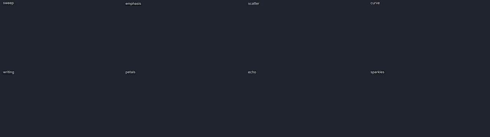

# Eight karaoke motion studies

These studies compare different motion mechanisms using one lyric fixture:
250 ms, 250 ms, 1 s and 2 s singing units, plus an independent harmony track.
The Japanese variant adds ruby. They are source-inspired examples, not exact
reproductions or evidence that eight videos exhaust karaoke styles.



Run the [complete example](../../examples/lyric_studies.py):

```sh
uv run python -m examples.lyric_studies build/petals.ass --effect petals --japanese
uv run python -m tools.render_lyric_studies build/lyric-studies --japanese
```

The second command renders all eight exported ASS files on dark, light and moving
test backgrounds and saves comparison videos and a cost manifest. English uses
DejaVu Sans; Japanese uses Sarasa UI J. These system fonts must be installed.
The preview above is reduced to 12 fps; generated videos use 60 fps. Inspect the
full videos when judging the shortest notes.

## What differs

| `--effect` | Composition in the example | Reference mechanism |
| --- | --- | --- |
| `sweep` | Stationary glyphs, singing color, independent line fades | [Great Days](https://www.bilibili.com/video/BV1eeWu65ESU), 48–56 s |
| `emphasis` | Singing-relative pulse plus a separate copy arriving from above | [Falling & growing, P47](https://www.bilibili.com/video/BV1cp4y187Hv?p=47), 0–5.59 s |
| `scatter` | Seeded rotating exits, staggered at the end of the row | [Out, P56](https://www.bilibili.com/video/BV1cp4y187Hv?p=56), 0.5–6 s; [ぴ](https://www.bilibili.com/video/BV1tDpt6HE2R), 43.27–43.5 s |
| `curve` | Delayed curved copies and luminous path segments with following tails | [Bezier P9](https://www.bilibili.com/video/BV1Ro4y197Lf?p=9), 1.50–2.29 s |
| `writing` | Initially hidden text revealed by the singing front, with persistent dust | [ParticleWriting, P104](https://www.bilibili.com/video/BV1cp4y187Hv?p=104), 0–5.25 s |
| `petals` | Characters and ruby depart after singing; petal particles have independent lifetimes | [Cherry blossoms, P121](https://www.bilibili.com/video/BV1cp4y187Hv?p=121), 0–6.5 s |
| `echo` | Continuously rising, fading copies while the main baseline stays put | [Pulse, P135](https://www.bilibili.com/video/BV1cp4y187Hv?p=135), 0–5.5 s |
| `sparkles` | Decorations follow the singing front over already visible text | [Zzz](https://www.bilibili.com/video/BV1CKWt6LEyj), 46–54 s |

Five numbered references are mechanism demonstrations from one collection;
they do not independently establish popularity. Great Days, Zzz and ぴ provide
actual-song examples. Colors and fonts are not counted as different mechanisms.
The curve study now uses `Ribbon`, backed by `TrailPath`: the visible path grows
at its head and retracts from its delayed tail. It illustrates the strands in
Bezier P9, with chosen timing/geometry rather than a frame-exact reconstruction.
P70 was initially misidentified as a trail: its dot arch is stationary, with
right-to-left ornament exit distinct from left-to-right text exit. That separate
ornament composition has a [separate example](../../examples/lyric_ornament.py):
the measured arch stays fixed while text and dots exit in opposite orders. See the
[frame-based timing analysis](karaoke-timing.md) for evidence and corrections.
The writing study reveals through a horizontal front, not glyph stroke order.
The petal study uses `placement="line"` to emit around unsung text as observed
in P121. Its density, flutter and departure distances remain chosen parameters,
not recovered settings from the reference.

## Built-ins and custom animation

Rules own selection and time. Built-ins own reusable motion. Custom transforms
describe relative changes over normalized progress and use the same evaluator.
For example, the emphasis rule is:

```python
from kara_templater import LyricRule, ScalePulse

pulse = LyricRule("character", "singing", ScalePulse(peak=1.12, peak_at=0.42))
```

Its duration is the source singing interval. On a 250 ms note the peak is at
105 ms; on a 2 s note it is at 840 ms. Both phases ease to zero velocity at their
endpoints. The scale factor is an explicit artistic choice in this fixture;
equal amplitude need not be appropriate for very short notes in a finished song.

The P47 reference is more complicated than a pulse alone. At native cadence
(about 42 ms per frame), its first character grows/brights through roughly
0.5–0.6 s and fades toward the retained outline by about 0.8 s; the next copy is
already descending around 0.125–0.375 s. The last word arrives around 4.42–4.71 s,
emphasizes around 4.84–5.21 s and dissolves around 5.30–5.59 s. This supports
overlapping copies and separate entrance/emphasis/release phases. It does not
establish an exact easing formula or a source-duration ratio: source ASS timings
are unavailable, and glow affects apparent size. The example's 42% peak and
durations are our chosen parameters, not measurements of that reference.

In particular, the first glyph stays visibly enlarged across the next onset;
the final word also has a roughly half-second growth phase. This supports
separately timed decorations, not a universal rule that every reference effect
fits exactly inside its singing interval. Our L4TS-style pulse intentionally
follows the source interval because that is the requested behavior.

For an independent custom motion, a curved offset needs only progress functions:

```python
from kara_templater import Transform, Vec2

arc = Transform(
    offset=lambda p: Vec2(-36 * p, -80 * p * (1 - p)),
    opacity=lambda p: 1 - p,
)
```

A custom particle factory supplies shape and lifetime; the lyric emitter
supplies positions, births and identities. For a continuous luminous strand,
use `Ribbon()` or customize the [shared path trail](../guides/geometry.md#path-trails). No author code computes glyph
clip coordinates, searches internal object IDs or schedules individual letters.

## Copies, exits and reveal

`LyricEcho.animation` accepts a built-in, `Transform`, or `Timeline.animation`.
The sequence is fitted to the copy's `duration`. Default pivots use the measured
glyph center. Negative `delay` permits pre-onset arrival; copies cannot start
before Scene zero. Copies use the prepared static glyph appearance, not snapshots
of its animated history. Original singing clocks remain untouched.

`LyricRule(..., "exit", ..., stagger=0.04)` spaces exits in selection order.
The last selected target finishes at the display end; earlier targets finish
earlier. The layout reserves the full duration plus stagger. For per-character
departure after singing, use `after_singing` and an `offset` pause instead.
The fixture binds both characters and ruby when they leave; animating only the
body intentionally leaves its independently selected ruby unaffected.

For particle writing, hide only the unsung material:

```python
from kara_templater import CYAN, LyricHighlights, StatePatch

reveal = LyricHighlights.from_singing(
    StatePatch(fill=CYAN), base_paint=StatePatch(opacity=0),
)
```

The highlighted drawing starts from the original appearance before applying its
paint, so hiding the base does not hide the revealed text. `base_paint` accepts
paint/opacity properties, not position, scale or rotation. Ordinary sparkles keep
the default visible base, making these two effects visibly different.

## Cost and current limits

Every preview comes from ordinary ASS. Moving/rotating copies, fluttering petals
and arbitrary custom trajectories may require sampled events. Independent line
fades can also prevent a particle from using a simpler native strategy. The
renderer writes actual event, byte and peak-active counts to `manifest.json`;
the examples deliberately retain the same effects rather than silently lowering
particle density to meet a smaller output size.

See [animation and timing](../guides/animation.md) for approximation contracts,
[particles](../guides/particles.md) for the custom factory protocol, and
[materials](../guides/materials.md) for the limits of ASS gradients and clipping.

## Independent ornament and text clocks

```sh
uv run python -m examples.lyric_ornament build/lyric-ornament.ass
```


The supplemental P70 study uses one custom effect function to construct nine
stationary dots, and a custom source-time anchor with a normal LyricRule for
left-to-right character fades. Dots then fade right-to-left on their own clocks.
The layout discovers their lifetimes automatically; the author does not patch
parent lifetimes or manually bind each character. Durations/counts are chosen
illustration parameters, not recovered source settings. This demonstrates
independent decoration clocks rather than reproducing P70's arriving copies.
