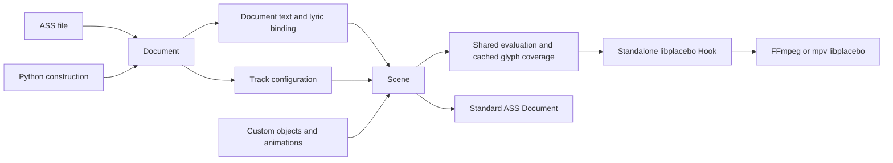

# 架构概览

了解带时间轴的歌词、场景对象、原生文本测量，以及 Hook 和 ASS 两套导出器如何协同工作。修改库模块或公共接口之前，请先阅读本页。

## 处理管线概览

所有创作 API 共用一套单位体系，且不会改动调用方传入的源对象：

| 领域 | 单位与约定 |
| --- | --- |
| 原始 ASS `Line` 时间戳 | 整数毫秒 |
| `DocumentLyrics`、`Track`、`Scene`、动画、提示 | 浮点秒 |
| 布局、路径、裁剪、描边、模糊 | 脚本像素（`PlayResX` × `PlayResY`） |
| 不透明度（`Paint`、`VisualState`、对象组） | `0.0` 到 `1.0` |

## 共享文档与场景模型

- **`ass.py`**：按顺序保存 ASS 记录并序列化标准 ASS（`Document`、`Line`、`Record`、`Style`）。原始 `Line` 记录保留毫秒时间戳。
- **`document_text.py` 与 `document_lyrics.py`**：解码歌词文本、计时区间（`TimedTextSpan`）、注音（`RubyText`）和提示标记（`CueMarker`），并保留与原始记录的映射。导入的歌词会采用模板样式，同时保留原始标签用于筛选。`LyricSource` 既可以包装解析后的 ASS，也可以包装结构化的 `DocumentLyrics`。
- **`scene.py`**：定义 `Scene`、`TextObject`、`PathObject`、`ObjectGroup`、`AssDialogue`、`PreparedHook`，以及 `Scene.export()`、`Scene.export_resources()` 和 `Scene.ass` 入口。
- **`scene_animation.py` 与 `scene_evaluation.py`**：提供带类型声明的动画（`StateAnimation`、`AnimationSequence`、`ShaderMotion` 等）和可随机跳转的求值逻辑。`SceneEvaluator` 在世界坐标中组合对象组层级和引用依赖（`object_references.py`）。
- **独立的类型化扩展模块**：位于核心场景之外，包括 `geometry.py`、`group_geometry.py`、`path_geometry.py`、`path_boolean.py`、`path_layout.py`、`path_animation.py`、`path_motion.py`、`text_geometry.py`、`paint_fields.py`、`particles.py`、`cues.py` 和 `karaoke_cues.py`。

## 歌词前端与内置特效

`lyrics/tracks.py` 中的 `build_lyric_scene` 负责编排多声部轨道（`Track`）的卡拉 OK 创作流程：

1. 从 `LyricSource` 输入中筛选各个独立的 `Track` 歌词流。
2. 测量歌词对象，并解析 `Track.effects` 中的计时规则。
3. 一次性构造可调用视觉对象，收集所有显式声明的视觉时间区间。
4. 为每条歌词流调用一次 `Layout.allocate`（`lyrics/placement.py`）分配行位置。
5. 将动画绑定到准备好的 `LyricLine`（`lyric_line.py`）目标上。

自定义回调可以返回 `line.schedule(...)`：动画工厂在声明时按区间解析一次，预留空间和最终别名绑定复用与 `Track` 规则相同的准备逻辑。可见性变化会保留显式的局部时钟起点，而不是重新构造工厂回调。`LyricScene` 把可供检查的 `LyricLinePlan` 挂到 `Scene` 上，且不覆盖导出逻辑。任意行数都共用同一分配器，自定义布局策略只需覆盖 `Layout.allocate`。源记录归属与同一源的视觉视图始终保持分离。

命令行默认预设（`__main__.py` 和 `_cli_preset.py`）基于同一套前端，使用预设排版和唱前/唱后着色规则。`--effect` 脚本只需导出 `tracks` 或 `build(document) -> Scene`；在导出之前，所有歌词都保持为可编辑的 `Scene` 对象。

### 塑形、间距避让与走字

- `ObjectGroup` 承载变换层级、继承的不透明度与裁剪。
- `KaraokeRows` 按塑形后的字形墨迹和左右留白贴合单元格。字形局部着色与裁剪以落笔原点（pen origin）为准，它可能与单元格左边缘不同。
- `VectorGuide`（`Track.guide_symbols`，`lyrics/layout.py`）会在源字符处切分字体塑形段，用按 em 缩放的矢量路径和前进宽度替换原单元格，再执行避让与注音排版。它在动画绑定阶段仍作为普通歌词目标参与绑定，最后由共享叶子收集器（`_scene_tree.py`）连同着色层一起下沉为路径绘制，同时供给 Hook 与 ASS 导出。
- 歌词绑定会在注音、提示和分行之前，把 `Track` 的描边避让距离应用到塑形簇的墨迹边界上。每个簇保留累计附加距离，以便自动走字（扫色）按 `StudioSpacing` 主描边区间或原生字体前进宽度推进。
- `lyrics/highlights.py` 在塑形文本几何上测量走字进度。在 Studio 模式下，它测量字形加主硬描边，并在相邻单元格重叠时缩短终点；避让距离、次级描边和辉光绝不会拉长走字行程。`LyricHighlights` 会在内部预留装饰边缘过渡并下沉符合条件的线性裁剪，模板只需声明外观，无需为了模糊去手动补偿裁剪坐标或时钟。

### 内置特效目录

`karaoke_effects.py` 将 `KaraokeEffects` 作为 `Track` 回调暴露出来，内部组合了 `LyricHighlights`、`LyricRule` 绑定以及普通粒子和路径节点。`_karaoke_motion.py` 和 `_karaoke_sprites.py` 存放私有的运动与图形配方，两者既不引入第二套时间线，也不直接编码 ASS。前沿与闪光别名共享源字形时钟，发射出的装饰粒子则拥有独立生命周期。

## Hook 输出

`output/hook/`（`export.py`、`draws.py`、`motion.py`、`materials.py`、`wipes.py`、`bands.py`）通过 `PreparedHook` 和 `HookDrawResolver` 实现 `Scene.export()` 与 `Scene.export_resources()`：

- **区间切分与运动**：每个叶子对象在生命周期、裁剪和动画边界处切分。已知运动区间保存端点变换与缓动；`RectangleKeyframes` 独立插值；`ShaderMotion` 着色器程序接收实例数据和片段时钟。继承的屏幕矩形轨道在后代之间共享，并按所属对象组的时钟求值；叶子裁剪则保留自身坐标空间及其在歌词走字中的作用。
- **WGSL 材质**：文本和路径对象上有序挂载的 `MaterialClip` 会按不重复的 WGSL 函数通过内置 Naga 翻译器（`_kara_wgsl`，源码在 `native/wgsl/`）各编译一次，并在覆盖率计算完成后执行。具名 `PaintInput` 会成为着色器 uniform，通过 `PreparedHook.material_inputs()` 和 `textures.json` 向预览宿主暴露名称和默认值。
- **覆盖率与描边**：填充路径用 `aggdraw` 光栅化，静态圆角描边用 FreeType（`_text_native.round_stroke`）生成，模糊由 Pillow 滤镜处理（`_path_raster.py`）；动态描边则在片元着色器中根据定位轮廓实时计算（`_contour_stroke.py`）。
- **稀疏分块时间线**：覆盖率遮罩按货架打包进 `KARAMASK`（宽 2048 像素、最高 8192 像素），去重后的帧、图块、曲线、材质和绘制记录打包进 `KARADATA` 浮点纹理。稀疏时间线按画家顺序索引 64×64 像素图块中的绘制项。每次绘制在多个覆盖率平面间共享变换、裁剪和不透明度；每个图块保留平面边界，并在按序合成前选择备用遮罩集。
- **开销校验与数据共享**：会改变几何形状的着色器运动按 8 帧短窗口在输出帧网格上采样姿态；内置粒子则可使用解析运动与缩放边界。两条路径都会索引可达遮罩覆盖范围，并经过相同的每帧与每图块工作量上限检查。曲线控制点、着色器参数、图块列表、材质和遮罩均跨实例共享存储。帧时钟与 GPU 资源由 FFmpeg 或 mpv 的 `libplacebo` 管理。播放与格式限制详见[播放与渲染 Hook](../output/hook.md)。

## 原生文本测量与 ASS 导出

`text/measurement.py`（`text_extents`）、`text/layout.py`（`layout_document_text`）和 `_metrics.py` 封装了 C++17 扩展 `_text_native`（`native/metrics.cpp`）。该扩展使用 Fontconfig 和 FreeType 选择字体，用 FriBidi 处理双向文本，用 HarfBuzz 完成塑形。`text_extents` 会为每一行含字形墨迹的排版框加上 `style.outline` 边距；落笔定位使用未加边距的前进宽度；轮廓查询（`text_geometry.py`）把 FreeType 轮廓分解到脚本坐标中。

`output/ass_export.py` 实现 `Scene.ass`，即作为兼容性备选的标准 ASS 导出。它执行全场景预检、策略选择、确定性原生 ASS 下沉、源归属处理、报告生成（`AssResult`、`AssObjectReport`）和 `AssBudget` 预算检查。`AssDialogue` 在相同归属规则下保留已下沉的原始 ASS。所有 Python 回调都会在序列化之前求值，播放器收到的只是装在新 `Document` 中的普通 ASS，调用方持有的场景和源文档不会被修改。`_ass_preview.py` 和 `_raster.py` 使用 `aggdraw` 和 Pillow 在 CPU 上光栅化编译后的 ASS 绘制指令。

## 公共 API 边界

所有公共符号统一在 `kara_templater.__all__`（`kara_templater/__init__.py`）中声明。只有在模板作者确实需要时才新增公共导出，准备逻辑、下沉步骤和编译器内部结构一律保持私有。只要修改了公共签名或文档字符串，就运行 `uv run python -m tools.generate_reference` 重新生成 [API 参考](../../reference/README.md)。

## 下一步

- [检查与文档验证](checks.md)
- [配置开发环境](setup.md)
- [API 参考](../../reference/README.md)
