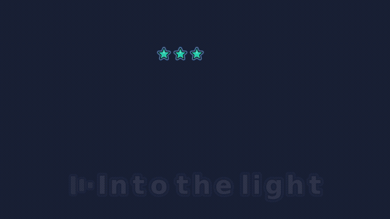
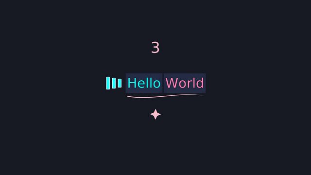
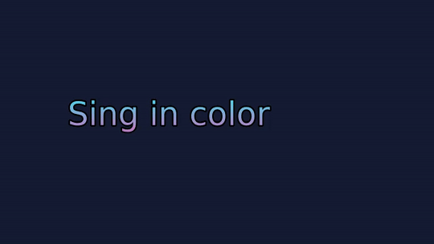

# 示例脚本

按视觉效果浏览可运行的卡拉 OK 示例，查看动态预览，并在源码目录中直接运行。想找一份现成脚本来改写成自己的歌曲模板时，可以从这里挑起。

[组件覆盖表](component-coverage.md)列出了组件库每张卡片对应的可调控件，或复现示例所需的源码和输入。

以下命令均在仓库根目录运行。请先创建 `build/` 目录（`mkdir -p build`），让生成文件留在已被 Git 忽略的构建目录中。若要与预览图排版一致，请安装示例中使用的字体，详见[选择与注册字体](../guides/fonts.md)。

## 按视觉目标查找示例

按你想要实现的效果挑选对应行。完整的内置入场、高亮、退场和装饰列表请查阅[内置卡拉 OK 特效](../guides/karaoke-effects.md)。

| 视觉目标 | 示例展示的内容 | 入口链接 |
| --- | --- | --- |
| 让歌词在复杂画面上保持清晰 | 同一套字形叠加深色主描边、彩色外描边与柔和辉光 | [内置卡拉 OK 特效](../guides/karaoke-effects.md) · [选择与注册字体](../guides/fonts.md) |
| 对比整曲动态风格 | 在同一组计时歌词上自由组合入场、音节高亮、退场与装饰 | [整曲模板](#整曲模板) · [动态研究](../tutorials/lyric-studies.md) |
| 安排交替双行或多声部 | 独立的主唱与和声 `Track`，配合换行轮换、专属配色与提示 | [lyric_orchestration.py](../../../examples/lyric_orchestration.py) · [karaoke_designs.py](../../../examples/karaoke_designs.py) |
| 不做扫色也能标出起音和收音 | 菱形指示点在起音时跳动，字符短促脉冲，收音时整字变色 | [无扫色卡拉 OK](#无扫色卡拉-ok) |
| 做出利落的遮罩切口入场 | 每个字符从隐形竖直切口中滑出，注音始终跟随正文 | [固定切口入场](#固定切口入场) |
| 对焦清晰、打字显现或尾字散开 | 独立的入场与退场配方，保证演唱期间文字清晰易读 | [特效配方](../tutorials/effect-recipes.md) |
| 制作贴合曲风的倒数提示 | 闪烁的行内音量条、独立星形指示灯与自定义猫爪倒数 | [倒数与提示](#倒数与提示) |
| 使用渐变、粒子、残影或 WGSL 材质 | 连续着色器渐变、随走字前沿发射粒子、起音残影与自定义 WGSL 材质 | [矢量图形、渐变与自定义着色器](#矢量图形渐变与自定义着色器) · [lyric_particles.py](../../../examples/lyric_particles.py) · [lyric_echo.py](../../../examples/lyric_echo.py) |

## 整曲模板

### 内置卡拉 OK 特效组合

用 `KaraokeEffects` 自由组合入场、高亮、退场与装饰。下方预览展示了使用 Sarasa UI J 渲染的四组搭配。


```sh
python -m examples.karaoke_catalog build/studio.hook --entry glow_in --exit dissolve_out
```

[karaoke_catalog.py](../../../examples/karaoke_catalog.py) · [内置卡拉 OK 特效](../guides/karaoke-effects.md)

### 主唱与和声轨道

了解多条独立 `Track` 如何共享同一首歌的时间轴、轮换多行、为提示预留空间并分别配色：

- [lyric_orchestration.py](../../../examples/lyric_orchestration.py) — 主唱与和声轨道，以及可覆写的行布局规则。
- [karaoke_designs.py](../../../examples/karaoke_designs.py) — 在同一套共享歌词上演示多种整曲风格预设。
- [track_colors.py](../../../examples/track_colors.py) — 逐音节轮换配色，可直接配合 `kara-templater --effect` 使用。

## 自定义入场与计时动作

### 固定切口入场

每个字在首音之前从隐形的固定切口滑入就位，随后从米白色走字为琥珀色。预览使用 Sarasa UI J 字体。


```sh
python -m examples.slit_reveal build/slit-reveal.hook
```

[slit_reveal.py](../../../examples/slit_reveal.py) · [特效配方](../tutorials/effect-recipes.md)

### 无扫色卡拉 OK

琥珀色小菱形在每次起音时跳到对应音节上方，字符短促放大后回弹，并在收音瞬间整字变为琥珀色。预览在夜景街道上使用 Sarasa UI SC 渲染。


```sh
python -m examples.lyric_no_sweep build/lyric-no-sweep.hook
```

[lyric_no_sweep.py](../../../examples/lyric_no_sweep.py) · [特效配方](../tutorials/effect-recipes.md)

### 更多计时与动态脚本

- [lyric_pulse_drift.py](../../../examples/lyric_pulse_drift.py) — 结合时长感知 `ScalePulse`、`DriftOut` 漂移退场与纵向填充渐变。
- [lyric_particles.py](../../../examples/lyric_particles.py) — 随走字前沿发射星光（`--kind sparkle`）或飘落花瓣（`--kind petal`）。
- [lyric_studies.py](../../../examples/lyric_studies.py) — 在相同计时下对比八组动态研究（残影、粒子、轨迹与显现），详见[动态研究](../tutorials/lyric-studies.md)。
- [lyric_ornament.py](../../../examples/lyric_ornament.py) — 与歌词退场时钟相互独立的静止拱形装饰点。

## 倒数与提示

### 行内音量条与独立星形指示灯

行内音量条紧贴歌词行首同步闪烁，星形指示灯则位于独立位置，在起唱前按节拍逐个熄灭。



```sh
python -m examples.karaoke_signals build/signals.hook
```

[karaoke_signals.py](../../../examples/karaoke_signals.py) · [注音与倒数提示](../guides/text-and-cues.md)

### 自定义猫爪倒数

从 [paw_countdown.py](../../../examples/paw_countdown.py) 导入 `paw_countdown(step_seconds=...)` 作为 `Track` 的提示预设，在歌词上方画出四个随节拍压扁消失的猫爪印。搭配 `KaraokeEffects(exit="spin_flip", exit_unit="character")`，还可以让每个字符与注音绕各自中心翻转退场。

## 矢量图形、渐变与自定义着色器

### 词组底框与装饰

按实测歌词范围绘制彩色底框、行内提示条和矢量星芒，并导出为标准 ASS。



```sh
python -m examples.scene_cues build/word-backgrounds.ass
```

[scene_cues.py](../../../examples/scene_cues.py) · [导出标准 ASS](../output/ass.md)

### 连续 GPU 渐变

用对象局部坐标下的 `LinearGradient` 为 `TextObject` 上色，渐变会随字形缩放与漂移同步移动。运行该模块会同时生成 `build/gpu-gradient.hook` 与纯 ASS 回退文件 `build/gpu-gradient.ass`。



```sh
python -m examples.gpu_gradient
```

[gpu_gradient.py](../../../examples/gpu_gradient.py) · [色彩与材质](../guides/materials.md) · [播放与渲染 Hook](../output/hook.md)

### 交互式画廊示例

以下精简脚本既用于驱动文档站点的实时交互画廊，也支持在命令行直接运行：

- [gallery_lighting.py](../../../examples/gallery_lighting.py) — 羽化走字、柔光扫描线与双色混合辉光，并提供可调的 `PaintInput` 参数。
- [gallery_ruby.py](../../../examples/gallery_ruby.py) — 日语歌词与注音读音共享同一音节边界同步走字。
- [gallery_material.py](../../../examples/gallery_material.py) — 自定义 WGSL `MaterialEffect`，在文字填充上扫过一条动态彩带。

## 下一步

- [快速上手](../getting-started.md) — 用 mpv 或 FFmpeg 预览导出的 `.hook` 文件。
- [内置卡拉 OK 特效](../guides/karaoke-effects.md) — 查阅所有内置入场、高亮、退场和装饰选项。
- [设计整曲布局](../tutorials/karaoke-design.md) — 把单句示例扩展成完整的多声部整曲模板。
- [预览与导出](../output/README.md) — 查看着色器播放与标准 ASS 各自支持的特效。
