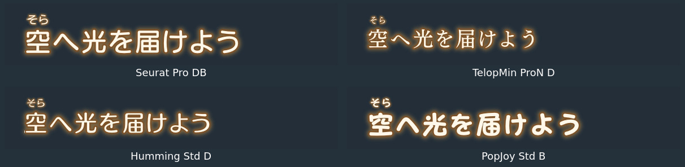

# 选择与注册字体

为主唱、和声与注音挑选易读的字体，启用假名比例间距、换算 Karaoke Studio 字号、搭配中日文字体，并注册本地字体文件用于排版测量。

## 为歌词挑选字体

试字体时请直接用目标歌曲里的真实歌词行，而不是泛泛的样例词。日语歌词建议至少挑出三个样本：一个笔画密集的汉字、一串假名，以及全曲最长的一行；如果歌词混排英文或标点，也放在同一行里一起看。务必在最终播放字号、实际描边和真实画面背景下对比候选字体。

| 歌词角色 | 选型起点 | 播放时重点检查 |
| --- | --- | --- |
| 主唱 | 笔画均匀的中粗或粗体日文黑体（Gothic），或更具印刷质感与细腻气息的明朝体（Mincho）。 | 在长音走字到一半时暂停画面。唱前与唱后填充都必须清晰可辨；留意细横笔和繁复汉字内部空隙是否糊成一团。 |
| 和声 | 沿用主唱字体但缩小字号，或在需要区分声色时改用气质对比鲜明的字体。 | 同时播放主唱与和声。检查小字号下的英文小写字母清晰度，并确认最长的和声行仍能完整放进轨道。 |
| 注音（振假名） | 优先选笔画舒展、在最终小字号下假名清晰可辨的平实字体。 | 在复杂画面并开启描边时，检查小假名（`ゃ`、`っ`）与浊音、半浊音符号（`゛`、`゜`）是否容易分辨。 |

例如在同一句日语歌词上对比 Noto Serif CJK JP 与 Noto Sans CJK JP 时，第一轮请先固定字号、描边、颜色和计时，选出合适字族后再微调字重与字号——不同字体在相同标称 `fontsize` 下的实际宽度和视觉高度往往不同。确定方案后通过 `Track.styles` 应用（见[布置声部轨道](tracks.md#用-track-构建场景)），让正文、注音和行内提示都基于真实字体度量排版。

## 检查歌词配色与对比度

从歌曲封面或视频画面中提取候选强调色后，分别核对两组对比度：

1. 唱前填充、唱后填充各自与字幕背后画面的对比度。
2. 唱前填充与唱后填充彼此之间的对比度，确保走字边界一眼可辨。

如果画面背景已经占用了主色调，可以改取插画或标题字里的次要强调色。检查部分走字状态的歌词行（含注音），分别在彩色与灰度下对照亮暗不同镜头，并在双声部同时出现时核对和声配色。可参考 WCAG 的[文本对比度](https://www.w3.org/WAI/WCAG22/Understanding/contrast-minimum.html)与[色彩使用](https://www.w3.org/WAI/WCAG22/Understanding/use-of-color.html)指南。

## 启用假名比例间距

对于横排歌词，在 `Track` 上设置 `palt=True` 可启用字体自带的 OpenType 比例替代宽度（`palt`），在行排布之前同时作用于正文和注音：

```python
from kara_templater import Track

lead = Track(id="lead", palt=True)
```

不含 `palt` 特性的字体会维持原有步进宽度，`Style.spacing` 依然会额外增加字距。Hook 与 ASS 导出都会将测量后的字符簇放在精确坐标上，因此只要播放端装有相同字体，标准 libass 也能正确还原间距。

> [!NOTE]
> 开启 `palt=True` 时，`KaraokeRows` 默认不再套用隐式的 Studio 字格间距，以便保留字体的比例步进。如需同时启用，请显式传入 `studio_spacing=...`。

## 换算 Karaoke Studio 字号

Karaoke Studio 以像素指定字体的 em 高度，而 ASS 的 `fontsize` 取决于所选字体的内部纵向度量。在相同脚本分辨率和 100% 缩放下，用目标 Studio em 像素值除以字体实测的 `em_ratio` 即可换算：

```python
from kara_templater import Document, Line, Style, layout_document_lyrics

document = Document.create(
    styles=(Style(fontname="DejaVu Sans", fontsize=50, shadow=0),)
)
document.records.append(Line(start_time=0, end_time=2000, text=r"{\k200}Sample"))
record_index = len(document.records) - 1

studio_em_px = 40
layout = layout_document_lyrics(document, record_index)
glyph = next(g for g in layout.body.characters if g.fonts and g.object.text.strip())
ass_size = studio_em_px / glyph.fonts[0].em_ratio
```

将得到的 `ass_size` 设为 `Style.fontsize` 再进行轨道排布；如果注音使用了不同字体，请分别测量。举例来说，Sarasa UI J 的 40 px Studio em 对应约 `48.36` 的 ASS 字号，其他字体会得出不同结果。细微的字号偏差就可能让单个字格宽度相差 1 像素，并在长行中不断累积。

## 为日语歌词搭配中文翻译字体

先确定日语歌词所用的字体与字重，再按翻译使用的简繁体挑选中文搭档，并将两行放在一起预览。下表摘录了《中日字体匹配推荐表》中的几组起始搭配（附工作簿与 Sheet1 行号供查证）：

| 日语歌词字体 | 简体中文候选 | 繁体中文候选 | 来源表格与行号 |
| --- | --- | --- | --- |
| Morisawa A-OTF A1 Mincho Std Bold | 方正标雅宋简体 | 華康中明體(P)（台湾） | Morisawa v1.01，第 3 行 |
| DynaFont DFHSMincho Std/StdN W5 | 方正准雅宋简体 | 華康中明體(P)（台湾） | DynaFont OpenType v1.00，第 7 行 |
| Fontworks FOT-Rodin Pro L | 思源黑体字族 | 思源黑體字族 | Fontworks v1.05，第 207 行 |

先对比共有汉字（例如“光”）的笔画粗细与字面率，再把日语假名与翻译里的繁复汉字、标点放在一起看节奏是否协调。第二项核对对特色假名字体尤为关键——例如 Fontworks 表中的 RodinBokutoh（第 219 行）虽然给出了汉字配对，但极具个性的假名风格仍需肉眼把关。

为日语轨道与中文翻译轨道分别定义样式，字体名填系统实际安装的字族名称，并在最终字号与描边下通查整曲翻译是否有缺字（遇到标注“简繁扩充”的字体时更要留意）。

### 设计示例中的 Fontworks 字体预设

可运行的 [karaoke_designs.py](../../../examples/karaoke_designs.py) 示例通过 `--font-preset` 提供了四组 Fontworks 预设，正文与注音均使用对应字体和字重。中文搭档列参考自《Fontworks 日文字体 中日字体匹配推荐表 v1.05》（Sheet1）：

| 预设名 | 日语字体 | 简体中文搭档 | 适用场景 | 行号 |
| --- | --- | --- | --- | --- |
| `seurat` | FOT-Seurat Pro DB | 方正兰亭圆 GBK（同字重） | 圆润风格的主唱歌词；中粗字重在动态画面上依然清楚。 | 359–361 |
| `telop-min` | FOT-TelopMin ProN D | 方正屏显雅宋 GBK | 抒情曲与长音段落；加粗的横笔在屏幕上更容易撑住描边。 | 65–69 |
| `humming` | FOT-Humming Std D | 汉仪润圆-55W | 柔和的主歌或应答声部；建议与 Seurat 同句对比假名节奏。 | 443 |
| `pop-joy` | FOT-PopJoy Std B | 方正少儿 GBK | 活泼的副歌或短促呼喊；用作密集注音前请检查小号浊音假名。 | 477 |



运行示例前请先安装目标字体：

```sh
uv run python -m examples.karaoke_designs build/seurat.hook --japanese --font-preset seurat
```

在基于 fontconfig 的系统上，可以用下面的命令核对实际命中的字体文件与字重（保留 Fontworks 名称中的连字符）：

```sh
fc-match -f '%{file} %{style}\n' ':family=FOT-Seurat Pro DB'
```

## 用 load_font 注册本地字体文件

调用 `load_font(path)` 可将本地 `.ttf` 或 `.otf` 字体文件载入当前 Python 进程的原生度量渲染器。该函数返回 `LoadedFont(family, sha256)`，同一字节内容的字体在同一进程内只会注册一次。

```python
from kara_templater import (
    Document,
    KaraokeEffects,
    Line,
    Style,
    Track,
    build_lyric_scene,
    load_font,
)

loaded = load_font("MyFont.ttf")

document = Document.create(
    styles=(Style(fontname=loaded.family, fontsize=54, shadow=0),)
)
document.records.append(Line(start_time=1000, end_time=3000, text=r"{\k200}Hello"))

scene = build_lyric_scene(
    document,
    tracks=(Track(id="main", effects=(KaraokeEffects(),)),),
)
scene.export("custom_font.hook")
```

注册完成后，通过 `Style.fontname`、`TextObject.font` 或 `TextCue.font` 选择对应的字族名即可。

> [!IMPORTANT]
> `load_font` 不会设定全局默认字体，也不会把字体嵌入导出的 ASS 文件。独立 Hook 在导出时已经将字形遮罩烘焙进着色器，因此播放 Hook 只需在导出前调用 `load_font`；但播放标准 ASS 时，你仍需在播放端安装该字体或将其封装进视频容器，否则字体回退会改变字宽、排版甚至导致缺字。

字面上的字体名仅用于诊断，并不代表底层字体文件字节完全一致。另外，源码仓库 `tests/fonts` 下的小型测试字体带有独立许可证，不会随 wheel 安装包一起分发。

## 下一步

- [布置声部轨道](tracks.md)
- [播放与渲染 Hook](../output/hook.md)
- [导出标准 ASS](../output/ass.md)
- [Text measurement API 参考（英文）](../../reference/text.md)
