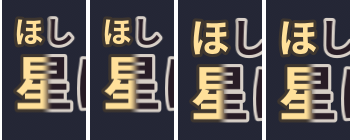
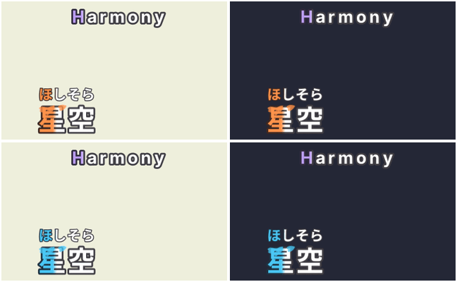
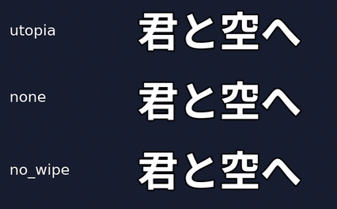

# 内置卡拉 OK 特效

用一条声明为声部轨道加上定时走字、入场、退场、脉冲和粒子装饰。当内置预设就能实现你想要的效果、不需要手写自定义动画时，从这里开始。

## 从走字扫色开始

在 `Track`（声部轨道）的 `Track.effects` 中传入 `KaraokeEffects()` 或 `KaraokeEffects.duotone()`，即可按带时间轴的歌词自动驱动整条轨道的动画，无需手动为每个字词排期。

```python
from kara_templater import (
    Document,
    KaraokeEffects,
    Line,
    Style,
    Track,
    build_lyric_scene,
)

document = Document.create(
    width=640,
    height=360,
    styles=(Style(fontname="DejaVu Sans", fontsize=56, bold=True, outline=2, shadow=0),),
)
document.records.extend((
    Line(start_time=1000, end_time=3000, text=r"{\k30}We {\k50}sing {\k120}tonight"),
    Line(start_time=3200, end_time=5000, text=r"{\k45}In {\k35}warm {\k100}light"),
))

scene = build_lyric_scene(
    document,
    tracks=(Track(id="main", effects=(KaraokeEffects.duotone(),)),),
)
scene.export("karaoke.hook")
```

`KaraokeEffects()` 提供预设目录的默认配置：歌词行首尾各 0.30 s 的淡入淡出、白色到珊瑚红的走字（扫色），以及每个音节上柔和的 `utopia` 缩放脉冲。

`KaraokeEffects.duotone()` 则采用平稳走字（`highlight="none"`），同步过渡填充与描边颜色。它会自动为唱前填充和唱后填充搭配高对比度描边，也可以通过 `before_outline` 与 `after_outline` 手动指定。

默认情况下，`duotone()` 会按字号的六分之一羽化走字边缘（`Glyph.font_size / 6`——72 px 正文对应 12 px，36 px 注音对应 6 px）。你可以传入固定像素宽度（如 `feather=12`）、更窄的比例（如 `feather=Glyph.font_size / 8`），或用 `feather=0` 得到硬边界。



从左到右，前两张展示 36 px 注音分别采用固定 12 px 和自动 6 px 边缘的效果；后两张展示 48 px 注音采用 12 px 与 8 px 边缘的效果，同时 72 px 正文始终保持 12 px 边缘。

## 在轨道间共享配色

使用 `KaraokeTheme` 可以让主唱、和声、倒数提示和跟随粒子共用同一套配色。将共享主题传给 `build_lyric_scene`，在单条 `Track` 上按需覆盖个别角色，或在具体特效上直接指定颜色以获得最高优先级。

```python
from kara_templater import CYAN, Color, KaraokeEffects, KaraokeTheme, Track

song_theme = KaraokeTheme(after_fill=Color.hex("#FF964A"))
harmony_track = Track(
    id="harmony",
    theme=KaraokeTheme(after_fill=CYAN),
    effects=(KaraokeEffects.duotone(),),
)
```

`KaraokeTheme` 包含五个 RGB 角色：`before_fill`、`after_fill`、`before_outline`、`after_outline` 以及 `shine`（用于扫光条、描边闪光、残影和星芒）。普通 `KaraokeEffects()` 在未提供描边角色前会保留源描边；`duotone()` 会为唱前和唱后两端自动推导对比描边。

未添加预设目录特效的 `Track` 会保留源 ASS 着色；一旦加入 `KaraokeEffects`，它会接管变色前后的全部颜色（包括含行内 ASS 颜色标签的文本）。如果要按词指定配色，请使用 `LyricHighlights.from_timing` 的 `segment_colors` 或自定义材质，详见[颜色与材质](materials.md)。



你也可以在 `KaraokeEffects` 或 `LyricHighlights.from_timing` 上直接叠加外层描边、辉光和材质，对应参数为 `secondary_outline`、`after_secondary_outline`、`base_glow`、`glow`、`base_material` 与 `material`。


例如，把 2 px 深色主描边、3 px 薰衣草色 `SecondaryOutline`、紫色 `Glow` 辉光和 14 px `hook_feather` 组合起来，歌词在亮色和暗色背景上都能保持清晰。`glow=None` 可关闭辉光。

## 选择高亮模式

观察下方三行同步渲染中结尾的长音，它们仅改变了 `highlight` 参数。



| `highlight` | 表现 |
| --- | --- |
| `none` | 平稳的定时走字，不带缩放脉冲 |
| `no_wipe` | 计时单元结束时整体切换颜色（包含零时长单元） |
| `utopia` | 默认。走字配合快速放大至 1.15 倍（占音符前四分之一时长，上限 100 ms），随后线性回落 |
| `scanline` | 普通走字配合明亮的前沿扫光条 |
| `utopia_scanline` | `utopia` 脉冲叠加前沿扫光条 |
| `zoom_pulse` | 在整个计时区间内持续放大至 1.10 倍，结束后在 0.30 s 内回落 |
| `zoom_pulse_scanline` | `zoom_pulse` 持续放大叠加前沿扫光条 |

> [!TIP]
> 检查模板时，暂停在一个长音的中途：走字模式下文字会同时呈现唱前和唱后两种颜色，而 `no_wipe` 会一直保持唱前颜色直到该音结束。

使用以下参数微调 `KaraokeEffects` 的高亮前沿：

- **走字柔边**：设置 `hook_feather`（脚本像素或 `Glyph.font_size` 表达式）在走字边缘后方平滑混合填充与描边；传入 `front_color` 可单独为移动边缘染色。只要 `base_glow` 与 `glow` 的 `border`、`blur`、`opacity` 相同，辉光也会沿同一前沿平滑过渡。
- **扫光条样式**：通过 `scanline_width`（1080p 下默认 16 px，按画布高度缩放）和 `scanline_softness`（1080p 下默认 8 px，`0` 为硬边）控制带宽与柔边，两者均支持 `Canvas.height` 或 `Glyph.font_size` 表达式。`scanline_mode` 可选 `"color"`（默认）、`"brighten"`（按 `scanline_brightness` 提亮 HSV 亮度，默认 `0.60`）、`"follow_before"` 或 `"follow_after"`。在 `"color"` 模式下，可设置 `scanline_color`（Hook 中支持 `PaintInput`）、`scanline_strength`（`0..1`，支持 `PaintInput`）或 `scanline_material`（如 `LyricGradient`）。
- **描边闪光**：设置 `stroke_flash=True`，在每个正文音符起音时沿正文描边触发 0.24 s 的 `shine` 闪光，注音节点不会重复触发。
- **缩放曲线**：`zoom_pulse_curve_level` 取值 `0`–`5`。`0` 和 `1`（默认）为线性，`2`–`5` 在接近峰值时放缓、离开时加速。
- **走字方向与倾斜角**：`reverse_wipe=True` 让每个计时单元从右向左扫色，同时保留原词序。水平歌词使用斜体字时，前沿默认向右倾斜 19°；传入 `sweep_angle=0` 可强制竖直前沿，或指定任意角度。需要整行从右向左排布或反向计时，请在 `Track` 上设置 `right_to_left=True` 或 `reverse_timing=True`（参见[布置声部轨道](tracks.md)）。
- **注音走字**：默认（`ruby_scanline="both"`）正文和注音均带有扫光条；设为 `"reading"` 则对完整注音单元仅在假名上显示扫光条。连续注音节点默认按节点数均分正文走字距离；设为 `ruby_reading_units=True` 则按可见假名字符均分，空读音 `#|` 会让正文走字原地停顿。

重复计时区间会重新触发脉冲，若下一个区间来得更早，上一次回落会自动缩短。多字符计时单元共用一条前沿，辉光和外描边不会占用走字时间。

## 入场与退场过渡

在 `KaraokeEffects` 中选择 `entry` 和 `exit` 预设，控制歌词行的入场与退场方式。

| 入场（`entry`） | 退场（`exit`） | 视觉效果 |
| --- | --- | --- |
| `none` | `none` | 在显示边界直接切入或切出 |
| `fade` | `fade` | 整行透明度淡入淡出（默认） |
| `slide_in` | `slide_out` | 整行水平滑动配合透明度变化 |
| `rise` | `rise` | 整行向上浮动 |
| `char_fade` | `char_fade` | 逐字错开的透明度淡入淡出 |
| `char_drip` | `char_drip` | 绕字符右侧边缘垂直切变 |
| `spin_flip` | `spin_flip` | 绕字符中心缩放与切变翻转 |
| `utopia` | `utopia` | 带过冲的逐字入场；旋转翻转缩小的逐字退场 |
| `tilt_pop` | — | 带倾斜过冲的逐字入场（仅入场） |
| `tracking_in` | `converge_out` | 字距收拢入场；向歌词行中心汇聚退场 |
| `wave_in` | `scatter_out` | 错开上浮的波浪入场；确定性径向散开退场 |
| `stretch_in` | `stretch_out` | 字符横向拉伸并附带五层 `shine` 淡出描边残影 |
| `glow_in` | `glow_out` | 同步辉光配水平残影与清晰正文层 |
| `assemble_in` | `dissolve_out` | 方形粒子汇聚进字框，或向外消散 |
| `sparkle` | `sparkle` | 14 颗星芒扫过整行（入场从左到右，退场从右到左） |
| `ripple` | `ripple` | 细空心圆环扩散并淡出 |
| `note` | `note` | 音符向上飘浮 |
| `petal` | `petal` | 花瓣摇曳旋转 |
| `snow` | `snow` | 镂空中心的六瓣雪花 |
| `snow_solid` | `snow_solid` | 实心六瓣雪花 |

使用以下参数调整过渡时长与粒度：

- `entry_duration` 与 `exit_duration` 控制完整过渡窗口的秒数（默认 `0.3`），设为 `0` 关闭对应过渡。整行淡入淡出、滑动和辉光过渡同步执行；`char_fade`、`char_drip` 和 `spin_flip` 使用 600 ms 窗口；`utopia` 入场 700 ms，退场每字 750 ms（在下一个可见正文字符唱完后启动）；几何与粒子过渡支持 120–3000 ms。
- `stagger` 是错开延迟占总过渡时长的比例（默认 `7/12`），余下时间分配给每个字符自身的运动。
- `entry_unit` 与 `exit_unit` 默认为 `"preset"`；设为 `"character"` 可让正文和注音的每个字形按阅读顺序独立执行所选过渡。

过渡期间注音会跟随所属正文字符同步位移、显现或退场，拉伸光晕和辉光残影则留在正文上。带时间轴的空格会参与过渡粒子，但计时装饰会跳过空格。

视频零秒处，入场会自动缩短或关闭而不会挪动计时时钟。在紧凑的自动换排轨道上，换行交接会先缩短缩放回落并压缩显示边界过渡，避免行间重叠。

## 计时装饰与粒子

设置 `KaraokeEffects` 的 `decoration` 参数，在每个正文字符高亮时发射确定性装饰粒子。可选值包括 `none`（默认）、`twinkle`（飘动星芒）、`twinkle_classic`（原地呼吸星芒）、`note`、`ripple`、`petal`、`snow` 与 `snow_solid`。装饰仅从正文发射，不会从注音发射。

默认每次字符起音发射一波：3 个涟漪环、4 片花瓣或雪花、7 颗飘动星芒，或 3 颗经典星芒或音符。可用下表参数微调：

| 参数 | 默认值 | 说明 |
| --- | --- | --- |
| `particle_size` | `0.4` | 粒子尺寸，按字体 em 大小的比例计算 |
| `particle_rate` | `None` | 改为按计时区间每秒发射数量控制密度（涟漪保持三环节奏） |
| `particle_color` | `None` | 默认跟随高亮色；可传单个 `Color`、双色元组 `(Color, Color)`、`"follow_before"`、`"follow_after"`、`"follow_mix"` 或 `"illustrated"` |
| `particle_layers` | `"solid"` | 搭配跟随颜色模式时，`"stroke"` 继承硬描边，`"decor"` 附加软辉光或阴影，`"all"` 同时包含两者 |
| `particle_glow_concentration` | `0` | 装饰粒子的辉光叠加层数：`-1` 隐藏辉光，`0`、`1`、`2` 分别启用 1、2、3 层 |
| `max_particles` | `512` | 单行入场、退场与计时粒子的总预算（资源上限），超出将在创建前报错 |
| `seed` | `0` | 确定性随机种子，渲染与任意拖动定位结果完全一致 |

使用 `"illustrated"` 时，高亮粒子为白色，过渡花瓣为樱花粉，过渡雪花为冰蓝色。启用渐变并配合跟随颜色模式时，粒子会采样对应渐变色：花瓣、雪花、音符和星芒上的纵向渐变会随形状旋转，横向渐变则按粒子在行内的水平位置采样。

## 组合预设与输出

你可以在一次 `KaraokeEffects` 调用中自由组合 `entry`、`exit`、`highlight`、`decoration` 与 `stroke_flash`。通过示例脚本可以快速试看组合效果：

```sh
uv run python -m examples.karaoke_catalog build/petals.hook --entry wave_in --exit petal --highlight zoom_pulse --decoration petal
```


`KaraokeEffects` 会接管当前轨道的高亮遮罩，不要在同一组字形上再叠一层高亮工厂；但你可以照常并行添加 `LyricRule` 或自定义 `line.schedule(...)` 动画规则。

> [!NOTE]
> 内置预设目录独立实现了常见卡拉 OK 动画菜单中的视觉家族（入场、退场、高亮、装饰和描边闪光），它不是外部编辑器的工程导入器，也不追求与特定渲染器逐像素一致。

浏览器预览与着色器播放支持预设目录中的全部效果，包括羽化走字、倾斜前沿、渐变、柔和扫光条和粒子过渡。让模板返回一个 `LyricScene`，再调用 `scene.preview()` 查看效果。

标准 ASS 导出（`scene.ass.compile().document.save("song.ass")`）仅支持硬边走字（`hook_feather=0`）、原生淡入淡出和受支持的变换；渐变、羽化走字、柔和扫光条和复杂粒子轨迹会触发 `SceneCompileError`。详见[预览与导出](../output/README.md)与[导出标准 ASS](../output/ass.md)。

## 下一步

- 用渐变、辉光和 WGSL 着色器定制色彩，见[颜色与材质](materials.md)。
- 编写自定义运动规则和缓动曲线，见[动画与时间控制](animation.md)。
- 构建自定义粒子发射器和起音残影，见[粒子、副本与残影](particles.md)。
- 查看预览与交付方式，见[预览与导出](../output/README.md)。
