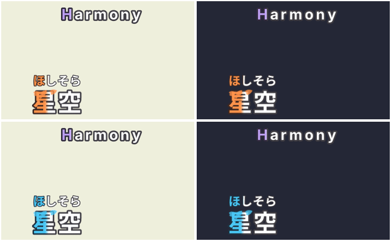
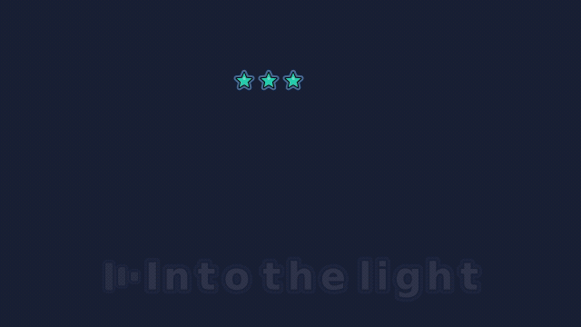

# 设计整曲歌词布局

从单一主唱轨道起步，逐步加入注音读音、顶部和声轨道与节拍倒数提示，搭出完整的卡拉 OK 整曲布局。当一首歌需要让多声部歌词与读音同屏清晰可读时，可以按这里的步骤组织模板。

## 从主唱轨道开始

只用一条挂上 `KaraokeEffects()` 的 `Track`（声部轨道），就能搞定大部分整曲排版与过渡效果。省略 `layout` 时，默认启用 `KaraokeRows()`，在画面底部左右交替排布两行歌词。

在 1920 × 1080 画布上，`KaraokeRows()` 会在左右各留出 50 px、底部留出 60 px，并在同屏可见的两行之间留出 45 px 间距。较短的歌词行会一起向内微调，保持左右外边距均衡；所有留白都会随画布高度等比缩放（例如 720p 下的底部留白为 40 px）。

`KaraokeEffects()` 默认以 0.30 秒完成入场淡入与退场淡出，唱到的音节轻柔脉冲，并从白色走字（扫色）过渡到珊瑚红。每条 `Track` 默认请求 5.0 秒唱前预览，并目标保留 1.0 秒唱后停留（含退场动画）。当两行衔接紧凑时，排版会自动先缩短预览时长、再压缩停留时长，只在必要时等比缩放过渡动画。

在 1080p 横排主唱场景下，建议先用 100 px 作为正文字号、45 px 作为注音字号，再按画布高度缩放。定稿字号前，务必在最终交付分辨率下预览全曲最长的一行和注音最密集的一行。

## 添加注音读音

在带时间轴的歌词中直接用 `正文|读音` 标注注音，并在 `Document`（歌词文档）里定义对应的 `<样式名>-furigana` 样式。库会联合测量正文与注音的边界，避免同屏多行相互重叠。

默认情况下，同一行内的所有注音共享一条位于正文上方的水平基线，与正文硬描边之间保持 6 px 间距（`ruby_gap=6`）。注音样式的描边应比正文更细，避免小号字符内部镂空被描边糊住。

## 将和声独立到另一条轨道

把伴唱或第二声部放到第二条 `Track` 上，用独立的 `source` 筛选函数和顶部锚定布局（如 `KaraokeRows(rows=1, anchor="top")`）。不同声部分轨后，既共享同一套歌曲时间轴，又互不争抢行位。

给和声配更小的字号、区分度明显的唱后高亮色，以及更克制的动效（例如 `highlight="none"`，只做平稳走字不做弹跳）。清晰的视觉层级能让观众一眼分辨主唱与和声。



## 添加节拍倒数提示

当乐句前面有较长间奏、需要给演唱者起唱节拍时，使用倒数提示。在歌词文本中插入 `CueMarker`，再通过 `Track.cues` 里的 `CuePreset` 绑定同名提示。

先确定节奏表现形式，再挑选具体符号：

| 提示工厂 | 视觉表现 | 摆放位置 |
| --- | --- | --- |
| `VolumeCue` | 柱状条先同步闪烁，再从左到右依次填色 | 行内，紧邻乐句 |
| `SignalCue` | 矢量灯（`circle`、`star`、音符或自定义 `VectorPath`）按拍逐个熄灭 | 行内或行上／行下 |
| `BarsCue` | 分段条随节拍逐步倒数至起唱点 | 行内或独立坐标 |
| `TextCue` | 数字或自定义文字（如 `3`、`2`、`1`）逐拍切换 | 独立坐标或行内 |



倒数提示的描边粗细和配色应与它引导的歌词保持一致。务必在实际视频画面上检查第一拍、中间拍和最后一拍交接帧，确保最后一拍准确落在起唱音节上。如果想制作自定义的矢量图案倒数（例如在歌词上方随拍弹跳的猫爪印），可参考 [paw_countdown.py](../../../examples/paw_countdown.py)。

## 组装整曲脚本

下面这份完整脚本把带注音的双行主唱轨道、行内 `VolumeCue` 倒数提示和顶部单行和声轨道组合在一起，并导出 `song-layout.hook`。

```python
from kara_templater import (
    Color,
    CueMarker,
    CuePreset,
    Document,
    KaraokeEffects,
    KaraokeRows,
    Line,
    Style,
    Track,
    VolumeCue,
    build_lyric_scene,
)

document = Document.create(
    width=1280,
    height=720,
    styles=(
        Style(name="Main", fontname="DejaVu Sans", fontsize=64, bold=True, outline=2.5, shadow=0),
        Style(name="Main-furigana", fontname="DejaVu Sans", fontsize=28, outline=1.2, shadow=0),
        Style(name="Harmony", fontname="DejaVu Sans", fontsize=38, bold=True, outline=1.5, shadow=0),
    ),
)

cue = CueMarker("intro", "count").markup()
document.records.extend(
    (
        Line(
            start_time=2500,
            end_time=5000,
            style="Main",
            text=cue + r"{\k50}Light|lait{\k50} up{\k150} the sky",
        ),
        Line(
            start_time=5200,
            end_time=7700,
            style="Main",
            text=r"{\k30}Take{\k30} my{\k60} hand{\k130} tonight",
        ),
        Line(
            start_time=5200,
            end_time=7700,
            style="Harmony",
            text=r"{\k120}Ah{\k130} ah",
        ),
    )
)

scene = build_lyric_scene(
    document,
    tracks=(
        Track(
            id="main",
            source=lambda source: source.style == "Main",
            cues={"count": CuePreset(factory=VolumeCue(), lead=2.0, duration=2.0)},
            effects=(KaraokeEffects(),),
        ),
        Track(
            id="harmony",
            source=lambda source: source.style == "Harmony",
            layout=KaraokeRows(rows=1, anchor="top"),
            effects=(
                KaraokeEffects(
                    highlight="none",
                    after_fill=Color.hex("#6AD4FF"),
                ),
            ),
        ),
    ),
)
scene.export("song-layout.hook")
```

如果要套用到带振假名的日语歌词，把 `DejaVu Sans` 换成中文字体或日文字体（如 `Sarasa UI J` 或 `Noto Sans CJK JP`），按 `{\k50}空|そら` 的格式书写读音即可。

## 微调位置与可读性检查

如果你希望指定固定起始坐标而不是使用自动底部留白，可以把 `KaraokeRows` 换成显式 `region=Box(...)` 搭配 `Layout(rows=2, position=Vec2(...))`。`Layout` 会从指定原点向下排列各行，行距为实测行高加上最大正文字号的 20%。

渲染整首歌曲前，建议在 Hook 播放中重点抽查三个时刻：

- **短音节与长音节**：分别在明亮画面和暗色画面下检查对比度。
- **紧凑换行衔接**：上一行刚要退场而下一行已经入场时，确认两行互不遮挡。
- **倒数起唱点**：确认倒数最后一步刚好衔接第一个音节。

> [!TIP]
> 如果需要一套在明暗切换画面上都清晰可读的主唱成品样式（深色主描边、彩色外描边加柔和辉光），请查看 [内置卡拉 OK 特效](../guides/karaoke-effects.md) 以及多配色示例 [karaoke_designs.py](../../../examples/karaoke_designs.py)。

## 下一步

- [特效配方](effect-recipes.md)：查阅狭缝显现、无走字提示与双态描边等独立特效配方。
- [布置声部轨道](../guides/tracks.md)：了解 `Track`、`KaraokeRows` 与 `Layout` 的全部参数。
- [注音与倒数提示](../guides/text-and-cues.md)：按 BPM 自动计算提示时长、自定义提示工厂与注音对齐方式。
- [选择与注册字体](../guides/fonts.md)：挑选歌词字体并注册本地字体文件。
