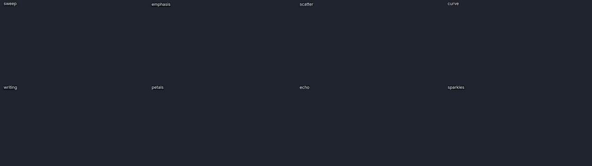

# 动效对比研究

在同一套包含短音、长音、注音读音与独立和声的歌词样本上，横向对比八种卡拉 OK 动效机制。挑一种契合歌曲气质的运动方式，先观察它在快慢音节上的表现，再决定是否与其他效果叠加。



这组样本把四个计时单元分别设为 250 ms、250 ms、1 秒和 2 秒，搭配一条独立和声轨道以及可选的日语振假名版本。上方动图展示了全部八项研究在该样本上的效果（录制自旧版 ASS 渲染器）。

在仓库目录下运行 [lyric_studies.py](../../../examples/lyric_studies.py)：

```sh
uv run python -m examples.lyric_studies build/sweep.hook --effect sweep
uv run python -m examples.lyric_studies build/echo.hook --effect echo
```

命令行支持将 `sweep` 和 `echo` 两项研究直接导出为 Hook（`sweep` 同时也支持导出为 ASS）。八项研究的完整场景都可以在 Python 中调用 `examples.lyric_studies.build(effect)` 构建并检查。

## 八项研究对照

| 研究名 | 聚焦的技术点 |
| --- | --- |
| `sweep` | 静止字形、走字高亮着色与独立整行淡入淡出 |
| `emphasis` | 随音节时长自适应的缩放脉冲，叠加从上方落入的彩色副本 |
| `scatter` | 带随机种子的旋转飘散退场，在行尾依次错开 |
| `curve` | 延迟入场的弧线字形副本，搭配发光丝带拖尾 |
| `writing` | 隐藏原始字面，仅随走字前沿显形并飘起光尘粒子 |
| `petals` | 唱完后字符与注音飘散离场，花瓣粒子按各自生命周期飘落 |
| `echo` | 主基线保持静止，唱到时持续升起并淡出彩色重影副本 |
| `sparkles` | 亮星粒子紧随走字前沿，在原本可见的歌词上闪烁 |

## 内置规则与自定义曲线

`LyricRule` 负责选择目标与绑定时间，内置动画负责可复用的运动规律。把 `ScalePulse` 绑定到 `"timing"` 后，同一条规则会自动适应任意音节长度：

```python
from kara_templater import LyricRule, ScalePulse

pulse = LyricRule("character", "timing", ScalePulse(peak=1.12, peak_at=0.42))
```

在 250 ms 的短音上，脉冲在 105 ms 处达到峰值；在 2 秒的长音上，峰值移至 840 ms，起止两端都平滑减速至零速度。在正式歌曲里，你还可以用动画工厂按音节时长动态缩放幅度（参见 [lyric_pulse_drift.py](../../../examples/lyric_pulse_drift.py)）。

如果想快速写一段相对运动而不必实现完整的 `StateAnimation`，可以把以归一化进度（`0` 到 `1`）为参数的纯函数传给 `Transform`：

```python
from kara_templater import Transform, Vec2

arc = Transform(
    offset=lambda p: Vec2(-36 * p, -80 * p * (1 - p)),
    opacity=lambda p: 1 - p,
)
```

发射粒子时，你只需要用 `ParticleFactory` 定义单颗粒子的形状与生命周期，出生时刻、位置与 ID 都由 `LyricParticles` 自动分配。想要首尾相随的发光丝带，可以直接用 `Ribbon()`，或借助 `TrailPath` 定制路径拖尾（参见 [形状、裁剪与遮罩](../guides/geometry.md)）。

## 副本、错峰退场与纯显形高亮

`LyricEcho` 会在每个字符或注音起唱时派生静态副本：

- `animation` 接收内置动画、`Transform` 或 `Timeline().animation`，并自动拉伸匹配副本的 `duration`。
- 旋转与缩放枢轴默认取每个实测字形的几何中心。
- 负数 `delay` 允许副本在起唱前提前到达（不会早于场景 0 秒）。
- 副本采样的是字形准备好的静态外观，而不是先前动画的历史快照，也不会改动原始计时时钟。

想要整行按顺序错开退场，在 `"exit"` 规则上设置 `stagger`：

```python
from kara_templater import LyricRule, ScatterOut

exits = tuple(
    LyricRule(role, "exit", ScatterOut(seed=42), duration=0.5, stagger=0.04)
    for role in ("character", "ruby")
)
```

使用 `"exit"` 时，最后一个被选中的目标正好在歌词行显示结束时完成退场，前面的目标依次提前完成，排版会自动为完整时长加错峰间隔预留时间。如果想让每个字唱完自己那一拍就离场，则改用 `"after_timing"` 搭配 `offset` 停顿。同时绑定 `"character"` 与 `"ruby"` 可以让注音随正文一起离场；只绑定 `"character"` 则会刻意保留注音在原地。

像 `writing` 那样只在走字经过时显现文字，只需要用 `base_paint` 隐藏唱前底图：

```python
from kara_templater import CYAN, LyricHighlights, StatePatch

reveal = LyricHighlights.from_timing(
    StatePatch(fill=CYAN),
    base_paint=StatePatch(opacity=0),
)
```

高亮层基于原始可见字形叠加高亮着色，因此把 `base_paint` 的不透明度设为 `0` 不会隐藏走字扫出的部分。`base_paint` 只接受着色与不透明度字段，不能修改位置、缩放或旋转。

> [!NOTE]
> 在 `lyric_studies.py` 的八组样本中，`sweep` 与 `echo` 可直接导出为 Hook（`sweep` 亦可编译为 ASS）。其余六组结合了 Python `Transform`、`AnimationSequence`、可变路径 `Ribbon` 或与整行淡入淡出重叠的粒子，用于演示场景级组合；若需导出 Hook，请改用 `ShaderMotion` 或 `KaraokeEffects` 预设。

## 独立的装饰时钟与文本时钟

装饰元素可以运行在完全独立的时间轴上，同时依然被纳入歌词行的排版占位窗口。


运行 [lyric_ornament.py](../../../examples/lyric_ornament.py) 可以编译 ASS 示例，或者调用 `examples.lyric_ornament.build().export("lyric-ornament.hook")` 直接导出 Hook：

```sh
uv run python -m examples.lyric_ornament build/lyric-ornament.ass
```

这个示例在歌词上方排布了九颗静止的弧形光点。最后一个音节唱完后，字符通过自定义锚点 `row_end` 从左到右依次淡出，而光点按自己的时间表从右到左淡出。轨道准备阶段会自动发现每个子节点的生命周期，为两者预留足够的显示窗口。

## 下一步

- [编写自定义动画](custom-animation.md)：把 Python 运动曲线改写为支持 Hook 导出的 `ShaderMotion`。
- [粒子、副本与重影](../guides/particles.md)：深入学习 `LyricEcho`、`LyricParticles` 与自定义 `ParticleFactory`。
- [动画与时间轴](../guides/animation.md)：了解 `ScalePulse`、`Transform`、`Timeline` 与可编译到 Hook 的动画。
- [颜色与材质](../guides/materials.md)：查看 `LyricHighlights`、渐变与着色器材质。
